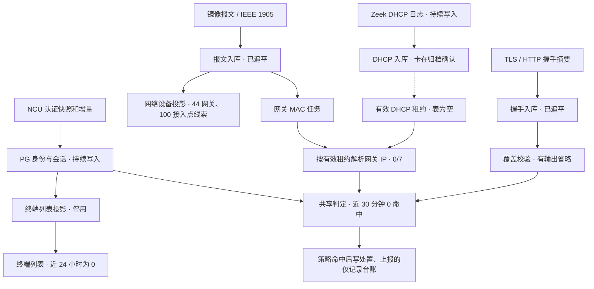

# 当前工作（2026-11-23，北京时间）

本页记录当前现场版本、数据边界、未完成缺口和下一步。现场瞬时状态以再次只读检查为准；已结束的试验和发布细节保留在 Git 历史。

## 184 设备发现菜单与路由器账号筛选（11 月 23 日 00:30）

- 应用更新至 `2026.11.23-0f25a363`，源码为 `0f25a363cd8dbfe936401a4594a7caff074f0e74`，包 SHA256 为 `f0676f50bb8910600069c198a98a872a4b5546459ac634fb4689f8ee2e7384ae`。254 条 PostgreSQL 和 75 条 ClickHouse 迁移均已应用且校验一致。发布沿用现场配置和数据库，构建清单记录了原有未跟踪目录 `.archify/`。
- 「发现设备」菜单按部署配置隐藏。路由器核验在一次 URL 更新中切换账号范围并回到第一页。共享行为页面把 UA 标为自报的候选线索。测试覆盖三种账号范围、跨页筛选、菜单显示和 UA 标签，前端 287 项单测、7 项浏览器测试、API 契约、生产构建及相关 Go 测试、构建和 vet 均通过。
- 现场核对 22 个应用进程的执行文件属于新发布目录，控制面和 NCU 就绪接口均返回 200。设备发现服务停用，DHCP 辅助采集运行。NCU 身份桥状态为 `degraded`，目录采集为 `healthy`。只读查询得到 346 条符合路由器核验条件的档案，28 条有关联账号，318 条无关联账号。线上入口和核心资源的哈希与发布包一致，登录入口三视口检查通过，现场登录后筛选交互未实测。
- 核对进程引用、systemd 生效路径和挂载后完成标准包替换，回收前一版 `2026.11.22-c0b4329d`、回退链接及上传暂存。两份更早的目录仍有 systemd 单元或配置快照引用。审计日志位于 `/opt/proxy-sentinel/data/ops/20261123-application-2026.11.23-0f25a363.log` 和 `/opt/proxy-sentinel/data/ops/20261123-release-retirement-0f25a363.jsonl`。

## 184 防代理报表发布（11 月 22 日 21:03）

- 报表聚焦路由器识别分布、当前镜像共享行为、近 15 分钟或 1 小时的共享判定趋势，以及采集与身份归因卡点。明细入口指向现有路由器观察、共享核验和策略判定页面，报表已移除重复的案件、设备、处置、流量与运维列表。
- **应用更新。** 21:03:55 切换至 `2026.11.22-c0b4329d`，源码 `c0b4329d669fccf178eb19329272a82bfea29855`，标准包 SHA256 为 `250321dd24ac0e8aa8671c071ae3b6490fea8ee1e2a915fa6d2bf31f170db3c7`。254 条 PostgreSQL、75 条 ClickHouse 迁移已应用且校验一致。现场配置与数据库沿用，构建清单记录原有未跟踪 `.archify/`。
- **验证。** 新增三个只读聚合接口，沿用现有权限、读取模型和索引。路由器按有效记录和设备去重，共享观测沿用有效窗口与代际，趋势按判定记录次数统计。184 数据只读 SQL 单次抽样分别约 17、42、74 毫秒。后端测试、构建和 vet 通过，204 相关包基线通过，前端 286 项单测、生产构建和三视口回放通过。现场确认 22 个应用进程、152 个安装资源、报表入口和 13 个线上资源含趋势图脚本，双就绪检查 200。登录入口三视口通过，登录态页面未现场实测。
- **现场抽查。** 21:05 路由器身份线索 264 项、待确认 42 项、已确认 0 项，镜像共享待核验 17 项、已确认 0 项。最近完整 15 分钟记录 0 次策略命中、7,838 次证据不足、4,712 次过期，握手采集仍有覆盖缺口。21:07 报文与握手共享归档待办均为 0 段，身份实时和归档待办各 3 条，风险待办较 21:05 的 12,837 项回落至 8,058 项。
- **程序清理。** 核对活动进程、systemd 生效路径和挂载后，替换标准包，清理无引用前版、`previous`、`frontend-previous` 和上传暂存。发布与清理审计分别在 `/opt/proxy-sentinel/data/ops/20261122-application-2026.11.22-c0b4329d.log` 和 `/opt/proxy-sentinel/data/ops/20261122-release-retirement-c0b4329d.jsonl`。

## 184 系统报表发布（11 月 22 日 19:47）

- **应用更新。** 19:47:38 切换至 `2026.11.22-f95f341f`，源码为 `f95f341ffd9cc8165aa7600f371d28d0721f511a`，标准包 SHA256 为 `a9131891b651766eedea29afbc37e48e6e4e7ef505bde9ade7ec25296b2f19f1`。254 条 PostgreSQL 与 75 条 ClickHouse 迁移均已应用且校验值一致。发布沿用现场配置和业务数据，构建清单记录原有未跟踪的 `.archify/`。
- **验收。** 本地 286 项前端单测、API 契约和类型检查、生产构建及报表三视口回放通过。现场核对 22 个应用进程、154 个安装资源、公开报表入口和其 13 个核心资源，控制面与 NCU 就绪检查均为 200。390×844、1280×800、1440×900 登录入口截图与 DOM 检查通过，已登录报表还未实测。报表从侧栏「系统报表」进入，按账号权限展示共享识别、风险与处置、终端与认证、流量与访问、链路与积压、资源与审计。
- **现场水位。** 19:50 报文和握手共享归档待办均为 0 段，最近采样仍显示握手覆盖不完整。19:53 终端投影成功距采样约 13 秒，风险待办降至 4,198 项，最老约 89 秒。NCU 实时来源与确认队列均为 0，隔离队列 141 条，身份桥仍报告降级。根盘可用约 752 GiB。
- **程序清理。** 已替换标准包，回收 5 个无引用旧程序目录、旧暂存包和本次上传暂存，移除 `previous` 与 `frontend-previous`。两份旧程序目录仍有 systemd 单元或配置快照引用。发布与清理审计分别写入 `/opt/proxy-sentinel/data/ops/20261122-application-2026.11.22-f95f341f.log` 和 `/opt/proxy-sentinel/data/ops/20261122-release-retirement-f95f341f.jsonl`。

## 184 风险队列自适应调度与批量提交（11 月 22 日 16:44 起）

- **调度修复。** 发布前两个 worker 每秒各处理最多 8 项，实际约 16 项/秒。领取改按首次入队排序，同一待办收到新特征仍保留原顺序。全批快速提交后自动缩短下一轮间隔，慢批、部分提交和失败回到基础节奏。触及特征上限的单个对象保留原租约到期再试，其他对象继续提交。16:46:37 发布 `2026.11.22-c492d70f`，其后实测完成约 31.6 项/秒，首次入队超过一小时的待办从约 1.13 万降到 0。16:53:19–16:55:27 自然输入短窗新增约 44.1 项/秒，仍能抬高总队列。
- **批量修复。** 满载时由每批 8 项自动提升至 16 项，同批合并领取、特征读取及结果提交。到达原有行数或字节上限仍自动拆批，独立确认已经成功的代次，其他代次继续待办。批次变慢、提交不全或失败会恢复小批和基础间隔。17:00:43 发布 `2026.11.22-1f35e0af`，源码 `1f35e0afc2c11dc0ea63f9b098504c2d5fd7801d`，包 SHA256 `10f043ad8a53c0923ca617e99b5a7b3fce6b99f62779d41239bf17c2c4f85457`。两次均为应用更新，254 条 PostgreSQL、75 条 ClickHouse 候选迁移校验一致。相关 Go 定向回归、全量测试、构建和 vet 通过，204 相关包基线通过。构建清单记录既有未跟踪 `.archify/`。现场审计分别在 `/opt/proxy-sentinel/data/ops/20261122-application-2026.11.22-c492d70f.log`、`/opt/proxy-sentinel/data/ops/20261122-application-2026.11.22-1f35e0af.log`。
- **现场节奏。** 第二版以 1 秒基础间隔运行前十分钟，实测约 63 项/秒。17:15 仅重启风险服务，将基础间隔校准为 750 毫秒，满批健康时仍可自动提速，慢批仍降速。整理了两个被覆盖的 `ExecStart` 片段，核对了其余参数、环境、重启策略与有效入口。审计位于 `/opt/proxy-sentinel/data/ops/risk-interval-20261122T091512Z/`。核对 22 个活动应用进程与 146 个前端资源哈希，替换标准包并清理暂存、无引用前版与 `previous`。
- **自然流量验收。** 750 毫秒生效后约 8 分 55 秒，累计确认 44,879 项，平均约 83.9 项/秒，1 次因新代次进入而重试。批次耗时 P95 约 329 毫秒。风险待办从 17:01 的 25,077 条降至 17:24 的 8,584 条，期间新入队波峰曾推动队列回升。17:15 调整前已入队的待办为 0，当前最老约 151 秒，均通过正常确认推进。原清空切点未移动。本轮完整自然流量观察只覆盖到上述时间。
- **并行链路。** 17:24 控制面和 NCU 就绪均为 200，27 个相关单元与定时器均 active，终端投影距现场检查约 8 秒，根盘约 756 GiB 可用。共享归档报文和握手抽样均无待办，判定待办 0，近三分钟完成 1,964 项。NCU 实时待办 6 条、归档待办 18 条，其中 17 条来自一份 17:00:34 接纳且正文、派生均已确认的片段，仅搜索确认仍待重试。自然共享实际命中仍为 0，近期 256 次证据不足抽样中 235 次涉及握手覆盖不足。
- **17:52 只读复核。** 风险待办从 17:24 的 8,584 降到 4,005，最老约 66 秒。过去十分钟完成 49,303 项，约 82.2 项/秒，批次耗时 P95 为 283 毫秒，17 项重试。终端列表近 24 小时有 11,478 条，10,369 条带当前 IP，投影更新距采样约 1 秒。NCU 实时待办 0–1 条、归档待办 17–18 条，17:00:34 的 17 条片段仍等待搜索确认，当前重试延后至约 18:02:39。共享判定抽样待办 193，近三分钟完成 1,966 项，报文与握手共享归档待办均为 0。报文覆盖完整，握手最新窗口有解析截断、特征溢出和输出省略。自然共享命中与仅记录处置均为 0。两项就绪检查 200，根盘约 756 GiB 可用，现场版本为 `2026.11.22-1f35e0af`。
- **18:04 只读复核。** 风险待办两次样本从 1,765 降到 1,431，最老从 27 秒降到 19 秒，过去十分钟完成 48,896 项，约 81.5 项/秒。17:00:34 接纳的 17 条 NCU 记录已于 18:02:40 完成搜索确认，正文、派生、搜索和批次总状态均完成。18:04:58 NCU 实时待办 0、归档待办 2。共享判定待办为 0，近三分钟完成 1,991 项，现场真实共享命中和仅记录处置均为 0。报文覆盖完整，握手仍有截断、特征溢出和摘要省略。终端近 24 小时 11,753 条，10,583 条带当前 IP。27 个相关单元和定时器 active，两项就绪检查 200，根盘约 755 GiB 可用。

## 184 清空历史与晚间观察基线（11 月 22 日 12:13–12:27）

- **固定切点。** 现场观察起点为北京时间 `2026-11-22 12:13:42.521301`。按用户明确授权永久清空 184 主业务历史，涵盖旧原文、案件证据和未核验归档，未做历史备份。清理覆盖 222 张 PostgreSQL 运行表、57 张 ClickHouse 业务存储表及 19 张诊断表、本机 Redis、两条 Redpanda 主题和旧采集文件、journal 与原文硬链接。两条主题保留六分区和原配置，复核重建初始偏移均为 0。保留账号、策略、规则库、接入与共享映射、迁移账本及继续运行所需的配置和审计元数据。旧登录会话已清空。已停用的 `database` 栈 MongoDB 独立卷保留。
- **停写和恢复。** 第一次停写中 Zeek 进程卡在内核换页，超时后恢复其他服务，待旧 Zeek 进程退出后重新停写。PostgreSQL 保留账号和配置并重新初始化终端与共享档案单例，旧 NCU 待办和计数从零开始。清空后核对 NCU 片段、终端索引、策略判定、处置、共享和风险待办均为 0。12:20:39 恢复主要采集和处理服务。12:22:38 关闭残留的旧 DHCP 别名，并按已登记的 NCU 代际恢复序号下界，待办仍从零计数。报文和握手已重新建立轮转保护。Zeek 启动后替换了初始化空文件，12:25:05 把 DHCP 游标接到新文件的字节 0，保留期间产生的约 1.6 MB 新输入。现场审计在 `/opt/proxy-sentinel/data/ops/data-reset-20261122T041337Z/operation.jsonl`。
- **12:27 现场基线。** 27 个本轮相关服务与定时器均 active，控制面和 NCU 同步就绪均返回 200，254 条 PostgreSQL 和 75 条 ClickHouse 迁移校验一致。报文、握手、TCP SYN、DHCP 和 NCU 均已有新搜索收据，抽查对应索引和 NCU 接纳均无切点前记录。两次读模型采样的终端计数为 1,307 和 1,422。12:27 NCU 实时待办 5 条、归档待办 5 条、累计接收 3,048 条。共享判定待办为 0，最近三分钟 1,981 项完成，真实命中与仅记录处置均为 0。报文覆盖完整，握手覆盖仍不完整。
- **晚间对照。** 风险处理待办从 12:25 的 18,858 增至 12:27 的 20,270，最早新增待办约 231 秒，切点前待办为 0。12:26 DHCP 文件未读约 15 KiB，报文未读为 0，握手约 1.5 MiB，TCP SYN 约 0.55 MiB。根盘可用从约 122 GiB 增至约 762 GiB，使用率由 93% 降到 56%。

### 16:14–16:17 只读复核

- **实时链路。** 当前发布仍为 `2026.11.22-336f77ac`，27 个相关单元与定时器均 active，控制面和 NCU 同步就绪均为 200，日志轮转最近运行成功。四路文件游标都在推进，16:14 报文、握手、TCP SYN 未读为 0，DHCP 未读约 8.5 KiB。报文、握手最新共享归档待办分别为 2、1 段，握手最晚归档落后约 29 秒。NCU 累计接纳 52,803 条，实时和归档待办短样本均为 1–8 条，派生待办抽样 1 条。实时认证投影落后约 6 秒，快照任务为 0。终端列表近 24 小时有 9,414 条，8,310 条带当前 IP，投影最近成功距检查约 4 秒。根盘可用约 758 GiB、使用率 56%，较清空后约少 4 GiB。机械盘两秒抽样忙 80%–91%。
- **风险待办。** 12:27 为 20,270 条，16:16 为 25,054 条，16:17 的样本在 25,093–25,121 条。切点之前首次入队为 0。16:17 有 11,280 个对象首次入队超过一小时，最早约 3 小时 54 分钟。按最新一次触发算，3,764 个已等超过五分钟，最早约 7 分 8 秒，超过十五分钟的为 0。近十分钟 worker 完成 9,613 个对象，平均约 16 个/秒，另有 3 次重试。风险当前结果与特征收据均仍在更新。
- **自然共享。** 16:14–16:17 共享判定待办抽样为 0–65，16:17 到期可处理 5 项，最近三分钟完成 2,010 项。自清空以来实际命中、仅记录处置均为 0。最近十分钟 5,015 次证据不足、3,201 次过期。报文覆盖完整，握手当前覆盖仍不完整，最新窗口内核丢包为 0，解析截断 6,408 次，特征溢出 23,463 次，输出省略 5,278 次。
- **风险处理限速定位。** 现场生效参数为 `--interval 1s --claim-limit 64`，两个 worker 运行。代码实际每次租约最多领取 8 项，因此当前调度上限约 16 项/秒。16:17:06–16:21:32 同口径 PostgreSQL 累计计数增加 4,353 次入队插入和 4,256 次出队删除，约 16.4 和 16.0 项/秒，待办由 25,121 增至 25,215。近期 ClickHouse 风险批量特征读取抽样 358 次，P95 约 73 毫秒、P99 约 85 毫秒。风险领取按最近一次触发时间排序，持续更新会改变同一个待办对象的顺序。已有 `--interval` 支持 750 毫秒，保持两个 worker 和每次最多 8 项时，调度上限约 21.3 项/秒。现场仍按 1 秒运行，尚未验证调整后的实测吞吐和对其他链路的影响。

## 184 NCU 归档正文恢复（11 月 22 日上午）

- **根因。** 11:32 抽查最近 256 个未归档片段，255 个处在正文已尝试、搜索待开始的状态，单片段最多领取 2,896 次。旧流程遇到正文缺失只会延迟后再次校验。上线前固定 80 个超过一小时且有权威原文的片段，共 313 条事件，抽取其中 8 个片段的 18 个位置逐一核对，ClickHouse 正文均缺失。抽样中磁盘忙 81%–94%，一次 PostgreSQL 水位检查有 15 个后端等待 WAL 写入。
- **修复与验证。** 使用 PostgreSQL 的原始接纳时间、来源位点和规范事件哈希验证恢复输入。正文确认失败且历史片段符合恢复条件时，持有原归档租约检查目标表在途写入，只补写缺失位点。整段正文复核成功后才提交正文收据和搜索写入意图。回放覆盖部分缺失、目标表仍在写入与未满恢复年龄三种场景。定向与全量 Go 测试、构建、vet 均通过，204 的 store 和 controlplane 包基线通过。归档工作线程保持两个。
- **发布。** 11:44:47 完成 `2026.11.22-336f77ac` 发布，源码 `336f77ac12c02dc9667fae242402d7105e2f3af5`，包 SHA256 `846317b1ed505ff89419e162525a2ce09c9f0e396f282d033e9e1a818be502eb`。254 条 PostgreSQL 和 75 条 ClickHouse 迁移校验一致。22 个应用进程已核对新版，146 个前端文件哈希一致，控制面与 NCU 同步双就绪检查 200。本轮未启动独立数据库快照，使用 Go 回放和 184 现存数据核对。构建清单包含既有未跟踪 `.archify/`。标准包已替换。核对活动进程、有效 systemd 路径和挂载后，删除无引用前版、`previous` 和上传暂存。现场发布和清理审计分别为 `/opt/proxy-sentinel/data/ops/20261122-application-2026.11.22-336f77ac.log`、`/opt/proxy-sentinel/data/ops/20261122-release-retirement-336f77ac.jsonl`。
- **现场验收。** 截至 11:48:34，固定样本 80 个片段中已有 41 个完成两道收据，共 155 条事件。其余 39 个仍等待正文确认。80 个片段的内容哈希一致。物理抽查中已有 7 个缺失位置补回，恰好 7 行和 7 种位点哈希组合。完整双线程计时窗折算总确认速率约 4.4 条/秒，发布前短窗约 2.9 条/秒。两个窗口长度分别约 3.6 分钟和 5.1 分钟，未确认等失败分别为 9 次和 120 次。新版仍有因观察到目标表在途写入而延后恢复的情况。固定样本在 `/opt/proxy-sentinel/data/ops/20261122-ncu-body-repair-sample.jsonl`，文件 SHA256 `865fd87a96865e5455c2ae9278b2e75b6f69f2425b22e834b2b5220c3c65cdbf`。
- **剩余缺口。** 11:48 实时身份待办 5 条，归档待办 1,221,667 条，较发布前固定样本净减 193 条。根盘约 121.8 GiB 可用、使用率 93%，短样本盘忙 86%–88%，PostgreSQL 有 12 个后端等待 WAL 锁。ClickHouse 查询日志占 131.58 GiB，符合现行期限的整段诊断分片为 0。最近 24 小时共享真实命中 0，近一小时新增仅记录处置 0。报文覆盖完整。握手最新样本内核丢包为 0，仍有 5,739 次解析截断、12,338 次特征溢出和 4,308 次输出省略，覆盖不完整。

## 184 旧搜索片段恢复、接口数据与自然流量（11 月 22 日 01:25–01:58）

- **重复查询根因。** 报文和握手源有 9 个 11 月 20 日 08:39 UTC 接纳的旧段，原文归档已确认，搜索状态长期为 attempted。原实现对搜索确认缺失一直使用源轮询间隔，55 秒样本仅 82 种旧校验就执行了 5,760 次，均返回空。逐段核对 journal、原文哈希和当前来源租约，分别短暂停对应文件消费者，用当前发布包的已稳定搜索修复流程只补缺失索引，再恢复消费。9 段共 8,213 条事件全部校验通过，等待依赖的消费者确认后均已从 journal 正常释放。适用段有 3 条共享收据、4 条已完成的投影收据。现场修复审计位于 `/opt/proxy-sentinel/data/ops/20261122-settled-search-*`。
- **根治重试与发布。** 已尝试的搜索查询持续无确认时，前三次按原间隔轮询，之后指数退避至最多 30 秒。等待原文归档的普通轮询和持久确认语义保持原有约束。01:45:37 切换至 `2026.11.22-f3a2ca0f`，源码 `f3a2ca0f992639787b3cc2eb30fe82d0860adf04`，包 SHA256 `06ee62145f22ee5fe0e1ac94da54b0cb1cd784d380d0d602eadb5bab229010ed`。Go 定向回放、全量测试、构建和 vet 通过，204 相关包基线通过。254 条 PostgreSQL、75 条 ClickHouse 已应用迁移校验一致。22 个活动应用进程已核对新版，146 个前端文件哈希一致。标准包已替换，上传暂存及无引用前版已清理。双就绪检查 200，修复后报文、握手、NCU 消费器均 active。发布和清理审计在 `/opt/proxy-sentinel/data/ops/`。
- **容量与积压。** 尚余两个旧段时，同类 55 秒查询样本从 2,647 次降至 52 次。修复前 01:31:00–01:31:55、修复后 01:48:00–01:48:55 对照，旧搜索确认查询从 6,047 次空结果降到 0，ClickHouse 已完成查询的 SQL 文本量从 29.79 MiB 降到 3.18 MiB。查询日志仍占 131.53 GiB，当前可按现有期限整段清理的诊断分片为 0。根盘约 124.3 GiB 可用、使用率 93%。01:49 NCU 实时待办 0，归档为 1,400,872 条，较 01:25 的样本净减 6,485。风险待办 10,624，最近更新超过一小时的项为 0。
- **诊断日志清理计划。** 现场原脚本遇到超过 1,000 个活跃分片就退出。更新的运维工具在数据库内统计分片，再有界读取已整段过期且符合空间预算的候选。七天期限、混龄分片保护、单次预算和执行前身份复核仍适用。修正了维护工具对当前与早期搜索修复参数说明的兼容。相关 Python 测试 38 项通过。由工作区脚本发起的现场只读验证成功覆盖 1,603 个活跃分片，报告零个可清理候选。当前应用程序包随 01:45 的业务发布保持一致。
- **接口数据复核。** 按用户要求，用接口契约测试与真实投影核对终端和共享列表。01:32 终端近 24 小时 23,925 条，16,589 条带当前地址，最新至 01:32，元数据读取同批终端的品牌和系统选项。现场单次数据库执行样本分页约 1.36 毫秒，筛选项与总数约 263 毫秒。实际已认证 HTTP 延迟分位仍未测。01:49 会话和快照投影分别落后 24 秒、278 秒。
- **自然流量。** 01:49 共享唤醒待办 0，判定待办 336，三分钟内 1,249 个任务更新完成时间。近十分钟策略记录为 3,869 次证据不足、1,773 次过期，真实命中与近半小时新增仅记录处置均为 0。握手最近完整度采样内核丢包 0，仍有 1,882 条摘要省略、1,244 次截断。一次 3 条多类指纹候选抽样有 1 条能在当前认证投影找到同 IP 成员，观察时间范围内 0 条对应的 NCU 流式策略事实、0 条取得同窗口账号归属。近二十分钟观测无可确认多终端的强证据。按用户选择使用自然流量观察。
- **01:57 复核。** 双就绪检查 200，根盘约 125.0 GiB 可用、使用率 93%。最近一分钟旧型搜索确认查询 0 次。NCU 实时待办 0、历史归档待办 1,397,920，较 01:25 净减 9,437 条。风险待办 10,707，最近一次更新超过一小时的项为 0。共享判定待办 323，近三分钟 1,168 个任务更新完成时间，待办报错 0。当前多类指纹候选 1 条、同窗账号归属 0，近 24 小时真实命中和近 40 分钟仅记录处置均为 0。报文覆盖完整，握手覆盖仍不完整。

## 184 实时归档读取优化（11 月 22 日 01:00–01:19）

- **原因与对照。** 实时共享窗口的批量校验用精确事件键核对原文哈希，原查询先读了大量候选粒度的作用域列。发布前自然样本 1,628 次查询有 1,626 种 SQL，条件缓存命中 30 次、未命中 39,080 次。关闭条件缓存后对 6 组实际查询做只读成对执行，先筛事件键后读取作用域，返回行完整一致，ClickHouse 逻辑读取从 89.31 MiB 到 59.92 MiB，服务器用户态 CPU 合计从 345 毫秒到 217 毫秒。额外 16 组线上默认条件缓存下结果也一致。重复相同条件的热缓存测试中，原查询能跳过更多粒度，因此新顺序只用于实时 v2 归档。案件取证、修复、旧布局沿用原查询。正文 SHA256、作用域、缺失、冲突和重复数量检查仍执行。
- **发布与代码验证。** 01:15:41 完成应用切换至 `2026.11.22-6726a978`，源码 `6726a9780ea40c1862fc0817dbd70ce480a25c2e`，包 SHA256 `40f7970e8e981ef7559ac0f645bcbb531126f95f34272a16eaac76062652550b`。Go 定向回放、全量测试、构建和 vet 均通过。204 使用多作用域键列表，单独验证了该工作线的 store/controlplane 基线，本轮发布对象为 184。两套账本合计 254 条 PostgreSQL、75 条 ClickHouse 已应用迁移校验一致。22 个应用进程核对新版，146 个前端文件哈希一致，双就绪检查 200。切换中 API 有短暂拒绝连接，启动后就绪。标准包已替换，上传暂存已清理。构建清单记录既有未跟踪 `.archify/`。发布审计见 `/opt/proxy-sentinel/data/ops/20261122-application-2026.11.22-6726a978.log`。
- **真实流量验收。** 01:13:55–01:15:25 与 01:15:55–01:17:25 各 90 秒自然流量中，目标查询完成数从 752 到 736，两段异常均为 0，平均返回约 27 行。逻辑读取由 10.692 GiB 降到 7.026 GiB，单次由 14.559 MiB 降到 9.775 MiB（减少 32.9%）。SQL P95 由 126 毫秒降到 79 毫秒，单次用户态 CPU 由 53.6 毫秒降到 34.8 毫秒。该统计为 ClickHouse SQL，已认证的业务 API 延迟分位仍待测。
- **实时与积压。** 01:18 四路游标均跟在当前文件，DHCP 未读约 5 KiB、握手约 1.24 MiB，SYN 和报文为 0。NCU 实时待办 0，长期归档待办降到 1,409,261 条。终端认证会话游标落后 24 秒，快照投影落后 223 秒。共享唤醒待办 0，判定待办 473，近两分钟 895 个任务更新完成时间，待办中报错和超过 10 分钟的任务均为 0。风险待办 10,914，最近更新超过一小时的项为 0。处置连接器、启用通知通道和启用上报通道均为 0。
- **版本清理与磁盘。** 验收后核对实际进程、systemd 生效路径和挂载，清理两个无引用的旧程序版本及应用回退指针。旧前端兼容指针仍在。回收约 0.71 GiB，01:19 根盘可用 126.1 GiB、使用率 93%，两个数据库容器健康、双就绪检查 200。审计见 `/opt/proxy-sentinel/data/ops/20261122-release-retirement-6726a978.jsonl`。

## 184 终端查询、归档积压与磁盘（11 月 22 日 00:04–00:23）

- **终端筛选项。** 分页主 SQL 的 24 次统计平均 1.22 毫秒，品牌和系统选项 SQL 同期平均 619 毫秒、最长 9.59 秒。实际执行计划扫描终端检索、设备实体和识别摘要三张表。强制倾向现有索引的试验耗时更长。默认无额外筛选的请求已用一次分组返回选项和精确总数，省去独立计数扫描。带条件的计数、轻量分页仍沿用对应的查询路径。现场只读一致性检查覆盖最近 2 小时、24 小时、历史和空游标，选项与总数均一致。24 小时样本的两条旧 SQL 共读 56,945 个共享缓冲页，新查询读 39,056 个，减少约 31%。该样本 SQL 执行时间合计约 395 毫秒，新查询约 233 毫秒。
- **应用发布。** 00:16:48 切换至 `2026.11.22-10181d10`，源码 `10181d10730a5be23b43de435425d942dab806d6`，包 SHA256 `7ede1dd0c9575af1630ce5449b0736076b888d06dde279ec9118b99a4ec8454f`。Go 定向与全量测试、构建、vet 和 204 的相关包基线通过。254 条 PostgreSQL、75 条 ClickHouse 已应用迁移校验一致。核对 22 个活动应用进程、两项就绪检查 200 和 146 个前端文件哈希一致。现场标准包已替换，上传暂存已清理。审计见 `/opt/proxy-sentinel/data/ops/20261122-application-2026.11.22-10181d10.log`。终端元数据接口需登录，已核对无凭据时返回 401。现场已认证业务接口的延迟分位仍待核验，当前保留回退版本 `2026.11.21-d1f6bc66` 和前端兼容指针。构建清单记录既有未跟踪 `.archify/`。
- **实时与积压。** 00:19 四路文件游标都跟在当前文件，DHCP 未读约 6 KiB、握手约 1.34 MiB，SYN 和报文未读为 0。终端近 24 小时计 23,959 条，最新到 00:18。00:20 NCU 实时身份待办为 0，归档待办从昨晚发布前的 1,430,390 降至 1,425,317，净减 5,073。固定 80 个样本片段均已确认，覆盖 144 条记录，80 个原文哈希一致。风险待办 10,963，最近一次更新超过一小时的项为 0。共享唤醒未处理为 0，判定待办 564。会话与快照投影游标继续推进，仍分别落后约 24 小时和 32 小时。
- **剩余读放大。** ClickHouse 同一类归档元数据校验在发布后 90 秒内执行 593 次，逻辑读取 8,633 万行、约 10.14 GiB，返回约 1.59 万行。另一组 280 次完整查询中，22 个重复键占 7,411 次键引用的 80.6%。保留逐键哈希与冲突校验。终端快照投影的游标查询已使用现有索引，发布前 1,000 行一批仍多次耗时 5.9–11.1 秒。发布后用真实游标执行一次计划，耗时 1.63 秒，其中 PostgreSQL 记录的读取等待占 1.61 秒。随后观察到共享判定待办 537，最老一次入队距采样约 168 秒。
- **容量。** 核对进程、systemd 路径、挂载和发布目录内容后，清理 11 个无引用的旧程序目录。两批清理期间可用空间合计增加约 3.98 GiB，00:20 根盘剩余 125.5 GiB、使用率 93%。保留两处配置引用及三个带历史硬链接或版本标识不一致的目录。业务数据、旧 MongoDB、采集原文和案件证据保持原有保留状态。ClickHouse 当前 `query_log` 约 130.38 GiB，抽样无整段超过七天的部件。清理审计见 `/opt/proxy-sentinel/data/ops/20261122-release-retirement-10181d10.jsonl` 及同名前缀的 `-extra.jsonl`。
- **观察模式复核。** NCU 桥接器运行新版并保持 `--durable-events=true`。该程序自身无 `--read-only` 参数。控制面的现行 systemd 启动参数为 `--read-only=false`，身份导入的只读例外开关已启用。本轮应用更新未修改单元。当前数据库内处置连接器、启用的通知通道和启用的上报通道均为 0，操作按现有观察配置运行。

## 184 性能水位与 NCU 归档恢复（11 月 21 日 23:33–23:59）

- **实时输入。** 23:59 四路游标均已跟到当前文件，SYN 和报文未读为 0，DHCP 约 5 KiB，握手约 301 KiB，四路 journal 待办段为 0。23:56 DHCP 近五分钟已入库 406 条租约事件，最新到 23:56:16。报文与握手新版收据均在增加，共享唤醒待办为 0。
- **终端与风险。** 23:57 终端列表近 24 小时有 23,960 条，最新到 23:57。实体、租约和识别结果接近实时。会话游标到 11 月 20 日 17:15，快照投影到 17:51，仍在回补。风险待办从 21:57 的 17,894 降到 11,594，抽样时最近一次入队更新超过一小时的项为 0，最早首次入队时间仍为 02:42。这组指标区分首次入队时间和随后再次变脏的时间。
- **归档卡点。** 最近 250 个未完成 NCU 批次抽样，113 个片段的原文已确认，卡在搜索索引确认。最重的片段曾被领取 1,139 次。另有 2 个原文仍待确认。此前约五分钟的两个 worker 日志累计 215 条记录归档完成、294 次失败，批次失败主要为 `archive_unconfirmed`。
- **归档修复与发布。** 23:54 发布 `2026.11.21-d1f6bc66`，源码 `d1f6bc6619001bba62f69e6f419ba6e9dbd6c391`，包 SHA256 `52f4a7de8b4e49c73fae1d031aecd2ba6c2bfe6cd03c979a4a016e8d43e896d0`。对已稳定失败的源位点索引，先核对权威正文和哈希，确认目标表无在途写入后只写缺失索引行，整段复核通过再确认完成。反复未确认的片段延后 10 分钟重试，保留原文、接受时间、既有代际和未完成状态。254 条 PostgreSQL 与 75 条 ClickHouse 候选迁移校验一致，22 个活动进程核对新版。双就绪检查 200，146 个前端文件哈希一致。标准包已替换，候选暂存已清理，保留回退指针 `2026.11.21-456fadcf`。Go 全量测试、构建、vet 和 204 相关基线通过。构建清单记录既有未跟踪 `.archify/`。
- **现场归档复核。** 发布开始时归档待办 1,430,390 条。23:57 降至 1,430,179 条，累计归档确认增加 338 条，同期接收 127 条。固定的 80 个待确认索引片段中，69 个已确认完成，覆盖 125 条记录。80 个内容哈希一致，另外 11 个保留待处理并延后重试。两个 worker 发布后完整计时窗合计确认 300 条记录、16 次失败，合计约 1.6 条/秒，发布前短样本约 0.8 条/秒。发布后窗口末次错误包括目标索引表仍在写入和归档未确认，次数字段分别用于状态采样与吞吐计算。实时身份待办在 23:57 为 0。操作审计见 `/opt/proxy-sentinel/data/ops/20261121-application-2026.11.21-d1f6bc66.log`，固定样本为 `/opt/proxy-sentinel/data/ops/20261121-ncu-search-repair-sample.jsonl`。
- **性能余量。** 根盘约 124 GiB 可用、使用率 93%。两库共享一块机械盘，23:56 短样本盘忙约 80%–94%，PG 有 10 个后端在等 WAL 写。终端分页主语句的累计样本最快路径平均 1.2 毫秒、最高 5.0 毫秒。同步品牌和系统筛选项查询平均 618.6 毫秒、最高 9.6 秒。接口 P95/P99 未验。ClickHouse 90 秒抽样中应用归档正文表查询逻辑读取约 23.4 GiB，典型批量定位校验读约 8,016 万行、返回约 1.57 万行。该逻辑读量与机械盘实际读字节按各自口径计算。

## 184 镜像流量共享观察（11 月 21 日 22:24–22:47）

- **原有卡点。** 22:24 的现行行为投影已有 11 条同时出现多种系统和 TLS 指纹的候选。实时任务以前只对满足共享政策强证据条件的窗口查询账号，界面默认进入路由器核验，当前观察列表又只展示 IEEE 1905 关联。镜像候选因此既无法在该列表查看，也很少触发账号核对。部署前另取 10 个候选出口，在近 15 分钟的对应 NCU 增量中没有同 IP 记录。复用现有认证投影查一个候选 IP，实际碰到 3 秒语句超时。投影约 210 万行，生效的索引对观察 IP 查找仍需扫描认证范围或近时段记录。
- **本轮改动。** 共享发现默认打开镜像流量观察。当前列表从已生成的 PostgreSQL 观察结果按游标读取，展示同一出口反复出现的系统和 TLS 指纹，也保留 IEEE 1905 关联证据。异步任务只对这类已形成候选的窗口按注册的 NCU 来源、观察时间和同一会话代次核对账号。仅账号核对设 1.5 秒预算，超时仍保存流量观察及状态。账号查询和展示要求 `identity:read`。策略的证据门槛、真实命中和仅记录处置语义沿用现有逻辑。
- **发布。** 22:44 切换至 `2026.11.21-456fadcf`，源码 `456fadcf584b5c4aac941524b9c6403b765f607d`，包 SHA256 `af0b8608e41db8583341da763e013f5730aa8d31cc48c33b73003d551411585d`。254 条 PostgreSQL 和 75 条 ClickHouse 候选迁移校验一致，22 个活动进程核对新版，两项就绪检查返回 200。首轮进程验收曾遇到应用物化器旧进程，最终核对为新版。现场标准包已替换并核验，上传暂存已清理，保留回退指针 `2026.11.21-155f6765`。发布审计在 `/opt/proxy-sentinel/data/ops/20261121-application-2026.11.21-456fadcf.log`。构建清单记录既有未跟踪 `.archify/`。
- **真实输入复核。** 22:46 有 24 条近八分钟的当前镜像流量候选。NCU 增量待办为 1，身份心跳更新至 22:46:34，最近快照推进至 22:43:46。22:47 复核有 21 条候选，其中 12 条在发布完成后更新，13 条保存了认证账号核对暂未完成的状态，归属账号为 0。发布后真实共享命中和新增仅记录处置均为 0。上报下游继续暂缓。
- **验证边界。** Go 全量测试、构建、vet 和 204 相关包基线通过。回放覆盖能按观察窗口归因的无网关候选和会话代次变化，SQL mock 验证候选写入后不生成动作。前端 Vitest 286 项、契约与类型检查、生产构建通过。390×844、1280×800、1440×900 回放截图及 DOM 检查通过，长账号可换行，选中标签对比度 6.71:1。现场共享入口登录页三视口及新版资源哈希通过，登录后业务页面尚未核验。单次数据库复核耗时约 24 毫秒，接口延迟分位未验。

## 184 共享地址归属与握手修复（11 月 21 日 22:00–22:22）

- **网关地址。** 当前报文代际 7 个网关任务均缺少权威地址记录，其中 6 个已过期。逐个按网关 MAC 查租约表，7 个均无记录。同期同作用域 20 分钟有 3,723 条新租约事件，说明 DHCP 输入仍在工作。唯一持续产生关联的网关在 VLAN 3389 上发出 ARP，请求的发送方地址为 `192.168.5.1`。该地址无 DHCP 租约，近 30 天账号会话也无对应记录。ARP 为接口线索，现场仍缺可归属的认证出口。发布后报文源抽样有两条客户端关联变更，未见完整 BSS 客户端快照。
- **握手缺口。** 发布前六个 30 秒样本每桶输出 300 条摘要，省略 3,460–3,605 条，内核丢包、无法归属的解析截断和键丢弃均为 0。对优先网段独立被动抽样 1,200 帧，786 条 TLS 候选中 87 条首条记录超出当前 TCP 段，414 条 HTTP 候选中 6 条请求头未结束。现有采集器只筛选握手起始报文，跨段的完整内容缺口仍会被记录。
- **本轮修复。** 完整 TLS ClientHello 或 HTTP 请求头后的截断不再使该握手失效，重传识别仅使用该记录或请求头。辅助展示字段达上限独立计数。识别窗口保留已有特征值的后续观测，真正达到新值上限时仍标记缺口。保留已通过完整性和租约校验的当前网关关联证据，供仅记录策略继续核对账号归因。关联设备展示仍沿用候选状态。
- **发布。** 22:17 更新为 `2026.11.21-155f6765`，源码 `155f67658a8dcf4236e401c27803398b709f6c46`，包 SHA256 `927e8c31547e1bcfac1563507aa02f0b3117fbce11dac8b4231cadf8f7a60e78`。254 条候选 PostgreSQL、75 条候选 ClickHouse 迁移账本校验匹配。22 个活动进程核对新版，双就绪检查为 200，回退指针为 `2026.11.21-8cfba309`。现场标准包已核验并替换，候选上传目录已清理。审计在 `/opt/proxy-sentinel/data/ops/20261121-application-2026.11.21-155f6765.log`。构建清单因既有未跟踪 `.archify/` 标记工作区有改动。
- **真实流量复核。** 新采集器首四个完整窗口每桶输出 300 条摘要，其中 169–182 条单桶覆盖完整，真正的特征额度溢出为 0，辅助字段裁剪为 2,633–3,061 次。每桶仍有 3,135–3,204 条摘要因限额未输出，3,020–3,259 次可归属的握手截断。22:20 已完成握手收据 13 段、报文收据 8 段，报文覆盖完整至 22:19:23。22:22 复核，7 个任务解析出 IP 为 0，仍有 1 个持续接收新关联。发布后约五分钟内 0 命中、940 条证据不足、1,298 条过期，新增仅记录处置为 0。需要能在镜像里核对认证出口和客户端关联快照的真实路由器流量才能完成验收。按用户要求，上报下游暂缓。
- **验证范围。** Go 全量测试、构建、vet 通过，204 工作区相关包基线测试通过。回放覆盖解析边界、特征上限和关联证据优先选择，SQL mock 覆盖命中后的仅记录处置和上报写入。本轮无独立 PostgreSQL 与 ClickHouse 测试实例，隔离双库回放跳过。生产包 146 个前端文件与前版哈希一致。现场实际登录入口在 390×844、1280×800、1440×900 完成截图和 DOM 核对，无横向溢出、按钮折行或异常资源请求。登录后的业务页面未验。

## 184 ClickHouse 查询日志减量与链路复核（11 月 21 日 21:49–21:58）

- **现场变更。** 抽查 `system.query_log` 的 5 个近期宽分片，SQL 正文约占压缩列数据的 91.1%。21:54:48 将 ClickHouse 应用账号 `proxy_sentinel` 的诊断 SQL 正文上限从 16 KiB 调至 4 KiB，核对查询完成、异常、查询设置和性能事件的记录设置。配置持久化于 ClickHouse 本地账号存储，应用版本仍为 `2026.11.21-8cfba309`，本轮无应用重启或数据清理。现场变更审计见 `/opt/proxy-sentinel/data/ops/20261121-query-log-text-cap.log`。
- **现场流量抽样。** 改动前 21:52:33–21:54:33 有 18,370 条应用查询日志，正文平均 7,050 B，13,992 条超过 4 KiB。改动后 21:55:03–21:57:03 有 18,645 条，平均 3,356 B，下降 52.4%，最大 4,093 B。较长语句只保留开头，诊断记录继续入库。两个窗口测的是正文长度，长期磁盘增长和写入延迟仍待观察。21:57 根盘可用 128.5 GiB，使用率 93%，旧 MongoDB 卷继续保留。
- **终端与后台。** 两项就绪检查返回 200。终端列表索引有 23,693 条近 24 小时记录，最新观测 21:56，21:56:48 投影轮次成功且无错误。21:58 前五分钟 DHCP 记录 1,023 条租约事件，其中 1,003 条为 ACK，最新观测 21:58:36，消费者自动重启 0 次。SYN 跨过压缩轮转，21:56 已沿旧游标处理至 18:53 的原文，当前这一份轮转文件仍有约 211 MiB 未读，抽查时 journal 待办段为 0。NCU 实时身份待办 4 条、归档待办 1,430,760 条。风险待办 17,894 条，最早项为 02:42。
- **共享验收。** 报文覆盖完整至 21:56:16，21:56:21 的握手覆盖仍不完整。当前报文代际 7 个网关任务均无有效 IP。21:56 前五分钟 0 条命中、248 条证据不足、1,130 条过期，现场真实共享及后续仅记录闭环仍待验收。

## 184 终端投影和握手计数修复（11 月 21 日 19:00–21:46）

- **终端投影。** 19:00 现场已有 1,824 条近 24 小时记录，但一个长轮次里的慢批次会让后续来源等待或超时。新版仍用单进程顺序处理，沿用现有 keyset 游标。每个来源在批次提交后按约 45 秒预算让出处理机会，每个来源另有 90 秒上限，后续来源照常处理。失败的批次保留自身原游标，轮次汇总实际错误和已提交进度。代码回归覆盖前序来源报错时租约游标仍可提交，以及失败批次不会越过最后确认的游标。
- **握手。** 全局特征额度用完后，旧逻辑会把已经收录的 TCP 重传计入特征溢出。新版先按事件去重和窗口采样规则核对，只对本应收录但受额度限制的特征记溢出。全局及单端点采样上限保留，实际遗漏仍影响完整性。HTTP 回放覆盖额度已满时的重传和新样本。
- **发布。** 19:17 完成应用更新 `2026.11.21-8cfba309`，源码 `8cfba309a58a7ee841c00bdaaedac87e968279b3`，包 SHA256 `bb3106171d7391c56a236d97151eebf26801e2db954f5040d28a76ad343336c6`。254 条 PostgreSQL、75 条 ClickHouse 迁移的校验值一致，22 个活动进程核对新版，回退指针 `2026.11.21-97ab23ef`。约 96 MB 的包上传曾中断，从已验证的字节前缀继续，包 SHA256 与内部清单验证通过。标准包已接管部署根目录，候选暂存已清理。发布审计在 `/opt/proxy-sentinel/data/ops/20261121-application-2026.11.21-8cfba309.log`。
- **验证范围。** Go 全量测试、构建及 vet 通过，204 工作区相关包基线通过。隔离 PostgreSQL 镜像拉取失败，新增调度回归使用 SQL mock。生产构建通过，146 个前端资源与前版哈希一致。现场登录页三视口最终通过，部分浏览器首轮请求发生连接重置，现场直接资源检查均为 200，移动端复测无失败。登录后业务页面与接口延迟分位待验。
- **21:46 终端与后台进度。** 终端投影最近一次完整轮次在 21:45:38 提交，`last_error` 为空。近 24 小时索引有 23,695 条，最新观测 21:45。实体和识别结果游标接近实时，会话和快照来源仍从 11 月 19 日的水位回补。SYN 从 19:19 的 11 月 20 日 20:39 推进至 11 月 21 日 18:01，剩 1 个 journal 待办段且仍在读轮转文件。DHCP 游标在当前文件，未读约 12 KiB。NCU 实时收件箱待办为 9，双 worker 继续导出，累计归档待办 1,430,773，较 19:17 减少 2,844 条。风险待办 18,744 项，最早项为今日 02:42。
- **21:46 共享与存储。** 报文覆盖完整至 21:45:16，握手窗口依然不完整。最近四个约 30 秒的握手窗口每桶输出 300 条摘要、另省略 3,687–3,790 条，已输出摘要中 102–136 条单桶覆盖完整，内核丢包为 0。7 个网关任务解析 IP 为 0。过去 5 分钟 0 条命中、394 条证据不足、1,445 条过期，抽查最近 100 条证据不足中 99 条涉及握手覆盖。发布后累计共享真实命中、新增仅记录处置和上报均为 0。根盘可用约 131 GiB，使用率 93%，两库容器健康，两项就绪检查 200。ClickHouse 首次诊断采样待排队后超时，重试成功，`query_log` 占 128.21 GiB，两张诊断日志表均无符合整段过期条件的分片。旧 MongoDB 卷仍由停止的旧容器持有。

## 184 报文覆盖修复与归档提速（11 月 21 日 18:35–18:56）

- **MongoDB。** 旧 `database_mongo_data` 卷约 852 GiB，唯一 Docker 挂载引用是已停三周的 `dpi-mongo`。卷与 PostgreSQL、ClickHouse 同在根盘，现场有 6,542 个 WiredTiger 集合文件，检查的归档路径内未找到可核验副本。18:54 根盘仍有约 142 GiB 可用，活动故障主要表现为同盘写入延迟。本轮保留旧卷及其容器。
- **NCU 归档。** 18:39 启用现有有界双 worker，保持身份接收、固定起点和确认语义。将 11 个旧 systemd 覆盖片段的生效配置收敛到主单元，原配置与验证记录在 `/opt/proxy-sentinel/data/ops/20261121-ncu-export-workers`。单 worker 样本 18:36:53–18:39:00 提交 326 条（约 2.6 条/秒），待办净增 82 条。双 worker 样本 18:39:00–18:54:13 跨应用重启仍提交 4,018 条（约 4.4 条/秒），待办净减 856 条，累计待办 1,435,026 条。18:54 实时收件箱待办为 0。试运行仍偶见部分归档确认待重试，原文和进度保留。
- **报文覆盖。** 回放复现完整 IEEE 1905 Topology Query 因无提取事实而被误判为解析缺口。发布前现场镜像的 420 帧有 47 帧通过结构核验但没有当前采集事实。补丁使这类完整报文正确退出，截断、未重组分片和格式错误继续记为缺口。发布前约 30 秒窗口有 62–71 次无法归属的解析缺口。发布后首 7 个完整窗口均为 0，内核丢包也为 0。18:54 已确认 PostgreSQL 中报文覆盖记录为完整，握手覆盖仍不完整。
- **发布与验证。** 18:50 发布 `2026.11.21-97ab23ef`，源码 `97ab23ef9e76e1d88371ce5dc31e3cb891713fd6`，包 SHA256 `eef731ca97b3ae5433d886b7f1789193fc08673780645e2f090e9ef9a8a034d9`。254 条 PostgreSQL 与 75 条 ClickHouse 迁移校验一致，22 个活动进程核对实际版本，双就绪检查 200。Go 全量测试、构建和 vet 通过，204 工作区相关包基线测试通过。生产构建完成，146 个前端资产的哈希与前版一致。现场登录入口 390×844、1280×800、1440×900 截图和 DOM 复核通过，移动端首轮出现临时资产请求失败，直接请求与复测均通过。登录后页面和延迟分位未验。标准包已核验并接管部署根目录，候选暂存已清理。回退指针为 `2026.11.21-4846d68d`。
- **仍待验收的链路。** 18:54 终端列表近 24 小时索引有 1,284 条，最新观测 18:51。投影旧水位回补仍有批次超时。SYN 已沿原游标推进到 11 月 20 日 18:44，未完成段 1 个，仍有轮转文件待消费。7 个共享网关任务仍有 0 个解析出 IP。发布后共享判定 0 命中、166 条证据不足、849 条过期，最新 100 条证据不足中 98 条握手覆盖不完整。仅记录处置和上报均无新增。
- **18:56 复核。** 两项就绪检查仍为 200。NCU 收件箱待办 2 条，归档待办 1,434,910 条，较变更前净减 972 条。报文覆盖已确认完整至 18:56:08，握手 18:55 的窗口仍不完整。EVE 检查点已提交至 18:56:22，网络设备读模型有 41 条网关和 99 条接入点线索。新版发布后共享命中仍为 0。

## 184 全链路恢复与复核（11 月 21 日 18:14–18:32）

应用继续运行 `2026.11.21-4846d68d`。本轮恢复终端列表投影，按原 journal 修复 SYN 错误，补回域名识别规则登记。控制面和 NCU 就绪检查均为 200。使用真实输入和现场账本复核业务产出。

| 链路 | 18:32 前最后复核 |
| --- | --- |
| NCU 认证和会话 | 17:50 完成快照，增量已处理至 18:29:47，收件箱待办 1 条。ClickHouse 导出仍持续，并有累计 1,435,389 条归档待办。抽查最近四个导出采样周期失败数为 0。身份总线 relay 的游标到 18:29:46。 |
| 终端列表 | 18:15 启动单个库存投影进程，沿用原游标回补，18:24 已启用开机自启。近 24 小时索引由 0 行增至 71 行，最新观测 18:18。等同列表默认条件的 SQL 返回首屏 20 行与下一页探测行，旧游标仍在回补。 |
| DHCP | 固定新起点累计写入 49,828 条租约事件。18:29:52 复核的最新事件为 18:29:02，落后约 50 秒。 |
| 镜像报文、网络设备与探测 | 近 5 分钟有 12 个报文收据，网络设备读模型有 41 条网关和 99 条接入点线索。路由探测进程运行，当前满足地址归属约束的探测目标为 0。 |
| TLS/HTTP 握手 | 近 5 分钟有 21 个握手收据。最新 100 个证据不足的判定中 99 个有握手覆盖缺口，采集完整性尚未达标。 |
| TCP SYN/SYN-ACK | 核对唯一原文后修复 1 个归档段（400 条）和 3 个索引段（2,567 条）。消费者复核收据后释放四个 journal 段，沿用原有轮转文件和游标。18:22 到 18:30 游标由 50.5 MB 前进至 127.0 MB，待收尾段由 24 降至 1。源事件仍在 11 月 20 日 17:07。仅后续轮转与当前文件的一部分就有约 1.9 GiB 原文待消费。索引修复记录为 `/opt/proxy-sentinel/data/ops/20261121-syn-search-reconcile.log`。 |
| Suricata EVE、域名识别 | EVE 最新事件 18:31:32，检查点约 1.5 秒后提交。数据库原来缺少活动版本 `offline-2026.11.03-fingerbank-obs1` 的规则。核对安装包清单、SHA256 和规则解析后恢复 3 条规则登记，修复后重复错误为 0。本窗未观察到该版本新增的终端归因证据。修复记录为 `/opt/proxy-sentinel/data/ops/20261121-domain-rule-registry-repair.log`。 |
| 指纹、活动和应用 | 指纹物化和覆盖状态已更新至 18:27。活动 5 分钟结果到 18:27，小时最后发布 16:17，已有 2 个到期小时任务待处理。小时和日任务在实时入库延迟不稳定时自动让出资源。日结果最后发布 09:37。应用实时和对账任务继续更新。 |
| 风险物化 | 增量评分持续每批提交 8 项，待办从 18:25 的 24,187 项减至 18:29 的 23,849 项，最早待办仍为今日 02:42。 |
| 共享命中、案件与处置 | 7 个网关任务仍有 0 个解析出 IP。现场无对应网关的有效 DHCP ACK，近期认证会话和当前地址事实也没有对应绑定。18:27 的前 5 分钟共有 0 命中、198 条证据不足和 1,386 条过期。无新增共享处置与上报记录，仅记录闭环仍待真实命中验收。 |
| 存储、维护和兼容旁路 | 根盘可用约 145 GiB，使用率 92%。两库与采集 journal 共用一块机械盘。抽样有 15 个 PostgreSQL 会话等待 WAL 写入，小时投影、风险队列和身份归档仍受吞吐影响。EVE 轮转、共享轮转和 SNMP 保留定时器最近均成功。旧发现消费者、历史回填和身份影子消费者继续停运。另有被动发现服务心跳，水位仍为 11 月 9 日。 |

现场查询验证了终端列表读模型出数，登录态浏览器会话工具超时，业务页面及接口分位未验。本轮保留应用版本和回退指针，历史源及审计按原规则留存。

## 184 磁盘减载与 DHCP 恢复（11 月 21 日下午）

- **诊断日志清理。** 15:25 根盘可用约 30.5 GiB，使用率 99%。核对运行中的 `system.text_log`、`system.query_log` UUID 和实际 7 天 TTL 后，仅清理最大事件日期早于 UTC 11 月 14 日的整段过期分片，约 125 GiB。首个大分片的清理客户端超时，同步复核了分片状态和实际磁盘回收。其余分片分批复查身份和期限后按名清理，最终符合条件的分片为 0。审计文件为 `/opt/proxy-sentinel/data/ops/20261121-expired-clickhouse-diagnostic-parts.log`。15:58 根盘可用约 153 GiB。两张系统日志表恢复 TTL 合并。ClickHouse 的 `proxy_sentinel` 账号通过持久设置配置 `proxy_sentinel_diagnostic_query_logging` 保留结束和失败查询日志，并将日志 SQL 文本上限设为 16 KiB。
- **缩减旁路。** 已停止并禁用 `proxy-sentinel-eventbus-consumer` 的旧发现主题消费。Redpanda 和身份 relay 仍运行，两套就绪检查通过。
- **应用发布。** 15:49 发布 `2026.11.21-4846d68d`，源码 `4846d68d8388052a5359c9539cb32b8f0ae3b45c`，包 SHA256 `7932752347864eefccb2d04e9e790da03be2b88053ab9e4ad215c146f005154d`，当前根目录标准包已核验。账本 254 条 PostgreSQL 和 75 条 ClickHouse 候选迁移均已应用且校验一致，21 个活动进程已验证版本。回退指针为 `2026.11.21-0b411728`，待业务验收后清理旧发布。DHCP 单元将 4 份旧覆盖收敛到主配置，原文件留在 `/opt/proxy-sentinel/data/ops/20261121-dhcp-unit-before`。生效上限为归档、索引各 4 个 worker，16 个待办段，单次存储预算 45 秒。
- **恢复与代码验证。** 依据 ClickHouse 已核验的原文修复 DHCP 旧段归档。已尝试写入的归档现在按段描述核对存储，避免重读老轮转文件。逐消息 ACK、撤销等在归档收尾时直接写入权威租约，按真实逐消息观测时间派生，不改原文。通过 Go 单元、构建、vet 和隔离 PostgreSQL 回放，覆盖重复提交、请求不生成租约、释放终止租约、网关归因及重启后的归档确认。15:58 现场已生成 433 条历史租约，源事件仍在 11 月 12 日 13:36，活动的有效租约为 0。11 月 13–20 日的 192 份 DHCP 轮转文件展开量约 2.7 GiB，用户已授权按固定新起点接收新数据，并留存和审计未处理历史。
- **DHCP 实时切换。** 16:05:26 停止旧消费者后固定审计，16:08 启用 `dhcp-message-fresh-20261121T080526Z`。从当前日志的字节位点 `1900807` 接续，第一条边界后报文的事件时间为 16:07:03，激活期间追加的字节全部留给新消费者。旧 `dhcp-message-real-20261110T044702Z` 已关闭，16 个未完成 journal 段（1,600 条）和 519 个未读原文范围（13,771,325 条源记录，3,309,346,871 字节）按原哈希标为取消、未处理。220 份原始文件以硬链接保护，旧 journal 保留。现场审计目录为 `/opt/proxy-sentinel/data/ops/dhcp-message-fresh-20261121T080526Z`，退休清单 SHA256 为 `8d456f16080b265cb6870360a497470a25d3afc1b0e8089bb6484f58bc327f24`，激活清单 SHA256 为 `13d30d88c3cad0f11efc4bbde399bc3e6a11f6afe1b9ea545063f02305981599`。
- **切换工具与版本。** 首次预检发现审计工具限制最多 168 个轮转文件，现场有 504 个。预检在写入退役账本前退出，旧消费者恢复后继续推进。提交 `6f70f632` 支持从已审计位点直接接续，提交 `fade0e31` 扩大 DHCP 轮转清单核对范围，保留 16 GiB 解码和 4,096 段审计上限。现场使用的一次性管理工具 SHA256 为 `3dad6129099ad5d634bc6bdb115890b78614e2642eb57b94026567ef132a3345`，两份临时工具已清理，当前标准发布包已复核。应用进程与标准包仍为 `2026.11.21-4846d68d`。
- **现场实时流量观察。** 16:13:22 根盘可用约 152 GiB，使用率 92%。16:10 两张诊断日志表符合整段过期条件的分片均为 0，`query_log` 仍占 119.5 GiB。DHCP 游标前进 1,587,326 字节，当前未读 9,858 字节，消费者自动重启 0 次。新起点以来写入 1,867 条租约事件，其中 1,842 条 ACK 的有效期尚未结束，覆盖 907 个端点，最新观测 16:13:16。共享报文和握手最近五分钟分别提交 15、20 段。网络设备列表有 43 条网关线索与 100 条接入点线索。终端列表投影仍停用，最新观测仍为 11 月 19 日 10:21。
- **共享验收卡点。** 新代际共 7 个网关任务，其中 1 个仍在事件新鲜窗口内，解析 IP 为 0。实时 ACK 中无对应网关 MAC。报文末尾 160 MiB 样本中，针对这批网关共观察到 191 条拓扑和 46 条客户端关联，5 个网关携带不同的接口 MAC，样本内这些接口 MAC 也无对应实时有效期内的 ACK。16:13 前五分钟有 1,535 条过期、1,848 条证据不足、0 条命中，未生成新增共享处置或上报记录。最新 100 条证据不足判定中 97 条握手覆盖不完整。抽查 4 个约 30 秒原文窗口，每桶输出 300 条摘要、另省略 5,856–5,991 条，输出的 300 条中只有 37–58 条单桶覆盖完整。四个窗口内核丢包和无法归属的解析截断均为 0，仍有归属到终端的截断与特征溢出。真实共享命中与后续仅记录闭环未完成现场验收。
- **验证边界。** 控制面与 NCU 就绪检查均返回 200。现场登录入口完成 390×844、1280×800、1440×900 截图与 DOM 样式检查，业务页面登录态和接口持续延迟分位待验。Go 全量测试、构建及 vet 通过，204 工作区相关包基线测试通过。回退指针保留供业务验收期间使用。
- **17:53 现场只读复核。** 控制面、NCU 同步、DHCP 和身份 relay 的活动进程仍为 `2026.11.21-4846d68d`，两项就绪检查均为 200。DHCP 已跨过 17:00 日志轮转，消费者重启 0 次，未读约 20 KiB。新起点累计写入 37,118 条租约事件，其中 36,711 条 ACK 的有效期尚未结束，最新观测落后约 14 秒。根盘可用约 147 GiB、使用率 92%，较 16:13 少约 5 GiB。ClickHouse `query_log` 为 122.65 GiB，两张诊断日志表符合整段过期条件的分片均为 0。
- **17:53 业务状态。** 近 5 分钟报文与握手分别提交 15 和 21 段。7 个共享网关任务中，2 个仍在新鲜窗口内，0 个匹配有效期内的 ACK 或解析出 IP。近 5 分钟 0 条共享命中、430 条证据不足、1,410 条过期。最新 100 条证据不足判定均有握手覆盖不完整。DHCP 切换后新增共享处置及上报记录均为 0。网络设备读模型有 42 条网关、99 条接入点线索。旧发现消费者和终端列表投影仍停用，终端列表最新观测仍为 11 月 19 日 10:21。

## 184 全链路报表（11 月 21 日 14:39–14:51）

现场版本 `2026.11.21-0b411728`。根盘使用率 **99%**，剩余约 **34 GiB**，凌晨为 106 GiB。终端列表卡在 **PostgreSQL 列表投影停用**。路由线索已出数。共享识别仍卡在 **网关 MAC 无法映射到有效 IP** 和 **握手覆盖不完整**。本轮只读采样，业务数据时点及统计窗口见下表。

### 业务流程与卡点

采集文件先转标准事件并提交到本地 journal，也就是可恢复的分段账本。文件链路通常分别确认 ClickHouse 原文归档与索引写入、PostgreSQL 业务投影及必要收据。NCU 使用 PostgreSQL 收件箱，再异步派生身份和会话。两个业务列表各有自己的结果表。

### 逐链路状态

| 链路 | 数据怎么走 | 现场卡点或最新产出 |
| --- | --- | --- |
| 终端列表 | NCU 等身份事实 → `proxy-sentinel-inventory` → `endpoint_inventory_lookup` → 终端列表 | **停用。** 11 月 19 日降载停服，应用更新沿用启停状态。投影最后成功 11 月 19 日 10:22，最新列表观测 10:21。相同查询条件近 24 小时为 0，取消时间条件可读到历史行。底层终端身份已有 11 月 21 日 14:48 的观测。 |
| NCU 身份 | 4K 快照和增量 → 持久收件箱 → 身份、会话和终端事实 | **降级但有产出。** 最近快照 14:21，增量 14:49。源队列 1、处理中 0、隔离 132，抽样值不含历史已审计取消量。 |
| 镜像报文 | TTL、SSDP、IEEE 1905 等 → `ttl.jsonl` → packet journal → 原文、索引和共享收据 | **已追平。** 14:51 游标到当前文件末尾。14:49 前两分钟新增 6 个共享段收据。 |
| 网络设备列表 | 报文事实 → `stream_discovery_network_state` → 网络设备页 | **在出数。** 14:49 抽样有 44 条有效网关、100 条有效接入点线索，最新观测 14:48。 |
| 握手 | TLS ClientHello / HTTP → `handshake.jsonl` → handshake journal → 索引和共享覆盖 | **入库已追平，覆盖仍缺。** 14:51 游标到文件末尾，14:49 前两分钟新增 8 个共享段收据。14:43 原文样本每约 30 秒省略约 5,600 条输出。 |
| DHCP | Zeek 逐消息日志 → DHCP journal → 归档和索引。共享网关归因读取权威租约。 | **卡在归档确认。** 文件继续写入，游标停在 11 月 17 日 10:13。4 段未收尾，其中 1 段归档已尝试待确认、3 段等待归档。`device_address_leases` 当前无行。 |
| TCP SYN / SYN-ACK | 镜像提取连接和端口线索 → `flow-syn.jsonl` → SYN journal → 原文及检索 | **卡在段收尾。** 源文件继续写入，游标停在 11 月 20 日 16:44。24 段未收尾，1 段待确认归档、3 段待确认索引，20 段已归档待建索引。 |
| 共享判定与处置 | IEEE 1905 网关任务 + DHCP 有效地址 + 握手覆盖 + 账号归因 → 共享判定 → 命中后生成仅记录处置和上报 | **判定在跑，闭环未出数。** 7 个新代际网关任务，0 个已解析 IP。14:49 往前 30 分钟有 9,325 条过期、12,213 条证据不足、0 条命中。14:50 最新 100 条证据不足中 97 条出现握手覆盖不完整，本窗无新增共享仅记录处置。 |
| Suricata EVE | Suricata EVE → 标准事件 → ClickHouse 明细 → 活动、应用和风险等下游 | **入库在走，域名识别有重试。** EVE 入库检查点 14:50 更新且事件时间接近检查点。14:40 日志有域名识别失败并等待持久回放。 |
| 发现消息总线 | 发现事件 → Redpanda `ps.discovery.events.v1` → 独立标准事件消费者 | **沿用旧启停状态。** 消费器为 `--normalized-only=true`，发现主题最近的日志段文件修改时间为 11 月 9 日。当前路由与共享主链路均使用文件流。消费组位点请求超时，未确认积压。 |
| 身份事件转发 | 身份事件 → relay → 事件总线 → 独立消费器 | **转发在出数，独立消费器停运。** 14:40 有 relay 成功日志，消费器为 inactive，当前 NCU 持久收件箱仍在写入。 |
| 通用设备发现 / 路由探测 | 旧发现投影与被动发现各自消费，主动路由探测另写日志 | **部分停用或无新产出。** 旧发现与旧终端回填停用。被动发现有心跳，消费水位停在 11 月 9 日，累计处理为 0。主动路由探测进程运行，输出文件为空且检查点无当日变化。 |
| 指纹、活动与应用 | 标准事件及身份事实 → 指纹识别、活动聚合、应用物化 → 各自结果页 | **在推进。** 指纹状态 14:50 更新，活动 5 分钟结果到 14:49，小时结果到 14:05，日聚合最后更新 09:37。应用实时任务 14:51 已提交，对账任务运行中。 |
| 风险评分 | 已入库标准事件 → 特征、证据 → 增量评分和风险快照 | **在提交，有延迟。** 抽样每轮领取和提交各 8 项，日志有年龄超过 1 小时的任务。现场共享判定另有上表的证据缺口。 |
| 存储、控制面与维护 | PostgreSQL 承担当前态、任务和审计，ClickHouse 承担事件原文和索引，采集文件与两库共用根盘 | **资源紧张。** 根盘 99%，剩 34 GiB，14:49 抽样有 13 个 PG 后端等待 WAL 写入。ClickHouse 11 月搜索表 18 个活跃分片，短期原文表 10 个。控制面和 NCU 就绪检查均为 200，EVE 和共享文件轮转定时器最近触发成功。 |

报表以现场文件游标、归档确认、业务表和运行水位为依据。登录后的页面、接口延迟分位和消息总线消费积压本轮未核验。

### 发现总线与根盘复核（11 月 21 日 14:59–15:05）

- **发现消费者沿用原启停状态。** 11 月 19 日停用的范围包括旧发现、终端投影、历史回填和分钟影子投影。应用更新按活动服务重启，`proxy-sentinel-eventbus-consumer` 仍在，参数为 `--normalized-only=true`。发现主题实际占约 193 MiB，最近日志段文件修改于 11 月 9 日。184 的报文和握手入库从文件 journal 写 ClickHouse，并直接提交 PostgreSQL 共享任务和收据。网络设备页的实际读源为 `stream`。Redpanda 目录合计约 0.96 GiB，同一 broker 的身份主题 15:03 仍在写入。现场未变更总线服务。
- **最大存量是同机旧 MongoDB 卷。** `database_mongo_data` 实占约 852.1 GiB，引用容器 `dpi-mongo` 已退出约三周。15:03:57 和 15:04:36 的占用字节相同。PostgreSQL 数据目录约 217 GiB，其中 WAL 当时约 3.4 GiB。ClickHouse 业务活动表约 190 GiB，系统诊断表约 268 GiB。
- **ClickHouse 诊断日志仍在增长，且回收已过期数据存在积压。** `system.query_log` 约 171 GiB，`system.text_log` 约 71 GiB，两表均配置 7 天 TTL。按分片最大事件日期核算，整片已超过保留期的活动分片分别占 54.24 GiB、70.85 GiB。仅含 11 月 21 日 UTC 新事件的查询日志分片已占 25.96 GiB。15:03:57–15:04:36 抽样，查询日志活动数据增加约 34 MiB，根盘使用量增加约 219 MiB，旧 MongoDB 卷大小相同。当前根盘 99%，按可用字节约 32.2 GiB。`query_log` 的增长解释部分新增占用，尚无凌晨同期分目录数据可精确分摊全部增量。
- **主链路复测。** 15:04 报文与握手都提交了新收据，DHCP 租约表仍空，近 30 分钟共享命中仍为 0。终端投影停在 11 月 19 日。DHCP 消费卡点始于 11 月 17 日，SYN 消费卡点始于 11 月 20 日，均早于今天的发布。本轮仅做现场资源和链路只读检查。

## 184 现场发布与观察（11 月 21 日）

- **版本。** 00:01 应用 PostgreSQL `254_shared_stream_continuity.sql`，SHA256 为 `24c6bb718e1c2a2e3a326c54e5588e86321171a44fcd44c72f2160ed30fb9981`。安装器使用 `--skip-backup`，复用现有数据库容器和账号。00:03 切换至 `71567ee2`。观察发现握手采集器解析同一 TCP 段中的后续 TLS 记录时越界退出一次，修复 JA4 读取边界并回放验证后，00:17 应用更新至 `current=2026.11.21-0b411728`，`previous=2026.11.20-71567ee2`。当前包 SHA256 为 `22ef91005e2c37386c5471d92250115e59ad0dd0ed846ffc303f905499a03f9a`，源码为 `0b41172808295248510f90457b265760c3dc3b71`。发布核验通过 PostgreSQL 254 条、ClickHouse 75 条候选迁移和 22 个活动进程。00:23 控制面与 NCU 的 `/readyz` 返回 200，握手采集器运行超过 5 分钟，自动重启计数为 0。
- **来源。** 共享绑定已切到 `packet-fresh-20261120T062000Z`，握手沿用 `handshake-birth-20261111T022159Z`。控制面与两路消费者的必需绑定校验、握手采集器的新版开关均生效。以权威原文核验并修复了报文 journal 中两段旧搜索写入，消费者随后完成共享收据。报文重启后重新验证压缩轮转，约两分钟后游标继续前移。两路均已有超过 1,000 条的实段收据，报文新代际已产生网关任务。
- **判定。** 00:23 的报文覆盖水位为 11 月 20 日 16:59，握手为 18:32，距现场时间分别约 7 小时 24 分和 5 小时 51 分。00:08 至 00:23 握手当前文件未读从 1,634 降至 1,365 MiB，报文仍在读压缩轮转。活跃报文代际有效网关和接入点线索均为 0，00:04 以来 8,240 条共享判定全为过期。补账入口返回 `paused_for_realtime`，本次没有处理旧归档定位。升级后 3 个约 30 秒的握手原文样本中，内核丢包和无法归属的解析截断均为 0，每桶仍省略 2,142–2,205 条输出并有特征溢出。真实共享样本、身份归因和仅记录闭环尚未完成现场验证。
- **磁盘与维护。** 分表恢复普通合并，`stream_event_search` 和 `stream_event_body_short` 的最大普通合并分别限制为 8 GiB、1 GiB。11 月活跃分片从搜索表的 3,001、短期原文表的 223 分别降至 00:23 的 6、13。`account_sessions` 自动清理使用 cost limit 50 和 delay 20 ms 恢复，抽样已扫描约四分之一的堆表，两路同期继续写入。根盘剩 106 GiB，使用率 94%。两表 TTL 合并仍暂停，正常维护下的持续容量待实测。当前包已核对并放到部署根目录，已清理本次两处候选暂存。业务验收尚未完成，保留现有回退指针和旧发布目录。
- **验证。** Go 全量测试、构建与 vet 通过。隔离 PostgreSQL 18、ClickHouse 25.9.2.1 的 SQL 集成回放覆盖新增迁移、重复补账、只切报文绑定与仅记录闭环。一份完整 IEEE 1905 快照产生一条命中、一条仅记录处置和一条仅记录上报。前端类型检查、生产构建通过，本机 Node 25 禁用实验性 Web Storage 后 Vitest 286 项通过。现场登录入口在 390×844、1280×800、1440×900 完成截图和 DOM 样式检查，未见横向溢出、按钮文字挤压或异常资源请求。登录态页面与接口延迟分位未验。运维操作见[应用更新流程](application-only-upgrade.md)。

## 184 现场只读复核（11 月 20 日 16:31–16:43）

- **报文入库接近实时，路由线索恢复。** `current=2026.11.20-902c6a06`，抽查的控制面、报文和风险物化进程均运行该版本，NCU 同步也在该发布目录。PG 已应用 `253_device_signal_segment_2000.sql`，账本校验值与工作区一致。报文游标已跟上轮转后的当前文件，16:42 前后抽样未读约 3.9 MiB，journal 仍有 24 段。抽查最新完成的一段，接纳到 PG 投影约 2.3 秒。16:42 报文代际有 45 条符合列表条件的当前网关线索、104 条有效接入点线索、0 条有效 `router` 类型线索。按默认路由列表 SQL 复核，第 1 页数据和下一页探测行均存在。控制面和 NCU 的 `/readyz` 均返回 200。`discovery`、`inventory` 和 `inventory-backfill` 仍停用，`passive-discovery` 运行中。登录页面及持续延迟验收待完成。
- **共享仍未恢复。** 16:30–16:42 的持久判定为 `matched=0`、`insufficient=3585`、`expired=3360`。实时新任务的日志判定延迟 P50/P95 为 47.4/91.4 秒。16:33 的近 15 分钟窗已查到 31 条 `ieee1905_client_association`，最新观测距查询约 80 秒。文件切换账本已关闭 `packet-birth-20261111T022159Z` 并启用 `packet-fresh-20261120T062000Z`，共享账本的活跃 packet 条目仍是旧代际。`MarkStreamSharedJobs` 对缺少活跃共享登记的新代际直接返回，报文可以完成归档和投影，但关联事件没有生成新的网关任务。网关任务表的最后事件时间仍为 11 月 17 日 11:05。
- **握手覆盖也独立阻塞判定。** 最近抽查的 1,000 条 `insufficient` 判定全部记录 `capture_interval_incomplete:handshake-sidecar` 与 `capture_unlocated_loss:handshake-sidecar`，均无已验证覆盖或强锚点。16:42:54 的 30 秒握手原文覆盖样本有 122,097 个接收包、0 个内核丢包、44,735 次无法归属的解析截断、8,869 条输出省略。入库游标接近文件尾仍无法补足采集覆盖。
- **修复顺序与运行余量。** 先补齐共享切换和回放验证。现场共享段收据仍限制每段最多 1,000 条，报文新段实测约 1,300 条，直接激活会使含共享事件的超限段无法完成收尾。现有错代恢复入口要求报文、握手两条文件代际均已审计关闭并更换，本次只切了报文；需支持保留握手文件起点，核对报文已归档事件和遗漏网关任务，再验证握手覆盖、身份归因及仅记录闭环。现场根盘剩约 140 GiB（92%），`account_sessions` 自动清理仍关闭，两张 ClickHouse 大表均未见合并，`stream_event_search` 活跃 part 已约 3,000。风险物化仍在提交，脏队列抽样 47,735 项。后续需分步恢复维护并观察入库净斜率。本次现场无写入、服务变更或发布。

### 反复故障的根因（16:47–16:50 复核）

- **单盘写入竞争让一段慢写拖住整个来源。** 采集文件、journal、PostgreSQL 和 ClickHouse 数据目录均位于 `openeuler-root`，底层是 `ROTA=1` 的 `sda`。两张大表合并已暂停时，三次 1 秒样本的 `sda` 忙碌率仍为 84.5%–97.3%。近 20 分钟记录到的 ≥500 毫秒阶段中，报文追加和提交游标各 118 条记录，中位耗时分别为 0.94 秒和 1.54 秒。运行时每个来源的投影与收尾按段有序，段完整收尾才释放待办配额。11 月 17 日归档超时、11 月 19 日设备事实计数漂移、11 月 20 日投影超时和 1,155 条段被约束拒绝，均因此传导为源消费停顿或积压。路由线索的过期是观测事件时间落后的结果。
- **报文到共享判定的切换与段长约束各自维护。** 当前报文文件已换代，共享登记仍指向已关闭的文件代际，缺匹配登记时归档和收尾可以继续。11 月 1 日提交 `36f4ce44` 已记录过文件重置后的共享代际失配，既有恢复逻辑要求两条文件代际同时更换。此次扩大报文段时，投影表与共享收据也没有同步变更，现场共享收据上限仍为 1,000 条。16:48 复核共享仍为零命中，16:49 控制面 `/readyz=200`。
- **握手采集与覆盖判定的约束冲突。** BPF 最多交付 1,024 字节，解析器遇到 IPv4 声明长度超过实际可见字节就返回失败，同时进入无法归属的覆盖缺口计数。过滤器还会放行随后被解析器排除的非 ClientHello TLS 握手记录，两类情况共用计数。本地临时回放复现 1,243 字节 ClientHello 完整输入可解析、截到 1,024 字节后失败，以及非 ClientHello 也增加同一计数。现场凌晨和下午共抽查 21 个 30 秒桶，内核丢包均为 0，每个桶都有无法归属的解析失败及输出省略。下午 9 个桶的失败计数约 4.3 万–4.8 万，输出省略约 8,800–9,000 条，运行中配置每桶最多输出 300 个设备摘要。共享校验对贡献源重叠窗口内的无法归属缺口判定覆盖不完整。现场摘要计数无法拆分各类解析失败的比例。本次复核只读，本地诊断回放未改应用代码。

## 184 发布与验收（11 月 18 日记录）

- **2026-11-18 16:23 投影减写已切到发现进程，整包重启没有做。** `current` 为 `2026.11.18-dbb58e4c`（源码 `dbb58e4c1228ce9a39c11dbc05f36838855cf127`，包 SHA256 `35f6d96e80da4b3b1f05ce8640ca8d0c3c5c5b01b62fbebe870112bb8bc3fa75`），`previous` 为 `2026.11.16-5b23c764`。PostgreSQL 252 条、ClickHouse 75 条候选迁移与账本校验一致。全量 `upgrade-application.sh` 因风险物化进程没有稳定主进程号而在切换前退出，16:05 的一次全量重启又被就绪检查退回。16:23 只重启了 `proxy-sentinel-discovery`，进程 `3913506` 的可执行文件位于新目录，启动后继续完成 `write_facts` 投影；`/readyz=200`，NCU `18082/readyz=200`。控制面、入库、身份和被动发现仍是已加载的 `5b23c764` 程序。风险物化启动项使用 `current`，它下次自行退出再拉起时会带上新程序。现场配置未改，旧发布目录未清理。这是观察投影减写的短时混版，不是单版本验收。
- **2026-11-18 18:50 只读复核：减写已见效，投影仍追不上采集。** 进程仍是混版：`discovery`（16:23 起）、`flow-syn-signal`（18:45 崩溃重启后）、`risk-materializer`（18:48 崩溃重启后）运行 `2026.11.18-dbb58e4c`，控制面、入库、身份、被动发现仍是 `5b23c764`；`/readyz=200`（0.8 秒），NCU `18082/readyz=200`。发现投影每 30 秒窗口的设备当前态写入 38–62 行、事实写入 423–660 行，10 分钟窗口为 1,333/12,839，约为改动前同口径的 1/10（11-17 10:09–10:13 为 3,860/3,866）。风险脏队列 37,509（10:11）→16,071（16:49）→10,699（18:51），风险物化每轮 `claims=8 committed=8`。但投影队列从 29 段（16:24）持续涨到 656 段（18:49），约 +4.3 段/分钟；采集约 10–14 段/分钟、投影约 10 段/分钟，单段平均 4.6 秒（`commit` 1.71 秒、`begin_tx` 1.93 秒、`publish_state` 1.02 秒），17:44 出现一次 30 秒 `projection.write` 超时失败。PG 采样仍有 11–25 个后端阻塞在 `LWLock:WALWrite`。这是混版短时观察，不构成单版本验收，也不能据此认定投影瓶颈已经解决。
- 最近一次全量应用更新的源码与发布目录为 `2026.11.16-5b23c764`，源码提交 `5b23c764dcd9b22fa9ff7a714784c707713304a4`，发布包 SHA256 为 `171569a709f7cc6cf362ffc609077c04c8b1d48571fc0dcfedd1bd15c79dd135`。2026-11-17 约 10:06 通过应用更新流程切换；PG 252 条、ClickHouse 75 条已应用迁移及校验值一致。受影响服务进程与 systemd 生效路径已核对，切换时 `/readyz` 通过。路由读源生效环境为 `DISCOVERY_CURRENT_SOURCE=stream` 与 `ROUTER_ASSET_CURRENT_SOURCE=stream`。
- 当前 `previous=2026.11.16-fa046d27` 仅供问题未验收期间回退；尚未按单版本约定清理。登录态页面验收按用户要求暂缓，本地前端测试、类型检查、构建与三视口检查不能替代现场页面验收。一次健康检查也不构成状态接口 P95/P99 验收。
- 处置动作与上报记录继续是“仅记录、未执行”；不实际发送通知或执行处置。

## 当前数据问题与原因

- **2026-11-19 10:10 只读复核：发现投影完全停摆，共享判定零命中。** 发现投影队列自 06:08 起冻结在 7,934 段、durable backlog 7,935 段，采集已因 `recovery_backlog`（low_water 3,967）暂停；卡点是设备 `642047043d5b372f85a22887b2a96b9b` 的事实计数漂移（存储 `evidence_count=89`，最新 scope 实际 90 行），`buildStreamDiscoveryStateSummary` 的 fail-closed 校验使该段永远无法投影，单线程有序车道随之停摆，且没有可用修复入口。`risk-materializer` 重启 282 次，仍是 `renew incremental risk window lease: timeout`。load 降到 24.6 是采集停下的结果，不是优化效果。
- 同一时点共享识别没有产出：`proxy-sentinel-control-plane-eventbus` 09:00–10:03 共 19,129 条 `shared_observation_decision`，其中 18,724 `expired`、405 `insufficient`、0 `matched`；时延 914 条 <180 秒、12,704 条 180–300 秒、4,325 条 600–1,800 秒，而 `shared-access-observe.json` 的 `freshness_seconds=180`。11-18 21:00–21:30 同为全 `expired`，不是今晚才出现。
- 共享强锚点缺失：ClickHouse 中 `ieee1905_client_association` 最后一条为 11-17 02:32（UTC），运行中的 `discovery-collection-stream-dnssd-b3.json` 把 `ieee1905_client_association`、`dhcp`、`ndp` 都设为 `false`，只开 `dns_sd/ssdp/arp/lldp`。`NewObservationDecision` 要求 `StrongAnchor` 非空才可能 `matched`，因此当前配置下共享命中不可能出现。`packet-sidecar` 自 11-17 02:33 起只产出 `ttl`，`ssdp/arp/ndp` 改由发现进程以 `source=passive` 写入，并在今日 05:20 后中断。`router_assessments` 11,206 行全部过期（live=0，最后 `last_seen` 为 11-16 19:06 UTC）。磁盘使用 93%、剩余 120 GB。
- 路由资产已改读稀疏 `stream_discovery_network_state`，以协议网关线索展示，不把路由角色候选当成确认资产。10:00 左右同源有 35 条有效网关线索；10:16 只读检查仅剩 48 条已过期网关线索、当前有效 0 条。默认列表 SQL 在当前无命中时约 0.3 毫秒，因此此刻空白不是慢查询或旧影子读源。`ttl.jsonl` 在 10:17 仍持续收到 SSDP，PG 网关最新观测却停在 09:40，10 分钟租约已自然过期。报文源读取及发现投影滞后约 38 分钟；不能延长租约或把过期线索伪装成当前路由器。
- 10:19 报文源 `ttl.jsonl` 文件约 1.036 GB、游标约 675 MB，未读约 361 MB；多段 journal 已完成 archive 但 projection 待完成。10:21 的短窗输入约 401 KB/s、游标仅约 65 KB/s，未读增至约 370 MB。最近尾部约 4 MB 样本以不同 IP/MAC 的 NDP 为主，另有 SSDP，不能把整条源当成单个重复热点。被动发现 10:09–10:13 的连续窗口接纳 64 段、7,630 标准事件，投影 43 段、3,873 事件，PG 事实与设备状态分别写 3,866、3,860 行，持久待办 889→908 段。最近 20 个未完成段的 2,206 条事件中，ARP 2,116、DNS-SD 67、SSDP 23；此协议分布只代表该样本。普通发现当前态写入是可量化的负担，但不能据此把所有 PG `WALWrite` 归于发现链路。
- DHCP 历史源的一个已确认原文段已按唯一正文、哈希和落点修复，读指针随后从旧代 34 推进至代 50；10:11 仍约 1.64 GB 未读。握手源保护轮转链同刻仍约 4.48 GB 未读，报文源另约 326 MB。风险脏队列同刻约 37,509 项，部分 `commit affected risk facts` 与租约续期仍因 PG 等待超时。身份接收曾在 5 秒预算内多次 503，阶段日志明确为 `identity_inbox_failed stage=accept`；Redis 仍重试，不把失败记作已接收。各来源积压独立，不能称为单一 Redpanda 积压。
- PG 抽样仍有多条 `WALWrite`，并有数据读取及长时自动清理；这些等待会随瞬时负载变化。ClickHouse 正在执行必要保留规则的 `stream_event_search` 大块 TTL 重写，磁盘 IO 也在竞争。一次受控诊断日志清理仅移除已过期且无活动引用的约 30.8 GB `system.text_log` 块；没有清空 `query_log` 或必要原文。`/readyz` 可短时返回 200，过去亦曾间歇超时，尚无持续延迟验收。

- **2026-11-18 18:50 只读复核的未解决项。** 风险物化累计重启 163 次，失败原因是 `renew incremental risk window lease: timeout: context deadline exceeded`；`flow-syn-signal` 重启 18 次，报 `invalid flow SYN ring block header`，并伴随每批 1,105–24,810 的 `kernel_drops`，TCP SYN 采集有丢包。DHCP 流车道自 10:00 起卡在同一段 `90d3bfe2…` 的 `archive stage=reconcile`，累计 479 次重试，同期 Zeek DHCP 日志仍增长到 31 MB。`stream_discovery_network_state` 50 行全部过期、最后更新停在 11-17 03:47（UTC），路由资产仍为空窗。发现设备当前态存活 2,402 行、10 分钟内有更新的只有 1,333 行，当前态依靠每秒 100 条的过期车道重建，需持续观察是否掉设备。自动清理落后：`stream_discovery_receipts_202611` 死元组 5.04M、上次自动清理为 11-11，`stream_discovery_facts` 的 VACUUM 已运行 41 分钟未结束。根盘使用 92%、剩余 138 GB（16:31 为 115 GB），相对 100 GiB 最小保留线只剩约 38 GB 余量。

## 阶段 0 执行记录（2026-11-19）

- **10:22 已按用户授权停掉发现类服务**：`proxy-sentinel-discovery`、`proxy-sentinel-inventory`、`proxy-sentinel-inventory-backfill`、`proxy-sentinel-recognition-minute-shadow` 全部 `disable --now`，原始启停状态记录在 `/opt/proxy-sentinel/data/ops/20261119-stage0-stop.json`。保留 `recognition-materializer`（同一进程负责共享设备画像）、`passive-discovery`、`router-prober`、读模型与控制面。停服后 `shared_behavior_observations`、`stream_discovery_facts`、`stream_discovery_device_state`、`stream_discovery_changes`、`stream_discovery_receipts_202611` 的 60 秒写入增量均为 0，`/readyz` 在无 IO 风暴时返回 200。
- **积压按审计口径取消，不计作完成**：7,935 段、430,552,709 字节全部导出到 `/opt/proxy-sentinel/data/audit-cancelled-source/20261119T021840Z-passive-projection-backlog.jsonl`，含 `segment_id`、`content_sha256`、字节数、来源文件与偏移、`accepted_at`、取消原因 `passive_projection_lane_deadlocked_device_fact_count_drift`，清单哈希 `8c73b40cbf5e73d8045b8732740ee0087543724c328b250ce74e5e451b9857ad`；原始 `.segment` 仍保留在 journal 目录，未删除唯一原文。停服前后 journal 段数均为 7,935，增量审计为空。
- **已修两处健壮性缺陷（代码，未发布）**：设备事实计数漂移不再阻塞整条有序投影车道，完整读取时以实际事实数为准并把漂移写入日志（`internal/discovery/stream_state.go`），新增回归测试 `internal/discovery/stream_state_count_drift_test.go`；风险物化租约续期遇到瞬时超时改为有界重试（最多 8 次、单次 8 秒）后才退出（`cmd/proxy-sentinel/main.go`）。`go test ./internal/discovery`、`go build ./...`、`go vet` 均通过。
- **待解决且无法用配置绕过**：`ttl.jsonl` 中确有新的 `ieee1905_topology`/`ssdp` 事件（样本 `control-1a3c2b36…` 时间 2026-11-19T02:28:00Z），但 ClickHouse `stream_event_search` 的 `packet-sidecar` 源在 11-17 02:33 之后只有 `ttl`，同期 2 小时 263,820 条全部是 `ttl`，说明设备信号入库路径丢弃了非 `ttl` 记录；这是共享强锚点缺失的直接原因，属于代码层选择逻辑，需定位后修复并补回放测试。停止发现期间 `shared_observation_decision` 仍以 `expired` 为主，判定时延中位约 200–500 秒，超过 180 秒新鲜度窗口。

## 阶段 1 执行记录（2026-11-19）

- **共享强锚点丢在一条被单段卡死的流车道上，不是协议过滤**。报文流车道 `proxy-sentinel-ingest-stream-packet-layered-r7` 自 11-17 08:19 起卡在同一段 `939607a9…`（内含 760 ttl、238 `ieee1905_topology`、2 `ieee1905_client_association`），archive 每 3 秒超时后无限重试，累计 9,906 次。`stream-run` 单次存储预算默认 3 秒且上限也是 3 秒，ClickHouse 在保留规则合并期间单次写入常超 3 秒，于是一个段就把整条有序车道永久钉住，控制面自此只能看到 `packet-sidecar` 的 `ttl`。
- **已发布应用更新 `2026.11.19-89853113`**（仅后端二进制，前端资产未变，目录用硬链接复制，`bin/proxy-sentinel` sha256 `64533882f1a75b1606c6e3e4ecae0a15c6a98074736fc9fcee2b79e55329a150`）：`current=2026.11.19-89853113`，`previous=2026.11.18-dbb58e4c`，无新增迁移。含三项修复：设备计数漂移自愈、风险物化租约有界重试、`ingest stream-run` 单次存储预算默认 15 秒且上限放宽到 120 秒。
- **现场参数与修复**：报文流车道与 DHCP 流车道各加 drop-in `--store-timeout 45s`；用 `stream-repair --settled-scoped --lane archive` 按作用域行证明确认了卡死段（1,000 事件）及其后续 1 段，车道已越过卡点。`risk-materializer` 已换新二进制并重启，重启计数归零，持续提交 features/evidence/snapshots。
- **当前进展**：报文车道正在回放 43 个轮转文件（共 4.3 GB）的历史积压，ClickHouse 中 `packet-sidecar` 的非 `ttl` 协议已从 11-17 02:33 恢复到 11-17 02:34 并继续推进；`/readyz=200`（12 毫秒）。回放追平前共享判定仍只能看到 11-17 之前的新鲜度，`matched` 还不会出现；判定时延仍超过 180 秒新鲜度窗口，属于阶段 2 的范围。

- **2026-11-19 12:20 走"提高入库吞吐"路线（A）**。发布 `2026.11.19-8e8c87e6`（`previous=2026.11.19-89853113`）：归档/搜索车道工作数上限 2→8，新增 `--archive-workers/--search-workers`；ClickHouse 写入启用 `async_insert_busy_timeout_ms=2000` 与 32 MiB 合并窗口，减少每次段提交新建 part。handshake 与 flow-syn 车道改为 24 段待办、45 秒单次预算、4+4 工作线程。实测 handshake 滞后自 12:13 的 99 分钟收敛到 12:27 的 73.9 分钟（约 1.4 倍追赶速度），flow-syn 与身份均为亚分钟级；`stream_event_search` 上 46.59 GiB 合并已到 100%，活跃 part 22 个（此前持续翻倍）。入库速率已高于采集速率，但共享判定仍全为 `expired`：报文车道按用户要求停用，`ieee1905` 无新鲜数据，且 handshake 证据追平前窗口必然过期。

## 2026-11-20 执行计划与落地（路由器 + 共享）

### 目标与必要链路

184 只验收两项目标：**识别路由器（网络线索）**、**识别共享行为（强锚点确认）**。

| 目标 | 必需信号 | 采集 | 入库 | 消费者 | 验收口径 |
| --- | --- | --- | --- | --- | --- |
| 共享命中 | `ieee1905_client_association`/`snapshot`；handshake 佐证；ttl 弱线索；身份 | device-signal packet/handshake | **packet stream-run** + handshake stream-run | shared_observation worker | 出现 `matched`；`latency_ms` 多数 <180s |
| 路由线索 | ssdp / ieee1905_topology / ndp / lldp / dhcp 网关事实 | device-signal + Zeek DHCP | packet + dhcp stream-run → **窄网络投影** | `stream_discovery_network_state` | live gateway/router clue >0 |
| 已追平佐证 | handshake、flow-syn | 对应 sidecar | 对应 stream-run | 共享弱信号 | 未读近 0，保持即可 |

硬条件：`NewObservationDecision` 要求 `StrongAnchor` 非空；现场 `freshness_seconds=180`。不移动 epoch、不把取消积压计作完成、不造数。

### 问题待办

| ID | 问题 | 优先级 | 阶段 |
| --- | --- | --- | --- |
| P1 | packet stream-run 自 11-19 12:05 停用 | P0 | A |
| P2 | CH 无新鲜 ieee1905 → 共享 matched=0 | P0 | A |
| P3 | packet 当前未读约 0.7 GiB（另有轮转 `.1`） | P0 | A |
| P4 | 约 19% 判定 ≥180s → expired；PG `WALWrite` | P1 | A 观察 / 必要时调优 |
| P5 | discovery/inventory 停服 → 路由空窗 | P1 | B |
| P6 | 无安全的 shared/network-only 窄投影配置 | P1 | B（需代码） |
| P7 | 旧 `ingest run` 与 stream-run 双读 `ttl.jsonl` | P2 | C |
| P8 | 根盘 95%、剩约 92–94G | P2 | C |
| P9 | DHCP 游标跨轮转 | P2 | C 观察 |
| P10 | inventory stale / 身份 delayed | P2 | C |

### 阶段划分

**阶段 A（今天落地）— 恢复强锚点入库**

1. 记录启停前水位：packet/handshake 未读、CH 各 protocol 最新 `observed_at`、共享 decision 分布、磁盘/load、`/readyz`。
2. 为 packet unit 对齐握手车道追赶参数：`--store-timeout 45s --archive-workers 4 --search-workers 4 --max-pending-segments 24`（原仅 45s/8 pending；`Restart=no` 保持，便于异常即停）。
3. `systemctl start proxy-sentinel-ingest-stream-packet-layered-r7`，连续观察：进程存活、未读净斜率、CH 是否出现当日 `ieee1905_*`/`ssdp`/`ndp`、段提交是否再被单段钉死。
4. 追平到近实时后，统计 30–60 分钟 `shared_observation_decision`：`matched`/`insufficient`/`expired` 与 `latency_ms` 分位；handshake 未读保持近 0。
5. 失败回退：`systemctl stop` 该 unit，保留 journal/原文，记录卡点段与错误；不改 freshness、不跳游标。

**阶段 B — 窄路由线索（A 验收后再动）**

1. 不恢复全量 discovery/inventory 热写。
2. 优先启用/补齐仅写 `stream_discovery_network_state` 的窄路径（已有 network backfill/state 代码则现场验证；缺配置则补 `shared_only`/network clue 职责标记与回归测试后发布）。
3. 验收：network_state live>0、路由页非空窗、PG WAL 不明显回到停服前风暴。

**阶段 C — 稳态**

1. 明确 stream-run 为报文权威路径；收敛旧 `ingest run` 对同文件的搜索写入，避免“只有 ttl”错觉。
2. 容量：清无引用过期日志块、控制 CH part；根盘留出 >100GiB 余量，不删唯一原文/案件证据。
3. 保持单段超时有界、计数漂移自愈、风险租约有界重试。

### 阶段 A 执行记录（2026-11-20）

- **13:43 启停前只读水位**：版本 `2026.11.19-8e8c87e6`；packet inactive（Restart=no）；packet 未读约 **707 MiB**、handshake 未读 0；近 2 小时 CH `packet-sidecar` 仅 `ttl`；根盘 95%/剩 92G；load ~19。
- **13:44 已启动 packet stream-run**：drop-in 先为 `--store-timeout 45s --archive-workers 4 --search-workers 4 --max-pending-segments 24`；随后提到 workers **8+8**、pending **32**。采集端 `ttl.jsonl` 游标附近事件时间约为当日 `04:02Z`（落后实时约 1.5–2h），尾部持续有 `ieee1905_*`/`ssdp`/`ndp`。
- **卡点**：有序投影车道钉在旧段 `891ea2fc…`（`accepted_at=11-19T04:05Z`，`needs_projection=true`）。`write_facts` 常耗时 ~119s，恢复投影预算仅 120s，于是 `projection reconcile` 每 2 分钟超时重试；pending 顶满后源游标净推进为 0，未读继续涨。search/archive 可前进，但不能释放段。`event_key_scheme_mismatch` 收据仍 `projected=1000`，不是“未投影”，是超时未 ACK。
- **14:03 已发布 `2026.11.20-03eb8c70`**（`previous=2026.11.19-8e8c87e6`）：恢复投影超时 5m；发布前先把 18 个混版进程对齐到旧 `current`，并把 `service-expectations.json` 中 discovery 改为 `stopped`（与阶段0一致）。`/readyz=200`。卡段 `891ea2fc` 随后释放，投影可在 ~1–2 分钟/段推进。
- **14:10 只读发现更严重卡点（出生代恢复读错）**：journal 段 `ab78fc9a…`（offset 247093081–247865270，`accepted_at` 今日）内嵌 1000 条事件全是 **`2026-11-17T03:06:30Z` 的 ndp**；同偏移在 `ttl.jsonl.1` 上实际是今日 `04:04Z` 的 ttl/ieee1905。段 `raw_sha256` 与文件切片哈希不一致。CH 中 **没有任何** `observed_at>=2026-11-20` 的 packet-sidecar 非 ttl 行。轮转发生在约 06:07Z，随后 catch-up 经 birth/recovery 写入了错误代际正文。
- **14:12 已停止 packet unit**，避免继续写入错代数据。`stream-cancel` 因 birth `file_id` 与轮转后尾校验无法锚定、解码预算耗尽而失败；改为保留旧 journal，另做审计清单。
- **14:22 `stream-prepare` 新鲜切入**：epoch `packet-fresh-20261120T062000Z`，`replace-closed-epoch=packet-birth-20261111T022159Z`，`cancel-id=packet-birth-wrong-generation-rehydrate-20261120`，`start_offset=121802597`（当时文件尾），丢弃记录 157,526/121,802,597 字节（审计取消、不计完成）；pending 段清单 `.../20261120T062000Z-packet-birth-pending-segments.jsonl` 哈希 `a8ad5ccf…`。unit 改指向新 journal，recovery 目录换新空目录。
- **14:24 验收（只读）**：CH 已出现当日 `observed_at` 的 `ieee1905_topology`/`ssdp`/`ndp`；14:25 起有当日 `ieee1905_client_association`（至少 3 条）。共享判定仍以 `expired`/`insufficient` 为主、`matched=0`，时延中位仍常 >180s；packet 未读约数 MiB、pending 段仍高，需继续追平后观察 matched。
- **14:28 投影仍慢于采集**：新鲜 epoch 上单段 `write_facts` 约 84 秒，pending 顶满，未读从数 MiB 涨到约 18 MiB。活跃写入落在 `stream_discovery_device_state`。`stream_discovery_network_state` 仍是旧 epoch `packet-birth-20261111T022159Z` 的 50 行过期网关，没有新鲜路由线索。
- **窄投影**：packet-sidecar 的新 `ndp`/`arp`/`ttl`/`hop_limit` 不再进入发现热路径，仍进 ClickHouse 正文。已经编成 `stream4-` 的段保持原收据子集，邻居事实不再写设备当前态；段内尚未编号的 `ieee1905_topology` 留到下一段再投影，避免改变已提交段哈希。新捕获的拓扑和客户端快照适配为接入点线索。`shared_only` 仍拒绝确认。
- **14:39 发布回退**：`2026.11.20-25755dc6` 曾切到 current，packet 在投影段 `b7a3301f…` 上报内容冲突后退出；升级脚本已把 current 恢复为 `2026.11.20-03eb8c70` 并核对进程。该候选目录仍留在磁盘，不是 current。
- **14:44 已发布 `2026.11.20-be34e6d2`**（previous=`2026.11.20-03eb8c70`）。packet 保持 active，发布后没有新的源内容冲突。已编号旧段仍整段出收据，新段里 1000 条事件只投影几十到几百条路由线索；`write_facts` 从约 84 秒降到数秒。`stream_discovery_network_state` 新鲜 epoch 现有 24 行（1 条 gateway clue，23 条已过期，`type_last_seen` 仍停在 06:25Z），要等游标追到近实时后才会保持有效。
- **14:47 双读与未读**：重启后的旧 `ingest run` 已把 `ttl.jsonl`、`handshake.jsonl` 和 Zeek DHCP 交给活跃 stream 所有者，不再自己读这些文件；单元仍保留路由器探测。握手未读 0，flow-syn 未读约 0.4 MiB。报文游标当时未读约 **195 MiB**。
- **14:51 容量**：用发布包内的系统日志清理脚本，按 7 天保留只删除已整段过期的 ClickHouse `system.trace_log`、`processors_profile_log`、`part_log`、`query_views_log`。没有动 `query_log`、业务原文或案件证据。根盘剩余从约 85 GiB 升到 **110 GiB**。`/readyz=200`（约 25ms），报文进程仍 active，未读降到约 184 MiB。`system.text_log` 仍有约 65 GiB 过期块，单块超过脚本 16 GiB 上限，这次未删。
- **14:56 追平未完成**：报文游标 `264,810,670` / 文件 `448,803,897`，未读约 **175.5 MiB**。15 秒内游标前进约 1.44 MiB、文件增长约 0.41 MiB；负载约 25。投影没有停，14:56:29 的收据仍是 `projected=372/1000`，游标还在 14:44 之前已经编成 `stream4-` 的旧段里。ClickHouse 里 `observed_at≥06:30Z` 的 packet 计数：`ieee1905_client_association` 24 条（最新观测 06:39:15Z，索引进到 06:54:22Z）、`ieee1905_topology` 9,348、`ssdp` 6,220、`ndp` 59,743，观测时间都停在约 06:39Z。新鲜 epoch 的网络态 149 行全部 `expired`，`type_last_seen` 06:38:30Z。共享队列 06:55Z `realtime=1812`、`realtime_oldest_s≈412`。`matched` 仍是 0。
- **15:01 积压没有下降**：游标 `311,959,307` / 文件 `495,863,154`，未读仍约 **175 MiB**。12 秒样本里游标 +1.5 MiB、文件 +4.6 MiB；从 14:55 起约 6 分钟两边各前进约 47 MiB，净未读持平。网络态仍是 149 行全部 `expired`，`type_last_seen` 06:40:30Z，比当时墙钟晚约 20 分钟，写入时已经超过 600 秒线索有效期。共享队列 07:03Z `realtime=2007`、`realtime_oldest_s≈378`，比 06:59 的 316 秒又抬高，仍超过 180 秒新鲜度。近 10 分钟没有 projection retry。PostgreSQL 约 23 核，ClickHouse 容器内存 22/24 GiB。当前速度只跟住新输入。根因是机械盘：每 1000 条报文就要做一次日志同步，追加约 3 秒、提交游标约 2 秒。
- **15:17 已发布 `2026.11.20-902c6a06`**（previous=`2026.11.20-be34e6d2`）。报文段上限改为 2000 条、单次读取 2 MiB，仍受 4 MiB 段正文限制；已编号旧段的收据规则没变。升级完成，活动进程都指向新目录，发布后没有新的源内容冲突。新段实际约 1300–1400 条，追加从约 3.1 秒降到约 1.5 秒。重启期间文件继续增长，未读升到约 186 MiB；随后 20 秒游标 +3.1 MiB、文件 +1.2 MiB，未读降到约 **181.5 MiB**。15:21 的 45 秒样本：游标 `517,174,281` / 文件 `694,302,108`，未读降到约 **168.9 MiB**；游标 +11.0 MiB，文件 +2.2 MiB。同刻强锚最新观测约 07:00Z，网络态 151 行仍全部 `expired`（`type_last_seen` 07:00:30Z），共享最老等待约 478 秒。还没到近实时，`matched` 和未过期路由线索仍要等游标追上后再看。旧版本读不了超过 1000 条的新段，回退前必须先停在这个版本把已进入 journal 的段投影完。
- **15:39 游标再次停住，路由页仍空**：段 `69c6b000…` 已投影 1155/1155，插入被 `stream_projection_device_stream4_shape` 拒绝（stream4 仍限制 1..1000）。15 秒内游标和文件增量都是 0，未读约 154 MiB。新鲜 epoch 网络态 153 行全部 `expired`，`type_last_seen` 07:17:00Z，`type_valid_until` 07:27:00Z，当时墙钟 07:39Z。当前列表只读未过期线索，所以路由器页面没有行。
- **15:41 已应用迁移 `253_device_signal_segment_2000.sql`**：stream4 段、清单、定位和证据上限改为 1..2000，与被动段一致。只跑迁移，没有重启报文进程，账本校验已写入。约束错误停止，随后有游标提交。15:43 最新观测 07:21:30Z，墙钟 07:43:15Z，未过期线索仍是 0。40 秒样本游标 +6.0 MiB、文件 +5.5 MiB，未读约 167 MiB；`write_facts` 约 0.1–0.7 秒，追加约 1.5 秒、提交游标约 1.8 秒。另有一次段收尾超时，不是约束拒绝。页面要等观测时间进入距现在 600 秒以内才会出现路由器。下一次发布包必须带上这条迁移，校验才能对上。
- **15:48 会话表清理占住磁盘**：`account_sessions` 自动清理已扫完约 2.6 GB 堆、正在清索引，投影提交一度到 15 秒。取消后它又启动，已对该表关闭 autovacuum，当前没有清理在跑。关闭前 35 秒游标 +6.0 MiB、文件 +5.7 MiB，事件时间只从 07:31:00Z 到 07:31:30Z，未读约 148 MiB。关闭后 25 秒游标 +4.0 MiB、文件 +4.3 MiB，游标事件时间仍停在 07:32:00Z，未读约 149 MiB。这一段报文很密，未过期路由线索仍是 0。追平后要重新打开该表的 autovacuum。
- **16:00 事件时间开始快于新输入**：30 秒内游标 +8.0 MiB、文件 +4.6 MiB，未读降到约 112 MiB。游标事件时间 07:46:00Z 到 07:47:00Z，文件尾部 08:00:19Z。16:01 最新观测 07:47:30Z，未过期线索仍是 0，还差大约 4 分钟才进入 600 秒有效期。ClickHouse 上 `stream_event_search`（约 46 GiB、已跑 5.6 小时）和 `stream_event_body_short` 的合并占满磁盘；已对这两张表 `SYSTEM STOP MERGES`，正在跑的合并随后从列表消失。追平后要 `SYSTEM START MERGES` 恢复。
- **16:04 未过期线索出现**：最新观测 07:54:30Z，墙钟 08:04 之后进入 600 秒有效期。新鲜 epoch 上接入点 104 条未过期，网关 4 条未过期、另有 46 条仍过期。路由器类型行仍是 0，路由页读取的是 `router` 与 `gateway`。共享 `matched` 还未按追平后的新判定核对。`account_sessions` 自动清理和上述两张表的合并仍暂停。

## 数据边界与待办

- 固定来源 epoch：被动发现 `discovery-fresh-20261031T092000Z`，报文当前 `packet-fresh-20261120T062000Z`（旧 `packet-birth-20261111T022159Z` 已关闭，取消缺口保留），握手 `handshake-birth-20261111T022159Z`，TCP SYN `flow-syn-birth-20261113T104500Z`；身份派生新起点 `2026-10-29T05:11:29Z`。不移动起点，不把旧段或取消任务计作完成。11 月 12 日约七小时无 PCAP 窗口及既有套接字丢包仍是未恢复证据缺口。Redpanda 仍是影子链路。
- 用户已确认目标职责：184 保留共享识别与路由线索，204 负责自己镜像范围内的普通设备发现；两边采集范围独立，184 普通设备不转发到 204。204 现场使用另一镜像口和采集身份，当前发现物化仍有超时、硬件证据超过单次 128 条的未完成评估，不能把它视为 184 原文副本或宣称其数据全量正常。
- 当前没有安全的“184 停普通发现设备、仅保留共享/路由投影”配置。停止 discovery worker 会停止采集或必要投影；路由资产读取网络稀疏态和设备当前态，部分共享线索读取 DHCP 事实和当前态。共享档案的弱网络角色提示仍读取旧普通发现表，切换前必须改读窄网络事实或明确显示为历史。可实施的减载边界是保留 journal、ClickHouse 权威正文、收据与共享需要的地址/网关事实，将普通设备当前态的重复更新从 184 热路径分离；需新代码、固定水位对账和回放，不能通过停服务或跳 ACK 实现。
- 先修复报文源投影滞后与路由空窗，核对源游标、各 journal lane、PG 等待及持续输入净斜率。普通 NDP 无效风险特征减写已随当前发布生效。身份接收重复进度初始化减写和职责标记兼容读者已完成代码验证；两个真实 PG 身份集成测试因本机没有隔离数据库而未执行。职责标记空值保持旧段完整投影，`shared_only` 在新 writer 和固定 cutover 完成前明确拒绝，不能把未投影段计作完成。报文源现已启用 stream4/manifest 减写，单纯调高待处理段上限只会增加缓冲，不会增加唯一的有序投影工作线程。按同一固定时间窗记录 ClickHouse 确认、PG 行写、真实状态变化、WAL、ClickHouse 合并、积压和未解释缺口，再分阶段启用窄投影。现场仅用真实输入，不造数压测。
- 用户选择只用现有资源。必要正文早期粗估约 2.45 GB/日、一年约 893 GB，尚未计索引、journal、WAL、合并和单机故障保护；11 月 17 日 10:40 左右根盘剩余约 144 GiB，不足以承诺一年保留。不得缩短约定保留期、删除唯一原文或案件证据以掩盖容量缺口。旧程序目录只在验收及活动引用核对后按单版本约定清理。
