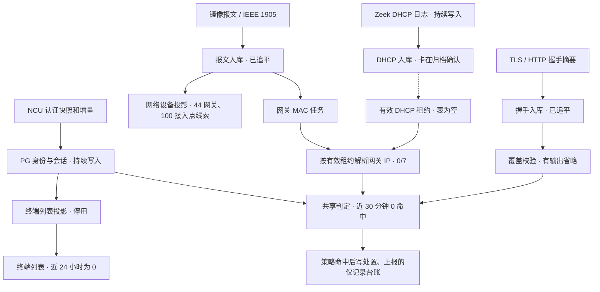

# 当前工作（2026-11-25，北京时间）

本页记录当前现场版本、数据边界、未完成缺口和下一步。现场瞬时状态以再次只读检查为准；已结束的试验和发布细节保留在 Git 历史。

观察期落地顺序与验收标准见 [共享识别落地任务](shared-access-landing-tasks.md)。T15 已在 184 验收，报文入库追平活动文件。T4、T12 由校方后续配置。T6 等待控制器查询消息 ID，T7 等待网络侧消除第四口回环。T13 继续收集每日磁盘数据。

## T15 报文轮转恢复（11 月 25 日）

**停点和原因。** 11:37:59 是最后一次失败退出，持久游标仍在 03:59 接纳完的 `ttl.jsonl-20261125-034302`。系统日轮转继承了 `dateext`，专用定时器生成编号档，两者同时管理 `ttl.jsonl`。原游标的设备、inode、出生时间、1,082,282,682 字节长度及末尾 4,096 字节哈希与日期档完全相符。已核对随后三个封口文件的完整长度和哈希，合计 3,550,131,432 字节。

**恢复。** 报文规则已移出系统轮转的加载目录，专用定时器按编号轮转。核对日期原档和保护链第 19 份的 SHA256 后，保留同一 `packet-reset-20261122T041342Z` 游标代次，从第 19 份的字节 0 接续。接续记录为 `/opt/proxy-sentinel/data/packet-source-recovery/packet-fresh-20261120T062000Z/ttl-rotation-bridge.json`，SHA256 为 `a0d7504eec773936d7670443588f7f9fa755771a13347dfc49c24339888293ea`。轮转配置审计在 `/opt/proxy-sentinel/data/ops/20261125-packet-logrotate.0YNcqq`。

**补读。** `2026.11.25-7519dcc4` 于 14:04:19 开始补读，前三段的字节区间连续，首段各归档车道在 14:05:02 完成。到 14:16:44，ClickHouse 已补入停机窗口前段的 SSDP 和 IEEE 1905。14:09:38 至 14:15:38 的自然流量样本中，机械盘 `fsync` 限制下入库读了 100.96 MiB，同时采集写入 50.42 MiB，净追赶 8.42 MiB/分钟。

**批次与发布。** `2026.11.25-943033c9` 只为独立报文入库入口放开既有 2 MiB 批次上限，gzip 合并已核验的窗口余量，仍受 2,000 条和 4 MiB 段正文限制。14:25 在报文入库单元启用该参数，旧参数保存在 `/opt/proxy-sentinel/data/ops/20261125-packet-batch.YO13oE`，若回退旧应用须先恢复旧参数。应用更新核对了 256 条 PostgreSQL、75 条 ClickHouse 迁移及 22 个应用进程，控制面和认证桥就绪均为 HTTP 200。包 SHA256 为 `8ed4e9a948aeeb1831d4a45bb6509096bf2b1280f132c7340173964ac4a8010a`，包清单记录了工作区原有的文档修改，152 个前端文件与上一包一致。定向回放及竞态检查、全量 Go 测试、构建和 `go vet` 均通过。

**采集覆盖。** 两次标准应用切换各有一段采集停止。14:03:59–14:04:04 和 14:24:20–14:24:29 的原始覆盖记录仍在，已知丢包分别为 37,459 和 135,929 帧，各有一小段没有内核计数。14:25 单独调整报文入库时采集进程继续运行。轮转补读保留已采集原文的字节位置。

**跨档与协议。** 15:01 从保护链第 19 份的 1,159,456,635 字节末端接到第 20 份的字节 0。15:53 从第 20 份的 1,241,447,589 字节末端接到第 21 份的字节 0。两侧 PostgreSQL 段回执与 ClickHouse 正文位置一致。第 21 份是 15:30 专用定时器轮转后的原 `.1`，解压长度 1,149,227,208 字节，SHA256 与压缩前相同。16:12 查询已补入采集时间 11:38 之后的 SSDP、IEEE 1905 拓扑与客户端关联记录。16:46，第 21 份的末段和轮转前活动文件的首段均已完成所有车道，三个原封口文件共 3,550,131,432 字节全部补读完毕。

**现场验收。** 17:40 从 15:30 封口文件的 1,177,230,667 字节末端接到下一文件的字节 0。专用定时器在 17:45 再次完成编号轮转，采集覆盖边界严格相接。18:36 从新封口文件的 1,198,445,169 字节末端接入活动 `ttl.jsonl` 的字节 0，PostgreSQL 段回执与 ClickHouse 正文位置均相符。18:59:55、19:00:10、19:00:40 和 19:02:40 四次采样的活动文件大小与游标相等，尾部 SHA256 与换行一致。19:02:40 读取位置为 544,164,210 字节，源文件、游标及出生时间相符，原游标代次和丢弃偏移 0 保持一致。报文入库运行正常，14:04 后无新的缺口退出。19:02 两个就绪检查均为 HTTP 200，运行表无 blocker。

**入库结果。** 截至 19:02，ClickHouse 在采集时间 11:38 至 12:38 的窗口内查到本次恢复后补入的 SSDP 38,698 条、IEEE 1905 拓扑 68,980 条、客户端关联 109 条。最新五分钟的三类索引均持续更新。日期原档和已核验的后继原文保留，可按来源位置和归档哈希追溯。

**程序产物。** 核对 63 个 systemd 单元、活动进程和 21 个挂载命名空间后，回收 `7519dcc4`、`2a5f2469` 的旧程序目录、两个发布暂存和 `previous`。标准包校验通过，19:04 再次读取活动文件，游标和文件长度均为 553,984,099 字节。清理审计保存在 `/opt/proxy-sentinel/data/ops/20261125-release-retirement-943033c9.jsonl`。

## 11 月 25 日共享识别落地

**现场版本。** 第一阶段 `2026.11.25-a87a50fa` 在 11:09 完成应用切换。11:33 切至跨段指纹版 `2026.11.25-2a5f2469`，源码 `2a5f24690b289412a4482892376bcaf976871759`，干净工作区构建，包 SHA256 `5fe657f08d1b6b1e83d496885096de4532397cd9d34606d0c16aad191fbed741`。两次发布均核对 256 条 PostgreSQL、75 条 ClickHouse 迁移和 22 个应用进程。11:43:55 实测控制面和认证桥就绪接口均为 HTTP 200。

**优先出口。** 10:38:38 至 10:40:08 在 184 对握手采集做独立只读对照。连续三个 30 秒桶的 37 个 IPv4 优先出口均能按 IP 和 MAC 对账。每桶归档 300 条摘要，其中优先活动为 23、26、27 个，其余 14、11、10 个在该桶均无匹配帧。旁路套接字丢包均为 0。线上旧程序相邻三桶留存 24、26、27 个，桶边界相差约 2 秒，末桶丢包 318 帧。原始优先查询的 45 组键中另有 8 组 IPv6，现行握手路径只处理 IPv4。对照期间沿用业务采集和确认规则。

**采集验收。** 新版 11:11:44 至 11:14:44 的 6 个完整桶均有 36 个优先出口，留存活动为 25、26、27、28、25、27 个，未留存均为该桶无匹配帧。各桶逐 IP 和 MAC 核对原因分组及缺口总数，重项、原因差额和内核套接字丢包均为 0。

**跨 TCP 段的 ClientHello。** 184 发布前只读旁路在 11:23:43 至 11:25:13 为 36 个优先出口采集续段，三个完整桶分别有 35、42、43 个候选补入握手指纹。每桶仍为 300 条摘要，主套接字和续段套接字丢包均为 0。重组只补主套接字同桶所见首段的指纹，每个 TLS 记录最多 16 KiB 正文，最多 64 条在途，超时 3 秒。跨桶、首段自身被截断及未通过主过滤条件的报文保留原采集结果。全量 Go 测试、构建、vet、定向 race 回放通过。184 内核按完整 2,048 个优先键验证了过滤分片，204 的采集、共享和存储包回归通过。

**正式采集中的跨段指纹。** 11:33:11 至 11:41:11 的 16 个完整桶均覆盖 36 个优先出口，补入 758 个跨段握手指纹，原因计数核对差额 0。续段套接字有 5 个桶出现丢包，共 6,628 帧，主套接字有 4 个桶出现丢包，共 34,642 帧。续段重组另计 282 个超时、15 个未完成、30 个重复候选。此窗口未见重组争议或超过缓冲上限。

**归属和隔离。** 10:14 至 10:29，90 个候选出口中 50 个至少一次成功归属。其余 40 个中，37 个缺认证覆盖，2 个缺同窗绑定，1 个 MAC 或 VLAN 不符。另有 8 个出口曾遇到缺口后成功归属。健康区间并集覆盖 834.8 秒，13 个缺口共 65.2 秒。10:31:59 三条通道健康，认证桥综合状态 degraded，源队列、处理中、隔离分别为 0、0、156。10:32:49 直读队列为 0、6、156。核验 156 条隔离原文的哈希，旧错误类型均为 `operation_error`，均只有未指定地址，含昨晚窗口结束后新增的 2 条。

**归属现场复核。** 新版 11:10 至 11:20 共有 83 个候选出口，关联 37 个认证账号。时段内始终未归属 46 个，报表 SQL 分项核对为认证覆盖缺口 39、缺少同窗绑定 6、MAC 或 VLAN 不符 1。缺少有效 IP 的新消息仍进隔离，并有独立原因码。

**认证桥状态。** 11:33 重启后事件通道继续消费，在线快照一度失败，`18082/readyz` 返回 503。前后版本的认证桥二进制 SHA256 一致。11:40 和 11:42 两次只读复查均发现 1 条已具账号和会话、却只有未指定 IP 的在线记录，触发快照的身份校验。11:43:22 自动重试发布成功，读取 19,930 个在线成员，发出 35,333 条地址记录，跳过 38 个读取期间已移出的成员。就绪返回 200，快照连续失败归零，综合状态仍为 degraded。

**逐账号抽检。** 从 11 月 24 日 16:33:06 至 11 月 25 日 10:30，固定口径共 5 个确认账号。抽取各账号最新一条可关联命中，逐一复算握手和 IGD 公告的 SHA256，核对镜像传感器、源 MAC、出口 IP、双层 VLAN、认证会话和活动时刻覆盖，5 个账号的抽检结论均为“共享”。其中 2 个样本的网关公告源 IP 与认证出口 IP 不同。逐账号命中数、案件编号、会话、原文引用和结论保存在 184 限权文件 `/opt/proxy-sentinel/data/ops/20261125T1030-shared-account-review.jsonl`，5 行，SHA256 为 `74605edfe1af66a23fba6ff8209fe4eb8e2d7e164d83a26f48ab87519cf80fbb`。这是每账号一条的证据抽检。现场有两种认证 NAS 地址，登记为校方基础设施的实体为 0，5 个样本均未命中现有登记。校方尚未提供基础设施台账和白名单，后续由校方自行配置。

**校方配置回放。** 隔离 PostgreSQL 和 ClickHouse 验证了有效基础设施登记排除共享确认。按账号子串、校区和期限生效的白名单产生 `whitelist_suppressed` 并保留原文引用，新案件、处置和上报均为 0。184 的名单由校方提供后才能逐条验收。

**待核、案件和本地记账。** 11:10 至 11:40 有 355 条主机名待核观察，涉及 26 个账号，可确认角色引用、策略命中、案件、处置和上报均为 0。60 次自然命中涉及 4 个已抽检账号和 6 个账号、出口与会话代次组合，每组各关联一个开放案件。60 份快照和 8 个仅记录动作均已关联，待同步和错链均为 0。一个本地仅记账通道为 60 次命中各留一条 `recorded`，投递尝试及发送字段异常均为 0。两对同会话镜像活动相隔 181.637 秒和 270.013 秒，每对各保留两次命中、两份快照和两个执行周期，归入同一未关闭案件。后者跨发布切换。隔离 PostgreSQL 的 200 秒回放结果一致。

**页面验收。** 两个发布阶段均在 184 登录态按 390×844、1280×800、1440×900 三个视口复测共享发现、确认观察详情、案件活动、对应策略、处置动作、白名单与共享统计报表，每个视口 7 页。核对无页面横向溢出、标签挤压、控制台异常或失败请求，最低选中态对比度为 6.71。处置页显示“仅记录，未执行”。前端 287 项测试、类型与契约校验、生产构建通过，后端 Go 全量测试、构建、vet 和隔离 PostgreSQL/ClickHouse 回放通过。

**现场包清理。** 两次切换各核对 63 个相关 systemd 单元、21 个挂载命名空间及运行进程引用。正式标准包已更新至 `2a5f2469` 并通过现场 SHA256 校验，`2026.11.24-f9a4a90a`、`2026.11.25-a87a50fa`、两次上传暂存及 `previous` 均已清理。审计在 `/opt/proxy-sentinel/data/ops/20261125-release-retirement-a87a50fa.jsonl` 和 `/opt/proxy-sentinel/data/ops/20261125-release-retirement-2a5f2469.jsonl`。

**证据过期观测。** 184 在 11:10 至 13:10 的两小时自然流量内，入队时证据已过期 15 次、入队后才过期 1,169 次。定时复检 37,568 次、无活动证据 72 次，合计 38,824 次过期提交。按活动、入队及实际判定时间复算两类过期，分类差异为 0。共采集 120 组队列指标，采样最大间隔 61 秒。实时队列最老任务的最高年龄为 165.002 秒，末次为 59.161 秒。该窗跨 11:33 的应用切换，包含切换后的认证快照恢复时段。并发和证据有效期参数保持现场原配置。13:10:47 再次确认控制面与认证桥就绪接口均为 HTTP 200。

**拓扑与第四口。** 10:42:52 至 10:43:52 统计入站 IEEE 1905 帧，涵盖单标签和双标签。bond0、f0、f1、f2、f3 各收到 1,078、285、434、359、0 帧，其中组播发现为 972、273、382、317、0 帧。五个套接字内核丢包均为 0；本窗未观察到查询、响应或带成员清单的响应。三个活动成员口的 1,078 帧全部在 bond0 配对。缺少 AP 或控制器查询消息 ID，无法判断指定事务在上游哪一跳缺失。10:43:15 回看 15 分钟，第四口仍有 88 条 LACP 回环告警。f0–f2 属聚合组 1，f3 属组 2，网络侧校正与切换复测待办。

### 七天磁盘日点

以下均为字节。根盘取 `df -B1 /` 的可用量，PGDATA 取实际分配量，ClickHouse 取活动部件的 `bytes_on_disk`。四张原文表保有多种来源，物理部件可能混存握手和报文。日增量从第二个日点开始计算。

| 北京时间 | 根盘可用 | PGDATA | evidence | evidence_v2 | short | short_v2 | system.query_log |
| --- | ---: | ---: | ---: | ---: | ---: | ---: | ---: |
| 11-25 10:30–10:32 | 687062126592 | 58791313408 | 11738334477 | 3862162633 | 2756051652 | 1779490607 | 9791043715 |

同日补充按物理部件的来源路径归类。握手独占 5,699,817,064 字节，报文与其他来源混存 14,261,939,224 字节，其他来源独占 277,763,261 字节，报文独占为 0。混存部件的全部字节只计一次。复测使用[原文部件空间查询](../scripts/maintenance/shared-body-disk-usage.sql)。

已安排 11 月 26 日至 12 月 1 日每天 10:31 继续采样。当前只有第一个同口径日点，30 天热数据容量待后续日点估算。

## 184 认证出口按镜像证据时间归属（11 月 24 日晚）

**现场版本。** 20:36:50 部署 `2026.11.24-f9a4a90a`，源码 `f9a4a90a74d8352733a9589f3a45313df1677c53`，现场标准包 SHA256 `65efe91974dcada800a29808cc4590ade4412042bc9956fe150f9695a67f62b0`。256 条 PostgreSQL、75 条 ClickHouse 迁移校验一致。发布器核对 22 个应用进程，另对八项关键服务逐一复核了执行文件，控制面和认证桥就绪检查均为 200。认证桥沿用现场的 `--durable-events=true`。报表入口及五个模块的静态资源均与包一致。复核 63 个服务或定时器和进程挂载后，已清理本次替换的程序目录、上传暂存和 `previous`，20:52 根盘剩余 656 GiB。

**已定位的漏归属。** 旧版先按处理当时的认证队列判定能否归属，再按报文发生时的认证状态判定策略。19:27:06 至 20:12:45 的现场记录中，16 条明确网关公告相关的观察涉及 3 个出口，另有 44 条 DHCP 路由器线索观察涉及 16 个出口，均在报文时段有认证覆盖、处理时有缺口。反方向还有 2 条明确网关观察在策略层才被拦下。这些是观察次数，同一账号可重复。新版归属和策略均核验镜像证据时段内的认证覆盖。路由器以实际出口活动报文的时点核验账号、会话、IP、MAC 和 VLAN，多终端等窗口证据仍需覆盖整段。UA 不作为确认依据。

**切换后的自然流量。** 按证据发生时间固定统计 20:36:50 至 20:51:50。20:52:43 与 20:53:44 两次只读核对结果一致。93 个候选出口中，43 个出口归属到 42 个认证账号，22 个账号有待核路由器线索，3 个账号按认证路由器确认共享，同出口多终端确认 0 个账号。3 个账号共 51 次命中，形成 3 个新案件、3 条新建的仅记录处置。自固定起点 16:33:06 至窗口结束，累计 303 个候选出口、228 个可归属账号、4 个确认账号。此前确认的另 1 个账号仍有有效认证绑定，本窗口其原出口 IP 的握手归档为 0。20:50:33 至 20:51:23 对该出口独立只读采样，看到 169 个源 MAC 匹配的帧，计到 8 条源地址匹配记录，未计到 TCP 建连。该次采样有内核丢包，无法证明现场没有建连。

**证据与处置。** 3 次命中分别来自 3 个账号，报文时段有认证覆盖，处理时的健康记录显示缺口。另外 48 次命中在两个时点均有覆盖。反方向观察到 2 条明确网关角色记录，来自 2 个出口，报文时段缺覆盖、处理时已恢复，均保留为无法归属。51 次命中的会话、账号、IP、MAC 和 VLAN 逐条一致，51 条均找到自己的案件快照及通过 SHA256 核验的握手原文，合计 49 份不同握手原文。另核验 5 份 SSDP 网关公告的哈希、传感器、源 MAC 和网关服务。3 条处置均无连接器和远端动作 ID。启用的处置及上报通道分别为 0，待关联案件的命中为 0。

**待核与多终端。** 新窗口的 22 个路由器待核账号仅有 DHCP 型号线索，12 个明确标记来自主机名，另外 10 个缺少匹配字段，回查原文并校验哈希后均仅命中主机名。修复前窗口的 24 个同类账号中，11 个已有主机名标识，其余 13 个也经原文核验为主机名。旧版同一窗口的 106 条 IEEE 1905 原文均通过内容哈希校验，其中加入、离开各 53 条，涉及 6 个终端和 2 个网关。两个网关的 AL MAC、以太网源 MAC 和 BSSID 均未匹配到对应域当时查询到的在线认证出口。94 份采集心跳原文中，92 份带协议计数，合计 58,912 帧、0 个拓扑查询、0 个拓扑响应、0 个成员快照，其余 2 份无该计数。切换后的 15 分钟内，34 份关联原文由 2 个网关发出，加入、离开各 17 条，涉及 3 个终端。两个网关仍未匹配到对应域的在线认证出口。30 份带协议计数的采集心跳共观察到 19,458 个 IEEE 1905 帧、0 个拓扑响应，另有 2 份无协议计数。索引中的成员快照为 0。

**处理进度。** 15 分钟内认证覆盖 795.4 秒，15 段覆盖缺口共 104.6 秒。50 个出口在窗口内始终未归属，其中 40 个只有时段覆盖缺口，8 个缺少同窗认证绑定，2 个镜像 MAC 或 VLAN 与认证记录不符。上述 40 个出口的观察均未带可用的路由器画像，其中 36 个至少有一条报文落在健康段，整段多终端线索仍缺连续覆盖。窗口内日志记录 13,284 次新依赖提交，入队至提交 P50 为 18.4 秒、P95 为 46.2 秒、最长 57.7 秒。20:53:44 两路镜像待归档均为 0 段、0 字节，共享队列 992 项、最老 54 秒、带错误 0 项，风险队列 1,064 项、最老 7 秒。期间共享队列、风险队列分别出现过清零采样。

**代码测试。** 使用隔离 PostgreSQL 与 ClickHouse 回放，旧版在两个相反的认证时序上均复现错误，修复后通过。路由器与 IEEE 1905 的归属、证据、仅记录及重复处理回放通过，全量 Go 测试、构建和 vet 通过。204 工作区的共享依赖相关测试通过。

## 184 认证出口路由器共享现场验收（11 月 24 日晚）

**现场版本。** 19:27:05 切换至 `2026.11.24-9e31576a`，源码 `9e31576a2a9ca7f33d27a572a0826f70ede72649`，包 SHA256 `b63452a2831f819a28d1c9e103d0e48b396dc4f82c9252d4bf134495e6c14602`。控制面、认证桥就绪检查均为 200，八项关键服务的实际执行文件均来自该版。两套迁移账本分别核对 256、75 个校验值，均一致。现场使用既有认证、策略、白名单和仅记录模式。前端无代码变更，报表入口及五个模块的线上资源与包一致。业务计数以只读事务按报表同一口径查询。

**现场自然流量。** 19:43:37 读取入库结果，按证据发生时间统计。候选按传感器、校区、接入域、出口 IP 去重，账号按认证账号去重。表中的案件与动作均有实际记录可关联。

| 北京时间 | 候选出口 | 可归属账号 | 路由器待核账号 | 路由器确认账号 | 多终端确认账号 | 案件 | 仅记录处置 |
| --- | ---: | ---: | ---: | ---: | ---: | ---: | ---: |
| 修复后的首个完整 15 分钟，19:27:05 至 19:42:05 | 80 | 75 | 22 | 4 | 0 | 6 | 6 |
| 自固定统计起点，16:33:06 至 19:43:37 | 255 | 199 | 24 | 4 | 0 | 6 | 6 |

**案件与原文。** 首个 15 分钟内，75 个出口归属到 75 个账号。4 个确认账号共 49 条策略命中，49 条均匹配有效认证会话和出口 IP、MAC、VLAN，均能按对应观察找到案件快照与哈希校验通过的握手原文，共引用 38 份不同的握手原文。独立复核了这 4 个账号的 9 份 SSDP 网关角色原文，内容哈希、镜像传感器、源 MAC 和 InternetGatewayDevice 服务均匹配。其中两个账号的公告源 IP 与认证出口 IP 不同，账号归属使用认证出口和实际活动。4 个账号中有 3 个各建 1 案。另 1 个账号有 3 案，前后两次可确认活动的间隔分别为 191 秒和 202 秒，超过前一段证据的 180 秒有效期。6 条处置均为仅记录，无连接器、无远端动作 ID。启用的上报通道为 0。该窗口的待同步命中最终为 0。

**仍有缺口。** 本窗口 22 个路由器待核账号中，21 个缺少充分的角色证据，1 个遇到身份源中断。19 个出口至少有一次归属失败，其中 16 个遇到会话时间或身份源覆盖缺口，2 个缺少同窗绑定，1 个 MAC 或 VLAN 不符。部分出口随后成功归属。同出口多终端路径现场确认为 0。900 秒中身份覆盖有效 753 秒，16 段缺口共 147 秒。19:43:37 两路镜像待归档均为 0 段、0 字节，共享判定待处理 735 项、最老 22 秒，带错误的待处理项为 0。风险计算待处理 608 项、最老 15 秒。根盘余量 657 GiB。修复后首 15 分钟内，新依赖到判定提交 P95 为 42.1 秒。

**两处实测漏判。** 旧规则把被动采集的通用网络设备角色解释为校方基础设施。核对 5 份带哈希的网关公告，校正 3 个当时在线、认证 IP 和 MAC 同时匹配的出口，共 12 条当前画像事实。重复校正为 0。19:14–19:19 在同一镜像接口独立做了两段 120 秒的只读观察，其中两个出口确有主动 TCP 建连。第二段仅目的端口 80/443 就分别看到了 507 和 122 次。独立抓包有丢包，计数是观测下限。相同时段这两个出口在已有握手归档的摘要都是 0。原采集每 30 秒按普通流量排序与轮取，两个出口的活动未能进入有限的输出名额。

**修复与归属。** 新网关公告保留路由器角色，校方基础设施按独立的归属证据排除。握手采集在后台每 30 秒按传感器、校区和接入域读取认证出口与路由器画像，以精确 IP/MAC 从现有预算中最多预留四分之一。现场每桶总量保留 300，其他名额沿用原有全网取样。采集优先名单只决定哪些实际报文进入摘要。共享判定另行按活动时间核验认证账号、会话、IP/MAC、VLAN 和独立角色原文。UA 不参与共享确认。首 15 分钟完成 29 个采集桶，每桶均为 300 条摘要。候选优先名单为 36 个出口，每桶实际保留其中 19 至 22 个的活动，另有 12,917 至 13,152 个全网摘要受输出限额省略。

**队列实测。** 19:12 按作业版本与完成时间对照日志，253 次新依赖过期判定中，241 次仍能找到同一次提交的证据。234 次在依赖入队时仍有有效证据，处理时已超过 180 秒，另 7 次没有可用活动。19:16 将共享判定并发从 5 调到 7，保留最老任务和到期任务的处理。相同程序的两个 10 分钟自然流量窗口内，19:05–19:15 完成 7,260 次新依赖判定，P50/P95 为 31.1/64.6 秒，239 次过期。19:16:30–19:26:30 完成 9,361 次，P50/P95 为 16.4/45.4 秒，11 次过期。两段现场负载有变化。

**身份源覆盖。** 19:07:41–19:17:38 每 3 秒抽样，共 201 次。186 次身份现场覆盖有效，15 次覆盖缺口都伴随源队列有待处理消息，最高 2 条。三条认证通道在这些样本均为 healthy，隔离队列始终为 154。涉及缺口的活动继续保留归属复核原因。

**验证与发布。** 全量 Go 测试、构建、vet、Linux 握手过滤与采集回放通过。独立 PostgreSQL 和 ClickHouse 回放验证了两条确认路径、注册校方设备排除、不同接入域隔离、重复同步和仅记录处置。204 工作区的证据、存储、发现和采集回归通过。184 当时没有登记为校方基础设施的实体，现场可核对的两个认证 NAS 地址均无共享确认。发布后清理了已替换的程序目录和暂存，保留有引用的 11 月 16 日目录。清理审计为 `/opt/proxy-sentinel/data/ops/20261124-release-retirement-9e31576a.jsonl`。

## 184 认证出口共享识别（11 月 24 日）

**18:07 落地核对。** 自 16:33:06 起，184 已记录 193 个候选出口、144 个可归属账号、10 个路由器待核账号。两条共享确认路径、案件和仅记录处置均为 0。两路采集待归档均为 0，共享判定待处理 824 项、最老 151 秒，风险计算待处理 9,922 项、最老 99 秒。

**路由器确认的首要卡点。** 固定起点后，同一镜像传感器有 285 个不同源 MAC 发布了 SSDP 网关服务，285 个画像均带基础设施标记。与当时在线的认证会话对照，3 个 MAC 对得上，1 个同时匹配出口 IP 和 MAC。该出口的网关公告发生在认证会话内，镜像活动源 MAC 相同，双层 VLAN 与认证编码一致。在这次活动的有效期内，基础设施标记只来自 SSDP，另行触发共享排除的冲突证据为 0。采集器会给这类控制报文标上通用的 `network_device` 角色，画像把该角色直接认作基础设施，共享判定随后排除该画像。修复后分别记录设备角色和校方基础设施归属，只按后者的独立证据排除。18:07 时现场确认数为 0，晚间修复与验收结果见本页首节。

**判定口径。** 从镜像中的出口活动出发，按事件发生时的校区、接入域、IP、MAC、VLAN 和有效认证会话归属账号。认证出口与明确路由器角色一致即可确认路由器共享，包括仅看到一台终端或无法计数的情形。另一条路径使用覆盖已核验的同出口多终端关联。DHCP 主机名、历史来源字段不清的型号线索、TTL 和 TLS 差异可形成候选。UA 不参与这两条路径的确认。学校可配置登录名原文子串白名单，匹配的观察留存豁免记录。

**下午版本。** 184 从 17:37:52 至 18:49:31 运行 `2026.11.24-d198e5da`。源码为 `d198e5da869614ce54e0b686eedd2be16371d380`，包 SHA256 为 `f95a70286c1f7f69d4f594befaa133eb4e120b3815df3699fa46585b80486e92`。16:33:06 固定 v15 的统计起点，后续发布均沿用该起点。首次发布以 `--skip-backup` 应用 PG256。17:01 调整型号候选和报表筛选，17:21 修复建案时归档原文的来源代次校验，17:37 修复观察过期覆盖历史判定和账号明细。最终更新逐项校验了 256 条 PostgreSQL 与 75 条 ClickHouse 迁移。打包时工作区另有原有的现场文档修改和未跟踪的架构目录。现场沿用既有账号、配置和策略。

**首个完整 15 分钟。** 16:33:06 至 16:48:06 的自然流量产生 **59 个候选出口、47 个可归属账号、0 个确认共享账号**。逐笔对照同校区、传感器、IP、MAC 和观测时间的 DHCP ACK 租约，47 个账号中有 39 个至少有一次在没有相符有效租约时由认证会话成功归属。该计数不代表这些账号始终没有 DHCP。这个窗口的候选均由 TTL 与 TLS 差异产生，路由器确认、多终端确认、白名单豁免、共享案件、仅记录处置均为 0。21 个出口曾出现归属缺口，其中 15 个遇到会话时窗或身份源缺口、5 个缺少同窗绑定、1 个出现 MAC 或 VLAN 不符。统计按出口和账号分别去重，同一出口在不同观察中可以由有缺口转为成功归属。

**18:00 现场结果。** 18:00:03 读取报表，统计 16:33:06 至 18:00:00 已入库的自然流量。候选按传感器、校区、接入域和出口 IP 去重，账号按认证账号去重。

| 北京时间 | 候选出口 | 可归属账号 | 路由器待核账号 | 路由器确认 | 多终端确认 | 白名单豁免 | 案件 | 仅记录处置 |
| --- | ---: | ---: | ---: | ---: | ---: | ---: | ---: | ---: |
| 16:33:06 至 16:48:06 | 59 | 47 | 0 | 0 | 0 | 0 | 0 | 0 |
| 16:33:06 至 18:00:00 | 188 | 136 | 9 | 0 | 0 | 0 | 0 | 0 |

136 个已归属账号中，133 个仍有完整的认证出口字段可逐笔复核，105 个至少有一次在没有相符有效 DHCP ACK 的情况下成功归属。9 个路由器待核账号中，5 个有 TP-Link 型号规则、3 个有小米型号规则，均为缺少匹配字段的既有 DHCP 证据。另 1 个留有待核判定，修复前过期的详情已缺少角色字段。此次自然流量没有产生可确认的网关角色或符合条件的同出口多终端证据。核对 547 条已归属明细，其中 13 条从原判定取回旧详情丢失的账号，报表账号与原判定不一致的有 0 条。

共有 118 个出口至少一次缺少归属。90 个遇到认证会话时窗或身份源覆盖缺口，22 个缺少同窗绑定，8 个出现镜像 MAC 或 VLAN 与认证出口不符。同一出口可以出现多个原因，也可以在另一时刻成功归属。在本次约 87 分钟内，认证桥的健康记录覆盖 3,935 秒，记录到 150 段缺口、合计 1,278 秒。18:00 三个实时通道均为 healthy，源队列和处理中队列均为 0，隔离队列为 154，认证桥综合状态为 degraded。

**18:00 积压。** 握手与报文两路待归档均为 0 段、0 字节，最近归档分别在 23 秒和 24 秒前。共享判定有 896 项待处理，最老 141 秒，带错误的待处理项为 0。风险特征计算有 13,739 个待处理对象，最老 144 秒。17:49 抽样时这两项分别为 1,228 项、22,056 个对象，队列在持续消费。18:01 根盘余量 663 GiB，使用率 62%。本次样本没有验证长期容量或全网识别率。

**采集及归属边界。** 认证桥重启后于 16:36:05 完成新快照，16:36:09 起恢复有效健康区间。后续的身份源短暂缺口保持可见。握手原文中已经出现无需 TLS 的 IPv4 TCP 初始连接活动，归档事件键和现场镜像 MAC 可对照。17:00:11 至 17:00:41 的一个握手采集桶收到 458,192 个报文，内核丢包 0，解析截断 8,287 次，因输出限额省略 17,281 项。17:03 查询前一分钟完成的 914 个出口任务中，913 个保存了可溯源的活动，具备认证路由器确认依据的有 0 个。因采集有抽样、省略和证据覆盖限制，现场计数代表已处理证据能支持的结果。

**代码测试。** Go 全量测试、构建、vet、Linux 采集过滤测试以及 204 相关回归通过。使用独立 PostgreSQL 与 ClickHouse，从标准事件分别回放认证路由器、同出口多终端两条路径。每条均产生一个可关联到案件的策略命中、一个仅记录动作和一条测试通道的仅记录上报。重复同步保持一案，案件能按来源代次找到受保护的镜像原文，路由器角色字段与事件引用可以在快照复核。路由器用例仅有一个认证出口、一条 TCP 活动和网关角色证据。另行验证了过期、延迟到达的重复过期和旧版本账号查询。前端 287 项单测、类型检查、生产构建以及报表、共享观察、策略记录、白名单和案件历史的三视口检查通过。

**现场核验边界。** 控制面和认证桥就绪接口均返回 HTTP 200。核对采集、两路入库、认证、识别、风险和控制面共八个进程的实际执行路径，均为本次发布目录。报表入口与五个业务模块的线上静态资源和发布包逐字节一致。业务报表的匿名 HTTP 请求返回 401，现场计数按同一报表查询、以只读事务核对。现场未配置行为上报通道，观察期间仅使用自然流量。

**发布清理。** 核验标准包的 SHA256、活动进程、63 个 systemd 单元和挂载后，已移除本次替换的旧程序目录、上传暂存和 `previous`。两份仍有引用的 11 月 16 日程序目录保留。最终清理审计为 `/opt/proxy-sentinel/data/ops/20261124-release-retirement-d198e5da.jsonl`。

## 184 认证出口共享发现（11 月 24 日 14:25 发布）

- **真实流量验收。** 最终版 14:25:17–14:40:17。按活动采集代际、实际证据时间和新版规则，跨窗口按出口 IP 去重，累计有 **69 个候选出口，56 个出口归属到 56 个不同认证账号，确认共享 0 个**。69 个均由重复共现的 TTL 簇和 TLS 指纹进入候选，已核验的路由器出口候选 0 个。独立核对的 9 个认证 MAC 有有效路由器画像，该时段它们的认证出口没有对应的共享作业镜像事件更新。13 个候选出口缺少可采信的同窗账号归属。共享策略命中和仅记录处置均为 0。
- **无 DHCP 的现场正例。** 56 个已归属出口中有 49 个在该时段查不到同传感器、站点、认证 MAC 和 IP 的有效 DHCP ACK。另行核对这段时间的 3 条网关作业，有 1 个在没有对应 DHCP ACK 的情况下解析出 IP，最终判定窗口也保存了 NCU 认证归属证据。这个结果证明地址归属链路已走通，多终端转发仍需独立证据。
- **业务口径。** 有镜像活动，且同窗认证 MAC 对应有效、独立的路由器角色证据时，记为路由器共享候选。其次，同一出口的客户端初始 TTL 簇和 TLS 指纹反复共现，可以进入辅助核验。UA 不参与这条实时链路的候选评分。路由器画像、单个 TLS 指纹、不同应用数量均不作为下挂终端数。策略判定独立核对证据覆盖和认证会话。
- **地址归属。** 网关发现与判定均先按已登记的认证来源、站点和接入域查询 IP/MAC，再按时窗重放快照、登录、下线和换址。冲突、过期或不覆盖窗口的认证不会被 DHCP 覆盖。缺少认证绑定时，DHCP 仍可提供网关地址。镜像候选保存账号、会话、认证 MAC、VLAN 和认证来源，可追溯到原始证据。没有新增身份索引或数据库迁移。
- **双层 VLAN。** 第一版现场核对发现 18 个八位认证 VLAN 均与镜像内层相符，直接比较原始数值使这些样本漏归属。物理采样 60,000 个报文头中，有 21,046 个同时带网卡卸载的外层及报文内的内层标签。修复后在握手采集阶段恢复内核提供的外层标签，按 NCU 的双层编码分别比对。外层不符、内层不符、同一窗口出现不同标签组合均不能通过该认证关联。
- **发布和验证。** 当前为 `2026.11.24-944ec236`，包 SHA256 为 `38cc3d133e79cd631ddf7427d4489d11a335dd2e4f9c4a1b01717577a9715a84`。构建时有本页的未提交记录与既有未跟踪目录 `.archify/`。255 条 PostgreSQL 与 75 条 ClickHouse 迁移校验一致，22 个活动应用进程已核对新版。两项就绪检查 200，NCU 继续报告降级。Go 全量测试、构建、vet、Linux amd64 交叉构建、Linux 容器 VLAN 回放与 204 相关三包基线通过。前端 287 项单测、契约、类型检查、生产构建和三个视口共 6 项浏览器回放通过。现场三视口没有横向溢出，未登录会话返回 401，登录态页面仅做本地回放。最终两次应用版本的 152 个前端文件一致，85 个未压缩资源逐项通过现场 HTTP 哈希核验。
- **程序产物。** 已替换现场标准包并再次校验 SHA256。核对活动进程、挂载、配置及 63 个现场应用单元后，回收 `0f94b826` 和 `3a0a9510` 旧程序目录、两次上传暂存、`previous` 和 `frontend-previous`。两份有活动配置引用的 11 月 16 日目录继续保留。清理审计位于 `/opt/proxy-sentinel/data/ops/20261124-release-retirement-944ec236.jsonl`。

## 184 当前问题与解决条件（11 月 24 日 13:22–13:32，只读现场核对）

现场运行 `2026.11.24-0f94b826`。按现行报表筛选和去重，路由器身份线索 318 台、待确认 54 台、确认 0 台。13:31:29 的 20 分钟镜像窗口有 19 条共享候选，全部带 UA 和 TLS 差异，1 条覆盖已验证，0 条有多终端强证据。近 24 小时共享策略命中、仅记录处置均为 0。以下方案尚未实施。

| 环节 | 已定位的问题 | 解决方案与条件 |
| --- | --- | --- |
| 从镜像发现共享用户 | 实时行为规则只用 IEEE 1905 完整成员快照建立多终端强证据。近 24 小时活动报文范围有 3,111 条成员接入变化、0 条完整成员快照。普通路由器缺这类输入时，184 只能从协议差异得到候选。 | 按认证出口汇总同一时窗的镜像线索，覆盖全体用户。要确认真实转发，需要把至少两台终端的流量与该认证出口对应起来，例如接入侧和出口侧的流对应关系或具备终端归属的 NAT 会话记录。单侧出口镜像无法可靠还原所有 NAT 后面的终端。 |
| 共享报表与策略 | 镜像报表只纳入 IEEE 1905 关联或 UA 与 TLS 同时存在的记录。行为评估取得成员证据仍写候选，而策略可以在证据完整、账号等条件成立时写命中。报表的“已确认”要求行为状态为 confirmed。这两处采用不同口径。 | 镜像候选查询纳入引擎实际产出的有效线索，展示线索来源。按同一证据记录关联展示“发现多终端接入”“证实共享出口”“策略命中”，让报表、明细和仅记录处置可以按同一事件核对。 |
| 网关地址及账号 | 发现网关时与最终判定时都要求有效 DHCP ACK。近 24 小时有观测的 10 条网关作业中，9 条缺地址归属，另 1 条取得过地址但已过期。此前已有样本在镜像与认证快照中同时匹配 MAC、IP 和双层 VLAN。 | 在两个校验位置复用同一地址归属逻辑，支持覆盖证据时窗的权威认证会话，按站点、VLAN、MAC、IP 匹配，处理换址、下线和冲突。可修复有对应认证事实的漏归属。 |
| 物理镜像 | 最近 15 分钟第四口 enp8s0f3 有 87 次 LACP 回环告警，4 个物理口中 3 个参与活动聚合。此前配对取样确认切换期间有报文只到物理口。12:52 在物理口和 bond0 同窗收到的 411 帧 IEEE 1905 中都没有拓扑查询或响应。 | 需要网络侧校正第四口接线、聚合或镜像控制帧回送。用同一拓扑事务在 AP 或控制器、镜像出口和 184 对照，确定是否有成员清单可接。现有数据无法确定上游哪一跳缺帧。 |
| TLS 握手 | 最新五个 30 秒窗口各保留 300 组摘要，省略 6,972–7,053 组，解析截断 6,112–7,084 次，内核丢包均为 0。已证实部分 ClientHello 跨 TCP 段，当前解析器只看单帧。 | 增加有界 ClientHello 跨段重组，并按认证出口增量汇总特征，分别验证截断和摘要省略的改善。能提高候选覆盖，不能单独证明转发。 |
| 身份桥与健康检查 | NCU 隔离队列 151 条，三个通道健康，源队列和处理队列为 0。控制面两次就绪抽样均报告被动采集状态查询超时。 | 对隔离项按实际失败原因解决新增解析或源数据问题。被动发现健康查询应跟随现场启用状态，启用时单独定位超时查询。 |

13:31:29 有效共享待办 114 项、最老 12 秒，风险待办 575 项、最老 16 秒。另一次两分钟风险批处理完成 15,004 项，批次错误 0。根盘可用 675 GiB。当前样本显示队列在处理新流量，零命中已能由证据和判定链路解释。本次未改动现场。

## 184 共享策略零命中的证据链核对（11 月 24 日 12:52–12:53）

- **镜像物理入口。** 在 `bond0` 和四个物理口同步读取 18 秒的 IEEE 1905 报文头，只保存计数。三个活动物理口分别收到 112、153、146 帧，第四口 0 帧，与 `bond0` 的 411 帧一致。所有帧均为组播，拓扑查询、拓扑响应和辅助套接字内核丢包均为 0。该时段拓扑响应已在 184 物理入口缺失。接入设备是否产生响应及交换机镜像是否复制这些响应仍缺对端证据。
- **证据进入判定的两个门槛。** 近 24 小时活动报文代际归档索引有 3,090 条接入变化、0 条完整成员快照。现有实时规则只从完整的 IEEE 1905 成员快照建立多终端强锚点；接入变化可更新成员状态。网关归属要求在观测时和判定时均由同范围有效 DHCP ACK 解析到同一个 IP，并覆盖证据窗口。近 24 小时有作业的 8 个网关均为 `gateway_ownership_unavailable`，同范围最近 24 小时 DHCP ACK 也是 0。11 月 23 日已对其中一台独立确认其镜像 IPv4 活动与认证地址一致，现有 DHCP 归属条件仍将其挡在共享判定之前。
- **排除队列和握手作为唯一解释。** 当前 20 分钟有 27 条镜像候选，4 条已验证采集覆盖，强锚点和账号归属均为 0。共享待办为 0，风险待办 1,175 项、最老 25 秒，近 24 小时共享策略命中为 0。相关强锚点、成员快照和归属重试的代码回归通过。现场核对为只读。

## 184 握手取证与风险评分优化发布（11 月 24 日 11:56）

- **应用更新。** `current` 已切至 `2026.11.24-0f94b826`，源码 `0f94b826dd491bbf34f3bdd2c1a9eafbff984991`，标准包 SHA256 为 `3713866fa5a368e6528cd6bac9f1f468d488c5e0a58d105cbb538247bdf537fe`。构建清单记录原有未跟踪目录 `.archify/`。255 条 PostgreSQL、75 条 ClickHouse 迁移校验一致，22 个应用进程已核对新版，两项就绪接口为 200。现场配置沿用，152 个前端资源哈希与前版一致。Go 全量测试、构建、vet、Linux amd64 发布构建和 204 对应三包基线通过。
- **握手。** V2 抓取上限由 2 KiB 改为 4 KiB。每窗 300 组摘要的限额沿用，优先留存完整特征并保留轮换名额。发布前五个窗口有特征且地址级覆盖完整的摘要为 145–175 组，发布后四个窗口为 247–264 组，套接字内核丢包均为 0。发布后每窗仍省略 8,636–8,825 组。当前指纹解析以单帧为界，跨 TCP 段的 ClientHello 仍可能截断。
- **风险评分。** 追赶批次由 16 项增至 24 项，常规 8 项、特征行数和字节限额、延迟回退机制沿用。发布前两分钟完成 9,984 项，约 83.2 项/秒。发布后 169 秒完成 20,607 项，约 122.3 项/秒，批次错误 0。结果提交 P95 从 221 毫秒升到 287 毫秒。风险待办由 11:54 的 30,689 项降到 12:02 的 16,066 项，最老约 262 秒。
- **共享与清理。** 12:02 共享判定待办回到 40 项，最老约 15 秒。近 24 小时共享策略命中和仅记录处置均为 0。多终端拓扑证据仍缺。确认进程、有效单元和挂载引用后，替换标准包，回收前版 `1f13a757`、`previous` 和上传暂存。两份有引用的 11 月 16 日目录保留。发布和清理审计分别位于 `/opt/proxy-sentinel/data/ops/20261124-application-2026.11.24-0f94b826.log` 和 `/opt/proxy-sentinel/data/ops/20261124-release-retirement-0f94b826.jsonl`。

## 184 共享识别卡点定位（11 月 24 日 11:30–11:39）

- **握手解析。** 正式采集使用 `bond0`、30 秒窗口和握手 V2。11:38 四秒辅助样本直接读取 AF_PACKET，只汇总 IPv4 TCP/443 报文头，未保存报文。其中 7,690 条 ClientHello 有 775 条的 TLS 记录长度超过当前 TCP 段，另有 161 条能放在当前段内但超过采集器 2,048 字节上限，辅助套接字内核丢包为 0。当前指纹解析按单帧执行，跨段记录会被记为截断。辅助样本中的外层 VLAN 通过内核元数据提供，读取到的报文字节最多带一层 VLAN，因此本次样本没有证明双层 VLAN 被正式握手过滤器丢弃。
- **握手写出。** 四个最近的正式窗口各写出 300 组 IP＋MAC 摘要，每窗另有 9,335–9,616 组触及写出上限，按覆盖记录只写出约 3%。正式套接字内核丢包和新键上限丢弃均为 0。每窗已写出摘要中有 157–184 组在本窗具备完整的按地址覆盖。11:33 最后 256 条证据不足判定中，195 条标记握手覆盖不完整，61 条明确缺少多终端强证据。共享判定待办为 0，最近 24 小时策略命中为 0。
- **网关成员证据。** 三个正式报文窗口收到 1,632 帧 IEEE 1905，拓扑查询、响应、成员快照和内核丢包均为 0。近 15 分钟的 89 次 LACP 回环告警均来自 `enp8s0f3`，聚合活动口为 3 个。11 月 23 日物理口对照已确认聚合切换时有报文到达物理口但缺在 `bond0`，且同窗物理入口无拓扑响应。现有证据不足以确定拓扑响应的缺失发生在接入设备发包、交换机镜像还是聚合传递。
- **风险评分。** 五分钟提交 24,998 项，约 83.3 项/秒。1,570 批中 1,558 批已使用 16 项上限，当前双 worker 和 375 毫秒快周期的理论上限约为 85.3 项/秒。领取、特征读取和结果提交 P95 分别为 13、145、263 毫秒。11:33 仍有 31,928 项待办，最老约 392 秒。相关握手、覆盖和接入证据回归测试通过。

## 184 镜像共享识别只读核对（11 月 24 日 11:13–11:20）

- 现场运行 `2026.11.23-1f13a757`，根盘可用约 681 GiB。控制面就绪。NCU 身份桥就绪且状态为 `degraded`，采样时桥接来源和处理中队列均为 0，数据库活动认证范围待处理、待归档及接收与处理位点差均为 0。控制面的身份健康读取有间歇超时。终端列表近 24 小时有 35,702 条，34,012 条带当前 IP，最近投影写入距采样约 5 秒。
- 11:13 按报表口径去重后，路由器身份线索 320 项、待确认 52 项、已确认 0 项。路由器核验档案口径有 462 条，46 条有关联账号。最近 24 小时有 IEEE 1905 网关作业的 8 个网关均无有效解析地址。当前 20 分钟镜像窗口有 24 条候选，全部覆盖不完整且无强锚点或可归属账号。
- 近 15 分钟判定有 8,668 次证据不足、5,824 次过期。近 24 小时策略命中、仅记录处置和上报记录新增均为 0，通道配置 0 个。最近 256 条证据不足判定中，203 条含握手采集覆盖不完整原因。11:20 最近握手窗口有 10,957 次解析截断、397 次特征溢出和 10,181 次输出省略，套接字内核丢包为 0。同一时段最新报文窗口收到 633 帧 IEEE 1905，拓扑查询、响应及成员快照均为 0。两路仍有近期入库回执。近 15 分钟内核记录 89 次 LACP 回环告警。
- 共享判定队列在两次采样均持续处理，11:20 有 155 项、最老约 7 秒、待办错误 0。风险评分队列从 31,484 项变为 32,056 项，最老约 376 秒。三分钟日志完成 15,082 项，约 84 项/秒，领取、特征读取、提交耗时 P95 分别为 8、133、226 毫秒。

## 184 风险评分特征读取发布（11 月 23 日 17:30）

- **定位。** 16:56:45–17:02:45 的 ClickHouse 日志中，风险特征查询有 27 次异常，全部发生在按游标续读的页面。24 次集中在同一组 IP，该组以每页 5,000 行重复扫描同一个窗口，平均每条查询读取约 147 MiB。同一现场历史窗口用单次只读查询取回并逐条校验 49,116 条特征，耗时约 2.7 秒。
- **修复与验证。** IP 和账户各用一条有界查询并流式解码，保持接受时间与观测时间边界、跨查询去重、内容哈希验证和异常中止。行数或字节数达到上限时仍拆批重试，响应中断或内容冲突时整批待办保留。隔离 ClickHouse 经应用 HTTP 客户端完整读取 49,116 条有效特征，约 1.9 秒，并验证接受时间边界、物理重复与服务端超限。Go 相关回归、全量测试、构建、vet、Linux amd64 构建和 204 相关三包基线均通过。
- **发布。** 17:30:21 完成 184 应用更新 `2026.11.23-1f13a757`，源码 `1f13a75703ae03a061a60a5d3961b30fc375b4d4`，干净工作区构建，包 SHA256 为 `90eaa1442ece37e4384f47b4bc1ecb3e177aa6ce429cb340728eac1335725e73`。255 条 PostgreSQL、75 条 ClickHouse 迁移校验一致。22 个应用进程已核对新版，两项就绪检查均为 200。NCU 桥接器沿用 `--durable-events=true`，已核对进程与 18082 就绪。152 个前端发布资源哈希一致，现场登录入口三视口截图与 DOM 探针通过，登录态未验收。
- **自然流量。** 17:30:21–17:33:25 完成 15,440 项风险待办，约 84 项/秒，代次重试 16 项，任务执行错误 0。ClickHouse 已记账的 944 次读取均完成，无游标续页，最大 6,935 条，应用特征读取 P95 为 135 毫秒，结果提交 P95 为 273 毫秒。17:33:25 仍有 31,120 项待办，最老约 390 秒。4.9 万条热点窗口只完成历史只读复测和隔离验证，现场自然流量尚未覆盖同等规模。常规批次的主要耗时在结果提交，仍需按新增待办速率和提交负载观察队列。
- **清理。** 核对活动进程、文件描述符、挂载与 179 个有效 systemd 单元后，替换标准包，清理前版 `923d8aab`、`previous` 和本次上传暂存。两份有引用的 11 月 16 日目录继续保留。发布及清理审计为 `/opt/proxy-sentinel/data/ops/20261123-application-2026.11.23-1f13a757.log` 和 `/opt/proxy-sentinel/data/ops/20261123-release-retirement-1f13a757.jsonl`。

## 184 风险评分领取优化发布（11 月 23 日 15:29）

- **修复与成本。** PostgreSQL 迁移 255 新增按传感器和首次待办时间排序的领取索引。领取继续跳过锁定行及有效租约，先到的工作仍保有原排队时间。每条待办承担一个附加索引条目，队列退出时随行清理，非 HOT 更新仍需维护索引。保留现场仍有读取的旧租约索引。应用保留实测 `claim_ms`，修正结果重新赋值时丢掉计时的错误。
- **本地验证。** Go 全量测试、构建、vet、Linux amd64 构建和 204 相关三包基线通过。隔离 PostgreSQL 的真实领取 SQL 在 1 万、4.5 万及 20 万条待办时，中位数分别为 2.10→0.33、8.88→0.23、49.95→0.24 毫秒。4.5 万条的新索引为 2.59 MiB。两并发批次均领取不同任务，验证跨传感器隔离、原顺序、已锁行跳过、过期租约与事务回滚后可重领。标准迁移执行器从 254 到 255、重复执行及存量租约内容比对通过，PostgreSQL 18.4 并发预建路径通过。
- **发布。** 15:28:23 现场并发建索引完成并校验有效，安装器以 `--prepare-only --skip-backup` 写入迁移账本，现有存储容器及有效运行环境沿用。15:29:57 切换至 `2026.11.23-923d8aab`，源码 `923d8aab5ae123a84b35757302e1e3b7e0de42da`，包 SHA256 为 `9fd096dbcb1c7d41ad73b928d00f451e58b3f489fbdd62840e995952f7b48425`。255 条 PostgreSQL、75 条 ClickHouse 账本校验一致，现场 1 个本地账号、22 个应用进程均已核对，两项就绪检查 200。152 个前端发布资源哈希与前版一致，现场登录入口三视口截图及 DOM 探针通过，登录态未验收。
- **现场自然流量。** 发布前 30 秒样本 139 次领取 SQL 平均 265.01 毫秒、每次约 1,016 个缓冲块。新版两分钟样本 627 次，平均 2.35 毫秒、每次约 505 块，应用计时 P95 为 6 毫秒，提交 9,984 项、中途重试 8 项、执行错误 0。发布前样本末尾待办 42,177 项、最老 1,035 秒；15:32:18 待办 39,994 项、最老 605 秒，仍有积压。现场有效调度为 750 毫秒基础周期，两个 worker 的满批快频每批最多 16 项，当前短窗处理约 81.6 项/秒，接近该调度约 85 项/秒的上限。交换机镜像回环及 IEEE 1905 拓扑响应缺口仍需网络侧处理。
- **清理。** 核对活动进程、文件描述符、有效 systemd 启动配置及挂载后，替换标准包并清理前版 `96de1d3d`、`previous` 和上传暂存。保留两份仍有引用的 11 月 16 日程序目录。发布和清理审计分别为 `/opt/proxy-sentinel/data/ops/20261123-application-2026.11.23-923d8aab.log` 和 `/opt/proxy-sentinel/data/ops/20261123-release-retirement-923d8aab.jsonl`。

## 184 物理口到聚合口的采集覆盖核对（11 月 23 日 14:47）

- **受影响链路。** 现场进程确认设备信号、TLS/握手、SYN 和 Suricata 四路监听 `bond0`；Zeek 四个工作进程分别监听四个物理接口。Linux 收包路径可将未活动成员收到的帧留在成员接口，`bond0` 的采集套接字丢包计数只反映收到后的压力。现场 `all_slaves_active=0`。[Linux 5.10 bonding 收包路径](https://raw.githubusercontent.com/torvalds/linux/v5.10/drivers/net/bonding/bond_main.c)
- **实测入口缺失。** 首轮 `bond0` 辅助抓包含丢包，仅用来定位时段。重测于 14:51:46–14:54:21，在五个接口绑定前加载过滤器，用报文头摘要和同一主机的内核时间戳配对，五个辅助套接字均无内核丢包或缺失时间戳。活动期的 7,190 帧全部在 `bond0` 找到；聚合成员切换邻域另有 7 帧配对、9 帧仅物理口可见，后者含 7 帧 DHCP 端口对、1 帧 IEEE 1905 和 1 帧样本 IPv4。活动口数在 1,205 个轮询样本中有 14 个降到 2。已确认聚合切换期间存在入口缺失，样本未证明缺失的 IEEE 1905 帧是拓扑响应。修复交换机侧回环和控制帧串入后，用同样的配对及 AP 侧单播响应复验。
- **处理水位。** 14:48:48 共享判定待办 107 项，最老约 3 秒；前 5 分钟仅有证据不足及过期，命中为 0。最近完成的正式报文窗口收到 546 帧 IEEE 1905，套接字内核丢包为 0，拓扑响应和成员清单均为 0。14:49 两项就绪检查均为 200，现行版本 `2026.11.23-96de1d3d`。
- **独立的风险评分积压。** 14:52:58 待办 31,350 项，最老 490 秒。领取按首次待办时间排序，现有索引使用最后待办时间及租约时刻。只读选取 16 项的执行计划扫描约 31,950 个可领取行后排序，耗时 37.1 毫秒。另有 89 次现场真实领取 SQL，平均 209.65 毫秒、每次返回 16 行；同窗新起点查询平均 0.03 毫秒。领取耗时被结果结构体重新赋值覆盖，现有 `claim_ms=0` 有误。风险优化需同时核对领取索引及计时，保留原排队时间与租约语义。

## 184 镜像口 LACP 回环与认证快照核对（11 月 23 日 14:39）

- **第四口回环已确认。** 现存内核日志从 03:23 到 14:40 记录 3,988 次 LACP 回环告警，全在 `enp8s0f3`。14:42:42–14:43:42 同时抓该口收发方向的 LACP 控制帧，6 帧本机发出的报文全部原样回入，同一帧相隔 11–64 微秒，比较 124 字节，两个采样套接字内核丢包为 0。NIC loopback 功能为 off，四个成员口和 `bond0` 无配置的 TC 收发过滤器。Linux bonding 对入站 Actor System 与本机相同的 LACPDU 记录该告警。[Linux 5.10 驱动判断](https://raw.githubusercontent.com/torvalds/linux/v5.10/drivers/net/bonding/bond_3ad.c)
- **活动组也受串入影响。** 14:39:46–14:41:16 每秒读取聚合状态，活动组 91 个样本中有 2 个只剩两个口，`enp8s0f0` 曾离开活动组。物理口入站样本中，`f0` 和 `f2` 各收到一帧非本组对端 `c4:07:78:08:20:00`、聚合键 7 的 LACPDU，其 Partner System 也不是本机。正常活动对端为 `9c:2b:a6:dc:37:c5`、键 15。`f3` 在未选中的聚合组，观察到 `c4:07:78:08:20:00`、键 6 的端口号在 6 与 16 之间变化。需要在两台对端核对镜像回送方向和 LACP 控制帧的复制范围，核对第四口接线与聚合配置。
- **认证地址交叉确认。** 从当前映射下最新保留的、已投影的 NCU 完整快照原文按 IP 查询。14:13:39 的 32,838 条会话里，样本 IP 恰有 1 条记录，MAC、双层 VLAN 与认证 NAS 均一致。该快照未建立共享成员索引，实时认证当前地址表和 DHCP 租约仍没有对应行。14:41 的正式报文窗口已完成，593 帧 IEEE 1905、0 条拓扑响应，八个网关的有效租约绑定仍为 0。LACP 异常是否造成成员快照缺失，需在交换机侧处理异常后以同一 AP 的单播拓扑响应复验。

## 184 双层 VLAN 的单播、地址与物理入口核对（11 月 23 日 14:27）

- **单播与地址。** 外层 VLAN 2809、内层 VLAN 4 上，样本网关 MAC 在 14:27:12–14:28:03 和 14:29:40–14:31:25 两次无内核丢包的抓包中，用认证记录中的 IP 发出 452 帧 IPv4 单播，并收到发往该 IP 的 407 帧 IPv4 单播。第二次同时看到网关用该地址发送 ARP 请求及发往该地址的 ARP 应答。同 IP 也在其他 VLAN 上少量出现，现有样本不足以归因为同包转发或地址冲突。
- **地址归属门槛。** 13:59–14:31 的 Zeek 原文有 13,263 条 DHCP ACK，网关 MAC 和 IP 均无对应消息，租约表也没有该 IP 的记录。链路采样证实地址在该 VLAN 上实际使用，业务上仍缺可供策略采信的有效租约。
- **镜像入口。** 14:32:54–14:33:48 的同时取样中，`enp8s0f0` 读到样本 VLAN 的 242 帧 IPv4 单播，`enp8s0f2` 读到该网关的 2 帧 IEEE 1905 组播发现。两口同属 `bond0` 活动聚合组，对端系统 ID 为 `9c:2b:a6:dc:37:c5`，聚合键 15。`enp8s0f3` 链路在线，协商到不同的对端系统和聚合键，属于未选用的第二聚合组。14:35:09–14:36:03 的专项复核无内核丢包，`bond0` 收到 1,003 帧 IEEE 1905，均为组播且无拓扑响应，`enp8s0f3` 无 IEEE 1905；两个接口在样本 VLAN 上均未出现 UDP 67/68 端口对。
- **接入侧定位。** 地址网段在现场配置中映射到行政楼公共区域，可与认证 NAS 和 VLAN 对一起用于查找接入链路。现场接入点台账为空，活跃采集范围近 24 小时的 122 条 LLDP 记录对样本 MAC、认证 NAS IP、LACP 对端均无精确匹配。需在交换机侧导出活动聚合组的镜像规则，并在同一 AP/控制器链路核对 EtherType `0x893a` 的单播拓扑查询和响应。

## 184 拓扑响应归属修复发布（11 月 23 日 14:14）

- **应用更新。** 14:14:16 完成 `2026.11.23-96de1d3d` 切换，源码 `96de1d3de5711415ac8751f77f663248c83aacb4`，工作区干净，标准包 SHA256 为 `f625117bdae24105a01a250017f870c5a7cf1c0f327f2b7b7123ea280b65e541`。254 条 PostgreSQL、75 条 ClickHouse 迁移校验一致，沿用现场配置和数据。22 个应用进程已核对新版，NCU 启动参数延用既有桥接服务配置，两项就绪最终均为 200。
- **代码验证。** Go 全量测试、构建、vet、Linux amd64 构建、Linux 内的 IEEE 1905 与覆盖回放通过，204 工作线对应三包基线通过。新回放覆盖设备标识与发送口不同、标识冲突、重复及截断。152 个前端发布文件的 SHA256 与前版一致，现场登录入口三视口截图和 DOM 探针通过，未登录会话探测返回预期的 401，登录态页面未验收。
- **自然流量复核。** 14:14:05–14:20:05 的 12 个正式采集窗口累计 6,530 帧 IEEE 1905，内核丢包、拓扑查询、响应及成员快照均为 0，覆盖计数已进入 PostgreSQL。14:19 八个网关有效 IP 为 0，共享命中为 0，处置连接器记录为 0。
- **接入侧样本。** 认证与路由评估交叉选出的网关在 `bond0` 的辅助样本里发出 2 帧拓扑发现，均带外层 VLAN 2809、内层 VLAN 4，与 NCU 的 `28090004` 字段对应。辅助抓包含内核丢包，只用于确认收到报文的 VLAN，响应可见性采用正式采集统计。接入侧下一步以该 VLAN 对和认证 NAS 定位网关，核对同消息 ID 的单播查询及响应，仍需 AP/控制器侧数据和镜像规则。
- **清理。** 重新核对活动进程、文件描述符、内存映射、有效 systemd 启动配置、挂载及两项就绪。已替换标准包、清理前版 `14e6eb58`、`previous` 和上传暂存。两份 11 月 16 日有引用的程序目录保留。发布与清理审计分别在 `/opt/proxy-sentinel/data/ops/20261123-application-2026.11.23-96de1d3d.log` 和 `/opt/proxy-sentinel/data/ops/20261123-release-retirement-96de1d3d.jsonl`。

## 184 共享证据的镜像与地址核对（11 月 23 日 13:40）

- **镜像入口。** 13:49:03–13:49:53 同时被动读取 `bond0` 和四个物理成员口，分别收到 1,082 帧和 287、430、365、0 帧 IEEE 1905，成员口合计与聚合口一致，均无拓扑查询或拓扑响应，抓包内核丢包计数均为 0。第四个成员口仍正常接收其他报文。缺失的拓扑响应在该样本的 184 物理入口已不可见。
- **归档与判定。** 13:40–13:53 的采集原文有 27 个覆盖窗口、17,389 帧 IEEE 1905，全部有内核统计，丢包、拓扑查询、拓扑响应和完整成员快照均为 0。固定起点后，当前归档索引有 3,117 条客户端接入变化、0 条成员快照。13:52 判定待办 249 项，最老约 10 秒；13:53 近 15 分钟内 8,572 次证据不足、5,483 次过期，共享命中仍为 0。应用版本为 `2026.11.23-14e6eb58`，两项就绪检查 200。
- **网关地址。** 采集原文中，8 个待确认网关有 7 个在取样窗口出现拓扑发现，其中 3 个也有接入变化，这些记录的以太网源 MAC 均与网关标识一致。同一园区与传感器范围内，8 个原网关 MAC 加本次观测到的接口别名共 14 个 MAC，均无 DHCP ACK 或终端投影当前 IP；近一小时同范围仍成功写入 24,997 条 DHCP ACK。有 3 个网关具备路由评估 IP 线索，其中 1 个来自接口别名，均缺少有效出口地址的归属证据。
- **认证交叉核对。** 已映射的 NCU 投影对 3 个网关保有 5 条未结束记录，记录本身最后确认于 11 月 22 日 12:19。两个网关各有 2 个 IP。另一个网关的唯一投影 IP 与同 MAC 的路由评估一致，可作为接入侧首个比对样本。3 个网关在各自最近接入变化前 10 分钟的实时认证事实中均无相应 IP，当前地址表也无同 MAC、同 IP 的有效记录。
- **接入侧线索。** 唯一 IP 与路由评估一致的网关记录带认证 NAS 地址，当前认证投影及近七天接入历史均没有对应 AP 或交换机端口。IEEE 1905 拓扑查询和响应使用单播。前一轮镜像对照中的 1,082 帧均为组播，不能由此确认单播可见性。还需在同一网关的接入侧和 184 镜像同时核对查询、同消息 ID 的响应、方向和 VLAN，并核对生效的出口地址及交换机镜像规则。[IEEE 1905.1-2013 第 8.2 节](https://ducndc.github.io/assets/documents/networking/IEEESTD.2013.6502164.pdf)
- **解析修复。** 标准拓扑响应使用设备信息 TLV（`0x03`）携带 AL MAC，发送接口的以太网源 MAC 可以不同。采集器现在按设备信息标识归属成员快照，保留原以太网源字段，并拒绝截断、重复或与显式 AL MAC 冲突的设备信息。双 VLAN 本地回放复现旧版归错设备并验证修复，覆盖完整性和地址归属验证沿用原口径。

## 184 成员快照诊断发布（11 月 23 日 12:14）

- **应用更新。** 12:14:55 完成 `2026.11.23-14e6eb58` 切换，源码 `14e6eb5816e735f8c4ef9e75783ca87c86099bb0`，标准包 SHA256 为 `303b8702a0d9bf72a067dfb65acb972a5f8c12b59f6e0c8ac98cc974a96c8d7f`，构建清单为干净工作区。254 条 PostgreSQL、75 条 ClickHouse 迁移校验一致，现场服务配置和数据沿用。22 个应用进程已核对新版，两项就绪为 200。152 个前端资源哈希与前版一致，现场登录入口三视口截图和 DOM 检查通过，登录态页面未验收。
- **自然流量复核。** 12:14:44–12:16:16 三个连续报文窗口分别收到 720、686、688 帧 IEEE 1905，内核丢包为 0，拓扑查询、拓扑响应和完整成员清单均为 0。12:16:20 从 `shared_capture_progress.document.ieee1905` 读到第二个窗口的完整计数，报文与握手归档待办均为 0。当前网关有效 IP 归属和新增共享策略命中均为 0。下一步需要对照同一网关的 AP 或控制器侧输出与 184 镜像。
- **清理。** 现场标准包已替换，前版 `ef251ae1`、`previous` 和上传暂存已清理。两份有引用的 11 月 16 日程序目录保留。发布及清理审计分别为 `/opt/proxy-sentinel/data/ops/20261123-application-2026.11.23-14e6eb58.log` 和 `/opt/proxy-sentinel/data/ops/20261123-release-retirement-14e6eb58.jsonl`。

## 184 共享成员证据阻塞（11 月 23 日 11:31–11:37）

- **判定水位。** 现场仍为 `2026.11.23-ef251ae1`，两项就绪检查 200。11:31 近 15 分钟有 6,826 次证据不足、4,678 次过期、0 次命中，判定待办最老约 7 秒，异步唤醒待办为 0。11:35 最新 512 次证据不足都来自新版采集，其中 126 次覆盖已验证，512 次均无可确认的强证据。握手覆盖缺口仍影响候选，完整握手窗口也缺少可闭环的多终端成员证据。
- **缺口定位。** 自 11 月 22 日固定起点以来，ClickHouse 共享索引有 2,800 条 IEEE 1905 客户端接入变化、0 条完整成员快照。11:35:18–11:35:53 在 `bond0` 同一镜像接口被动统计 742 帧 IEEE 1905，内核丢包 0，未见拓扑响应 `0x0003` 或 Associated Clients TLV `0x84`。只输出聚合计数。代码以新鲜 BSS 成员快照建立同时下挂的终端集合，接入通知本身仅供候选。工作区协议与覆盖定向回归通过。
- **独立的地址缺口。** 8 个网关 MAC 的全表 DHCP ACK 匹配仍为 0，2 个有路由器 IP 线索，0 个有终端投影当前 IP。现场配置文件仍含旧的覆盖跳过和单设备阈值，当前加载逻辑强制验证覆盖、阈值至少为 2。即使补齐网关 IP，也需要可信成员快照才能生成共享命中。
- **后续核查。** 对照同一可控网关在 AP 或控制器侧与 `bond0` 的成员快照输入，区分源端未产生和镜像未转发。同步核对同一网关的权威地址。现场只读，未发送拓扑查询或改动采集配置。
- **采集优化。** 每个报文采集窗口在既有覆盖标记内并列保存 IEEE 1905 帧数、拓扑查询数、带或不带成员清单的完整响应、分片响应和格式异常响应。计数在去重前生成，覆盖读模型沿用既有原始 JSON 读取。覆盖证明和共享判定语义沿用原口径。Go 全量测试、构建、vet、Linux amd64 构建、Linux 容器内的抓包和覆盖定向回归及 204 相关包基线通过。

## 184 采集与风险处理修复发布（11 月 23 日 11:24）

- **发布。** 11:24:32 完成应用更新，`current=2026.11.23-ef251ae1`，源码 `ef251ae1abb6bab24cf106e3d41e0ee3369835d9`，标准包 SHA256 为 `75d427eff1b771aed479ccb64bd8a5c3c236f3af4ab36d360d84470414a51e9b`，构建清单为干净工作区。254 条 PostgreSQL、75 条 ClickHouse 迁移已应用且校验一致，沿用现场配置及数据。按用户要求更新 `AGENTS.md`，已验证的完整功能或独立修复可直接发布，同一个未解决的问题在本地收敛。
- **保留现场功能。** 凌晨版 `0f25a363` 的源码提交在本地及远端不可用。根据该版发布产物复原「发现设备」菜单可见性、共享筛选与分页联动和证据文案。候选包内 152 个前端文件与凌晨版逐文件 SHA256 一致。
- **验证。** Go 全量测试、构建、vet、Linux amd64 构建、Linux 容器采集回归、前端 286 项单测、API 契约、类型及生产构建通过。定向共享筛选回放和现场登录入口均完成 390×844、1280×800、1440×900 截图及 DOM 审查。通用响应式审查通过。旧共享复核全流程脚本所用的列表选择器与现场结构不符，登录态现场页面未验收。核对 22 个应用进程、两项就绪检查和 152 个前端文件，五个来源均有新索引。
- **现场短窗。** 新握手进程前两个完成桶分别输出 9,909、10,732 条特征样本，特征溢出 165、0。11:27 最新桶溢出为 0，仍省略 9,582 个摘要、解析截断 9,517 次。报文与握手共享归档均无待办，新增共享命中为 0。SYN 新进程在 11:26:17 仍是原 PID，自动重启 0，跨过旧版常见的 11:25:53 退出时刻。前三个窗口无异常环块，仍有每窗 5,792–6,961 次尝试聚合键丢弃。评分分段计时已出数，349 个批次的特征读取、结果提交及总耗时 P95 分别为 132、269、653 毫秒。11:27:34 仍积压 41,163 项，最老 495 秒。
- **清理。** 标准包已替换。核对活动进程、文件描述符、配置、systemd 和挂载后，移除 `0f25a363` 程序目录、`previous` 与本次上传暂存。两份 11 月 16 日程序目录仍有引用。审计见 `/opt/proxy-sentinel/data/ops/20261123-application-2026.11.23-ef251ae1.log` 和 `/opt/proxy-sentinel/data/ops/20261123-release-retirement-ef251ae1.jsonl`。

### 实现与本地回归

- **握手。** v2 采集先确定这一桶要输出的设备，再为这些设备分配既有的 32,768 个特征样本预算。此前，先到达但最终不输出的设备也会消耗预算。待选择的结构化候选只驻留在当前桶内，限 131,072 项及 24 MiB 字符串内容。超过缓冲限制继续记录覆盖缺口。设备摘要上限、单设备样本上限和判定证据要求沿用现场口径，需用实际流量复核新增特征字节、采集内存和覆盖收益。
- **TCP SYN。** 读取 TPACKET_V3 接收块时按实际块长度和逐记录偏移校验。代码测试通过一个包数超过原固定上限的合法块。遇到异常块时释放该块，记录覆盖缺口后继续采集。日志分别记录块头错误、采集桶、状态跟踪和匹配器的丢弃数量。现场旧版日志缺少具体失败字段，18 次重启的触发字段待上线核对。
- **风险与归属。** 增量评分直接使用已解码的证据，并记录领取、特征读取、评分和提交各阶段耗时。队列吞吐与耗时仍待现场实测。8 个 IEEE 1905 网关的归属缺口待补权威地址事实，继续按现有条件核验 DHCP 归属。
- **本地验证。** Go 全量测试、构建、vet、Linux amd64 命令构建和本地 Linux 容器内 6 项采集定向测试通过。204 分支的相关 Go 包基线通过。

## 184 各链路只读复核（11 月 23 日 10:24–10:29）

- **版本与资源。** 现场于 00:30 切到 `2026.11.23-0f25a363`，现场清单记录源码 `0f25a363cd8dbfe936401a4594a7caff074f0e74`。核对的 22 个应用进程均在该发布目录，控制面与 NCU 的就绪检查均为 200。PostgreSQL 和 ClickHouse 容器健康，根盘可用约 730 GiB、占用 58%。三次秒级机械盘采样忙 74%–90%，两次 PostgreSQL 抽样有 7–11 个会话等待 WAL 写入。遗留 `upgrade-r52a` 单元仍显示 11 月 2 日失败。
- **采集与归档。** 报文、握手、DHCP、TCP SYN 和 NCU 在 ClickHouse 检索中均有最新记录，Suricata EVE 检查点推进到 10:28:39。报文与握手共享归档分别抽到 0–1 段和 0 段待办。最新报文窗口覆盖完整。握手约 30 秒窗口内核丢包为 0，仍记录 10,325 次解析截断、89,332 次特征溢出和 9,849 次输出省略。TCP SYN 采集自 08:55 起累计自动重启 17 次，日志有 17 次 `invalid flow SYN ring block header`，集中在五分钟刻度的第 52–53 秒。10:25:58 恢复后有新索引，10:28 抽样文件未读为 0，重启间隙的覆盖待核实。
- **认证与设备。** NCU 最近快照 10:01:17，增量持续到 10:28，来源与处理中队列均为 0，持久流水的实时和归档待办样本为 0–1 条。身份桥隔离队列有 144 条，在线、事件和快照通道各自健康，桥接整体报告降级。终端近 24 小时有 27,183 条，26,306 条带当前 IP，投影距抽样约 6 秒。端点识别、实时活动和应用投影持续更新，小时与日统计最近更新分别为 10:07、08:34。旧被动发现进程有心跳，游标仍在 11 月 22 日 12:20，累计处理为 0。Redpanda 单节点健康，旧发现主题各分区高水位均为 0，身份转发主题有数据，独立身份消费者 inactive。
- **路由、共享与处置。** 10:27 报表口径去重后，路由器有 305 条身份线索、56 条待确认、0 条已确认。镜像共享待核验 8 条、已确认 0 条。10:10–10:25 有 5,961 次证据不足和 4,620 次过期，09:25–10:25 分别是 24,222 次和 19,469 次，两窗均为 0 命中。最新 256 条证据不足中有 245 条涉及握手覆盖不完整。8 个 IEEE 1905 网关任务中 1 个仍有效，8 个均缺少同作用域、同 MAC 的有效 DHCP ACK，解析到 IP 的为 0。共享判定待办样本为 54–290 项，10:28 样本最老约 15 秒，异步唤醒待办为 0。11 月 22 日 12:13 固定起点以来共享命中、关联案件、仅记录处置和仅记录上报均为 0。当前通用风险案件 153 个，上报通道启用数为 0。
- **风险评分。** 10:26–10:28 的四次抽样在 30,688–31,350 项，10:28:40 最老约 408 秒，超过 5 分钟 7,576 项，抽样未见超过 1 小时的待办。近十分钟提交 46,061 项，平均约 76.8 项/秒，27 项重试，批次耗时 P95 约 511 毫秒。待办明显高于昨晚 21:07 的 8,058 项，当前短窗仍在收发周转。
- **后续核查。** 优先定位握手截断、溢出和省略，核对 IEEE 1905 网关的同作用域 DHCP 归属。并行定位 SYN 采集重启，持续观测风险入队、完成速率及共享底层磁盘时延。本次只读查询了服务、日志、文件游标和业务库，未验收登录态页面或接口延迟分位。

### 10:33–10:37 问题定位

- **握手覆盖。** 现场启用 v2 采集，每 30 秒最多输出 300 个 IP/MAC 摘要。抽取 13 个连续覆盖窗口，内核丢包、无法定位的解析失败及键丢弃均为 0。每窗省略 9,573–10,174 个摘要，另有 9,751–12,452 次可归属解析截断及 85,222–104,583 次特征样本溢出。12 个完整摘要桶均输出 300 条，落盘项中每设备最多保留 153 个样本，低于工作区代码的 288 上限，仍有大量逐设备溢出，符合 32,768 个全桶特征预算耗尽的路径。仅保留约 3% 的 IP/MAC 摘要。最新 256 次证据不足中有 253 次因握手覆盖不完整，判定待办最老约 14 秒。握手截断的具体协议及原因比例尚无现场分项数据。
- **网关归属。** 租约库有 302,400 条 DHCP ACK 且持续更新，8 个 IEEE 1905 网关 MAC 在整张租约表里均没有 ACK，跨作用域查询亦为 0。进一步核对网关是否以其他接口 MAC 领取租约、使用静态地址，或对应 DHCP 报文未进入镜像。恢复归属仍需校验观测时和当前的唯一有效 IP。
- **TCP SYN。** 10:35:53 再次出现环形缓冲区块头错误并重启，累计 18 次。工作区代码把固定帧长换算出的包数作为 TPACKET_V3 接收块上限，该模式支持可变长度记录，存在误拒正常块的可能。现场错误合并了三个校验条件，尚缺出错块的字段值。10:26 后抽查前一进程的 19 个覆盖窗口，每窗另有 6,123–11,152 次键丢弃，合计内核丢包 814，键丢弃计数合并了聚合、状态跟踪和匹配预算，具体来源待拆分。
- **风险与 NCU。** 10:28:40–10:36:40 风险队列平均每秒新增约 78.0 项、删除约 78.9 项。10:36:40 仍有 30,253 项，最老 379 秒。10:25–10:35 评分批次 P95 为 486–513 毫秒，同期 ClickHouse 风险特征查询 P95 约 110 毫秒。机械盘四个秒级样本繁忙度 77%–96%，PostgreSQL 有 WAL 等待。应分段量化领取、评分和 PostgreSQL 提交耗时以定位主要开销。NCU 三个来源通道健康、连续失败为 0，144 条隔离记录仍使桥接整体处于降级。
- **验证边界。** 本轮为现场被动只读观测。工作区已有握手预算及共享覆盖定向测试通过，现场发布源码提交不在本地对象库。现场服务、配置和数据未改动。

## 184 设备发现菜单与路由器账号筛选（11 月 23 日 00:30）

- 应用更新至 `2026.11.23-0f25a363`，源码为 `0f25a363cd8dbfe936401a4594a7caff074f0e74`，包 SHA256 为 `f0676f50bb8910600069c198a98a872a4b5546459ac634fb4689f8ee2e7384ae`。254 条 PostgreSQL 和 75 条 ClickHouse 迁移均已应用且校验一致。发布沿用现场配置和数据库，构建清单记录了原有未跟踪目录 `.archify/`。
- 「发现设备」菜单按部署配置隐藏。路由器核验在一次 URL 更新中切换账号范围并回到第一页。共享行为页面把 UA 标为自报的候选线索。测试覆盖三种账号范围、跨页筛选、菜单显示和 UA 标签，前端 287 项单测、7 项浏览器测试、API 契约、生产构建及相关 Go 测试、构建和 vet 均通过。
- 现场核对 22 个应用进程的执行文件属于新发布目录，控制面和 NCU 就绪接口均返回 200。设备发现服务停用，DHCP 辅助采集运行。NCU 身份桥状态为 `degraded`，目录采集为 `healthy`。只读查询得到 346 条符合路由器核验条件的档案，28 条有关联账号，318 条无关联账号。线上入口和核心资源的哈希与发布包一致，登录入口三视口检查通过，现场登录后筛选交互未实测。
- 核对进程引用、systemd 生效路径和挂载后完成标准包替换，回收前一版 `2026.11.22-c0b4329d`、回退链接及上传暂存。两份更早的目录仍有 systemd 单元或配置快照引用。审计日志位于 `/opt/proxy-sentinel/data/ops/20261123-application-2026.11.23-0f25a363.log` 和 `/opt/proxy-sentinel/data/ops/20261123-release-retirement-0f25a363.jsonl`。

## 184 防代理报表发布（11 月 22 日 21:03）

- 报表聚焦路由器识别分布、当前镜像共享行为、近 15 分钟或 1 小时的共享判定趋势，以及采集与身份归因卡点。明细入口指向现有路由器观察、共享核验和策略判定页面，报表已移除重复的案件、设备、处置、流量与运维列表。
- **应用更新。** 21:03:55 切换至 `2026.11.22-c0b4329d`，源码 `c0b4329d669fccf178eb19329272a82bfea29855`，标准包 SHA256 为 `250321dd24ac0e8aa8671c071ae3b6490fea8ee1e2a915fa6d2bf31f170db3c7`。254 条 PostgreSQL、75 条 ClickHouse 迁移已应用且校验一致。现场配置与数据库沿用，构建清单记录原有未跟踪 `.archify/`。
- **验证。** 新增三个只读聚合接口，沿用现有权限、读取模型和索引。路由器按有效记录和设备去重，共享观测沿用有效窗口与代际，趋势按判定记录次数统计。184 数据只读 SQL 单次抽样分别约 17、42、74 毫秒。后端测试、构建和 vet 通过，204 相关包基线通过，前端 286 项单测、生产构建和三视口回放通过。现场确认 22 个应用进程、152 个安装资源、报表入口和 13 个线上资源含趋势图脚本，双就绪检查 200。登录入口三视口通过，登录态页面未现场实测。
- **现场抽查。** 21:05 路由器身份线索 264 项、待确认 42 项、已确认 0 项，镜像共享待核验 17 项、已确认 0 项。最近完整 15 分钟记录 0 次策略命中、7,838 次证据不足、4,712 次过期，握手采集仍有覆盖缺口。21:07 报文与握手共享归档待办均为 0 段，身份实时和归档待办各 3 条，风险待办较 21:05 的 12,837 项回落至 8,058 项。
- **程序清理。** 核对活动进程、systemd 生效路径和挂载后，替换标准包，清理无引用前版、`previous`、`frontend-previous` 和上传暂存。发布与清理审计分别在 `/opt/proxy-sentinel/data/ops/20261122-application-2026.11.22-c0b4329d.log` 和 `/opt/proxy-sentinel/data/ops/20261122-release-retirement-c0b4329d.jsonl`。

## 184 系统报表发布（11 月 22 日 19:47）

- **应用更新。** 19:47:38 切换至 `2026.11.22-f95f341f`，源码为 `f95f341ffd9cc8165aa7600f371d28d0721f511a`，标准包 SHA256 为 `a9131891b651766eedea29afbc37e48e6e4e7ef505bde9ade7ec25296b2f19f1`。254 条 PostgreSQL 与 75 条 ClickHouse 迁移均已应用且校验值一致。发布沿用现场配置和业务数据，构建清单记录原有未跟踪的 `.archify/`。
- **验收。** 本地 286 项前端单测、API 契约和类型检查、生产构建及报表三视口回放通过。现场核对 22 个应用进程、154 个安装资源、公开报表入口和其 13 个核心资源，控制面与 NCU 就绪检查均为 200。390×844、1280×800、1440×900 登录入口截图与 DOM 检查通过，已登录报表还未实测。报表从侧栏「系统报表」进入，按账号权限展示共享识别、风险与处置、终端与认证、流量与访问、链路与积压、资源与审计。
- **现场水位。** 19:50 报文和握手共享归档待办均为 0 段，最近采样仍显示握手覆盖不完整。19:53 终端投影成功距采样约 13 秒，风险待办降至 4,198 项，最老约 89 秒。NCU 实时来源与确认队列均为 0，隔离队列 141 条，身份桥仍报告降级。根盘可用约 752 GiB。
- **程序清理。** 已替换标准包，回收 5 个无引用旧程序目录、旧暂存包和本次上传暂存，移除 `previous` 与 `frontend-previous`。两份旧程序目录仍有 systemd 单元或配置快照引用。发布与清理审计分别写入 `/opt/proxy-sentinel/data/ops/20261122-application-2026.11.22-f95f341f.log` 和 `/opt/proxy-sentinel/data/ops/20261122-release-retirement-f95f341f.jsonl`。

## 184 风险队列自适应调度与批量提交（11 月 22 日 16:44 起）

- **调度修复。** 发布前两个 worker 每秒各处理最多 8 项，实际约 16 项/秒。领取改按首次入队排序，同一待办收到新特征仍保留原顺序。全批快速提交后自动缩短下一轮间隔，慢批、部分提交和失败回到基础节奏。触及特征上限的单个对象保留原租约到期再试，其他对象继续提交。16:46:37 发布 `2026.11.22-c492d70f`，其后实测完成约 31.6 项/秒，首次入队超过一小时的待办从约 1.13 万降到 0。16:53:19–16:55:27 自然输入短窗新增约 44.1 项/秒，仍能抬高总队列。
- **批量修复。** 满载时由每批 8 项自动提升至 16 项，同批合并领取、特征读取及结果提交。到达原有行数或字节上限仍自动拆批，独立确认已经成功的代次，其他代次继续待办。批次变慢、提交不全或失败会恢复小批和基础间隔。17:00:43 发布 `2026.11.22-1f35e0af`，源码 `1f35e0afc2c11dc0ea63f9b098504c2d5fd7801d`，包 SHA256 `10f043ad8a53c0923ca617e99b5a7b3fce6b99f62779d41239bf17c2c4f85457`。两次均为应用更新，254 条 PostgreSQL、75 条 ClickHouse 候选迁移校验一致。相关 Go 定向回归、全量测试、构建和 vet 通过，204 相关包基线通过。构建清单记录既有未跟踪 `.archify/`。现场审计分别在 `/opt/proxy-sentinel/data/ops/20261122-application-2026.11.22-c492d70f.log`、`/opt/proxy-sentinel/data/ops/20261122-application-2026.11.22-1f35e0af.log`。
- **现场节奏。** 第二版以 1 秒基础间隔运行前十分钟，实测约 63 项/秒。17:15 仅重启风险服务，将基础间隔校准为 750 毫秒，满批健康时仍可自动提速，慢批仍降速。整理了两个被覆盖的 `ExecStart` 片段，核对了其余参数、环境、重启策略与有效入口。审计位于 `/opt/proxy-sentinel/data/ops/risk-interval-20261122T091512Z/`。核对 22 个活动应用进程与 146 个前端资源哈希，替换标准包并清理暂存、无引用前版与 `previous`。
- **自然流量验收。** 750 毫秒生效后约 8 分 55 秒，累计确认 44,879 项，平均约 83.9 项/秒，1 次因新代次进入而重试。批次耗时 P95 约 329 毫秒。风险待办从 17:01 的 25,077 条降至 17:24 的 8,584 条，期间新入队波峰曾推动队列回升。17:15 调整前已入队的待办为 0，当前最老约 151 秒，均通过正常确认推进。原清空切点未移动。本轮完整自然流量观察只覆盖到上述时间。
- **并行链路。** 17:24 控制面和 NCU 就绪均为 200，27 个相关单元与定时器均 active，终端投影距现场检查约 8 秒，根盘约 756 GiB 可用。共享归档报文和握手抽样均无待办，判定待办 0，近三分钟完成 1,964 项。NCU 实时待办 6 条、归档待办 18 条，其中 17 条来自一份 17:00:34 接纳且正文、派生均已确认的片段，仅搜索确认仍待重试。自然共享实际命中仍为 0，近期 256 次证据不足抽样中 235 次涉及握手覆盖不足。
- **17:52 只读复核。** 风险待办从 17:24 的 8,584 降到 4,005，最老约 66 秒。过去十分钟完成 49,303 项，约 82.2 项/秒，批次耗时 P95 为 283 毫秒，17 项重试。终端列表近 24 小时有 11,478 条，10,369 条带当前 IP，投影更新距采样约 1 秒。NCU 实时待办 0–1 条、归档待办 17–18 条，17:00:34 的 17 条片段仍等待搜索确认，当前重试延后至约 18:02:39。共享判定抽样待办 193，近三分钟完成 1,966 项，报文与握手共享归档待办均为 0。报文覆盖完整，握手最新窗口有解析截断、特征溢出和输出省略。自然共享命中与仅记录处置均为 0。两项就绪检查 200，根盘约 756 GiB 可用，现场版本为 `2026.11.22-1f35e0af`。
- **18:04 只读复核。** 风险待办两次样本从 1,765 降到 1,431，最老从 27 秒降到 19 秒，过去十分钟完成 48,896 项，约 81.5 项/秒。17:00:34 接纳的 17 条 NCU 记录已于 18:02:40 完成搜索确认，正文、派生、搜索和批次总状态均完成。18:04:58 NCU 实时待办 0、归档待办 2。共享判定待办为 0，近三分钟完成 1,991 项，现场真实共享命中和仅记录处置均为 0。报文覆盖完整，握手仍有截断、特征溢出和摘要省略。终端近 24 小时 11,753 条，10,583 条带当前 IP。27 个相关单元和定时器 active，两项就绪检查 200，根盘约 755 GiB 可用。

## 184 清空历史与晚间观察基线（11 月 22 日 12:13–12:27）

- **固定切点。** 现场观察起点为北京时间 `2026-11-22 12:13:42.521301`。按用户明确授权永久清空 184 主业务历史，涵盖旧原文、案件证据和未核验归档，未做历史备份。清理覆盖 222 张 PostgreSQL 运行表、57 张 ClickHouse 业务存储表及 19 张诊断表、本机 Redis、两条 Redpanda 主题和旧采集文件、journal 与原文硬链接。两条主题保留六分区和原配置，复核重建初始偏移均为 0。保留账号、策略、规则库、接入与共享映射、迁移账本及继续运行所需的配置和审计元数据。旧登录会话已清空。已停用的 `database` 栈 MongoDB 独立卷保留。
- **停写和恢复。** 第一次停写中 Zeek 进程卡在内核换页，超时后恢复其他服务，待旧 Zeek 进程退出后重新停写。PostgreSQL 保留账号和配置并重新初始化终端与共享档案单例，旧 NCU 待办和计数从零开始。清空后核对 NCU 片段、终端索引、策略判定、处置、共享和风险待办均为 0。12:20:39 恢复主要采集和处理服务。12:22:38 关闭残留的旧 DHCP 别名，并按已登记的 NCU 代际恢复序号下界，待办仍从零计数。报文和握手已重新建立轮转保护。Zeek 启动后替换了初始化空文件，12:25:05 把 DHCP 游标接到新文件的字节 0，保留期间产生的约 1.6 MB 新输入。现场审计在 `/opt/proxy-sentinel/data/ops/data-reset-20261122T041337Z/operation.jsonl`。
- **12:27 现场基线。** 27 个本轮相关服务与定时器均 active，控制面和 NCU 同步就绪均返回 200，254 条 PostgreSQL 和 75 条 ClickHouse 迁移校验一致。报文、握手、TCP SYN、DHCP 和 NCU 均已有新搜索收据，抽查对应索引和 NCU 接纳均无切点前记录。两次读模型采样的终端计数为 1,307 和 1,422。12:27 NCU 实时待办 5 条、归档待办 5 条、累计接收 3,048 条。共享判定待办为 0，最近三分钟 1,981 项完成，真实命中与仅记录处置均为 0。报文覆盖完整，握手覆盖仍不完整。
- **晚间对照。** 风险处理待办从 12:25 的 18,858 增至 12:27 的 20,270，最早新增待办约 231 秒，切点前待办为 0。12:26 DHCP 文件未读约 15 KiB，报文未读为 0，握手约 1.5 MiB，TCP SYN 约 0.55 MiB。根盘可用从约 122 GiB 增至约 762 GiB，使用率由 93% 降到 56%。

### 16:14–16:17 只读复核

- **实时链路。** 当前发布仍为 `2026.11.22-336f77ac`，27 个相关单元与定时器均 active，控制面和 NCU 同步就绪均为 200，日志轮转最近运行成功。四路文件游标都在推进，16:14 报文、握手、TCP SYN 未读为 0，DHCP 未读约 8.5 KiB。报文、握手最新共享归档待办分别为 2、1 段，握手最晚归档落后约 29 秒。NCU 累计接纳 52,803 条，实时和归档待办短样本均为 1–8 条，派生待办抽样 1 条。实时认证投影落后约 6 秒，快照任务为 0。终端列表近 24 小时有 9,414 条，8,310 条带当前 IP，投影最近成功距检查约 4 秒。根盘可用约 758 GiB、使用率 56%，较清空后约少 4 GiB。机械盘两秒抽样忙 80%–91%。
- **风险待办。** 12:27 为 20,270 条，16:16 为 25,054 条，16:17 的样本在 25,093–25,121 条。切点之前首次入队为 0。16:17 有 11,280 个对象首次入队超过一小时，最早约 3 小时 54 分钟。按最新一次触发算，3,764 个已等超过五分钟，最早约 7 分 8 秒，超过十五分钟的为 0。近十分钟 worker 完成 9,613 个对象，平均约 16 个/秒，另有 3 次重试。风险当前结果与特征收据均仍在更新。
- **自然共享。** 16:14–16:17 共享判定待办抽样为 0–65，16:17 到期可处理 5 项，最近三分钟完成 2,010 项。自清空以来实际命中、仅记录处置均为 0。最近十分钟 5,015 次证据不足、3,201 次过期。报文覆盖完整，握手当前覆盖仍不完整，最新窗口内核丢包为 0，解析截断 6,408 次，特征溢出 23,463 次，输出省略 5,278 次。
- **风险处理限速定位。** 现场生效参数为 `--interval 1s --claim-limit 64`，两个 worker 运行。代码实际每次租约最多领取 8 项，因此当前调度上限约 16 项/秒。16:17:06–16:21:32 同口径 PostgreSQL 累计计数增加 4,353 次入队插入和 4,256 次出队删除，约 16.4 和 16.0 项/秒，待办由 25,121 增至 25,215。近期 ClickHouse 风险批量特征读取抽样 358 次，P95 约 73 毫秒、P99 约 85 毫秒。风险领取按最近一次触发时间排序，持续更新会改变同一个待办对象的顺序。已有 `--interval` 支持 750 毫秒，保持两个 worker 和每次最多 8 项时，调度上限约 21.3 项/秒。现场仍按 1 秒运行，尚未验证调整后的实测吞吐和对其他链路的影响。

## 184 NCU 归档正文恢复（11 月 22 日上午）

- **根因。** 11:32 抽查最近 256 个未归档片段，255 个处在正文已尝试、搜索待开始的状态，单片段最多领取 2,896 次。旧流程遇到正文缺失只会延迟后再次校验。上线前固定 80 个超过一小时且有权威原文的片段，共 313 条事件，抽取其中 8 个片段的 18 个位置逐一核对，ClickHouse 正文均缺失。抽样中磁盘忙 81%–94%，一次 PostgreSQL 水位检查有 15 个后端等待 WAL 写入。
- **修复与验证。** 使用 PostgreSQL 的原始接纳时间、来源位点和规范事件哈希验证恢复输入。正文确认失败且历史片段符合恢复条件时，持有原归档租约检查目标表在途写入，只补写缺失位点。整段正文复核成功后才提交正文收据和搜索写入意图。回放覆盖部分缺失、目标表仍在写入与未满恢复年龄三种场景。定向与全量 Go 测试、构建、vet 均通过，204 的 store 和 controlplane 包基线通过。归档工作线程保持两个。
- **发布。** 11:44:47 完成 `2026.11.22-336f77ac` 发布，源码 `336f77ac12c02dc9667fae242402d7105e2f3af5`，包 SHA256 `846317b1ed505ff89419e162525a2ce09c9f0e396f282d033e9e1a818be502eb`。254 条 PostgreSQL 和 75 条 ClickHouse 迁移校验一致。22 个应用进程已核对新版，146 个前端文件哈希一致，控制面与 NCU 同步双就绪检查 200。本轮未启动独立数据库快照，使用 Go 回放和 184 现存数据核对。构建清单包含既有未跟踪 `.archify/`。标准包已替换。核对活动进程、有效 systemd 路径和挂载后，删除无引用前版、`previous` 和上传暂存。现场发布和清理审计分别为 `/opt/proxy-sentinel/data/ops/20261122-application-2026.11.22-336f77ac.log`、`/opt/proxy-sentinel/data/ops/20261122-release-retirement-336f77ac.jsonl`。
- **现场验收。** 截至 11:48:34，固定样本 80 个片段中已有 41 个完成两道收据，共 155 条事件。其余 39 个仍等待正文确认。80 个片段的内容哈希一致。物理抽查中已有 7 个缺失位置补回，恰好 7 行和 7 种位点哈希组合。完整双线程计时窗折算总确认速率约 4.4 条/秒，发布前短窗约 2.9 条/秒。两个窗口长度分别约 3.6 分钟和 5.1 分钟，未确认等失败分别为 9 次和 120 次。新版仍有因观察到目标表在途写入而延后恢复的情况。固定样本在 `/opt/proxy-sentinel/data/ops/20261122-ncu-body-repair-sample.jsonl`，文件 SHA256 `865fd87a96865e5455c2ae9278b2e75b6f69f2425b22e834b2b5220c3c65cdbf`。
- **剩余缺口。** 11:48 实时身份待办 5 条，归档待办 1,221,667 条，较发布前固定样本净减 193 条。根盘约 121.8 GiB 可用、使用率 93%，短样本盘忙 86%–88%，PostgreSQL 有 12 个后端等待 WAL 锁。ClickHouse 查询日志占 131.58 GiB，符合现行期限的整段诊断分片为 0。最近 24 小时共享真实命中 0，近一小时新增仅记录处置 0。报文覆盖完整。握手最新样本内核丢包为 0，仍有 5,739 次解析截断、12,338 次特征溢出和 4,308 次输出省略，覆盖不完整。

## 184 旧搜索片段恢复、接口数据与自然流量（11 月 22 日 01:25–01:58）

- **重复查询根因。** 报文和握手源有 9 个 11 月 20 日 08:39 UTC 接纳的旧段，原文归档已确认，搜索状态长期为 attempted。原实现对搜索确认缺失一直使用源轮询间隔，55 秒样本仅 82 种旧校验就执行了 5,760 次，均返回空。逐段核对 journal、原文哈希和当前来源租约，分别短暂停对应文件消费者，用当前发布包的已稳定搜索修复流程只补缺失索引，再恢复消费。9 段共 8,213 条事件全部校验通过，等待依赖的消费者确认后均已从 journal 正常释放。适用段有 3 条共享收据、4 条已完成的投影收据。现场修复审计位于 `/opt/proxy-sentinel/data/ops/20261122-settled-search-*`。
- **根治重试与发布。** 已尝试的搜索查询持续无确认时，前三次按原间隔轮询，之后指数退避至最多 30 秒。等待原文归档的普通轮询和持久确认语义保持原有约束。01:45:37 切换至 `2026.11.22-f3a2ca0f`，源码 `f3a2ca0f992639787b3cc2eb30fe82d0860adf04`，包 SHA256 `06ee62145f22ee5fe0e1ac94da54b0cb1cd784d380d0d602eadb5bab229010ed`。Go 定向回放、全量测试、构建和 vet 通过，204 相关包基线通过。254 条 PostgreSQL、75 条 ClickHouse 已应用迁移校验一致。22 个活动应用进程已核对新版，146 个前端文件哈希一致。标准包已替换，上传暂存及无引用前版已清理。双就绪检查 200，修复后报文、握手、NCU 消费器均 active。发布和清理审计在 `/opt/proxy-sentinel/data/ops/`。
- **容量与积压。** 尚余两个旧段时，同类 55 秒查询样本从 2,647 次降至 52 次。修复前 01:31:00–01:31:55、修复后 01:48:00–01:48:55 对照，旧搜索确认查询从 6,047 次空结果降到 0，ClickHouse 已完成查询的 SQL 文本量从 29.79 MiB 降到 3.18 MiB。查询日志仍占 131.53 GiB，当前可按现有期限整段清理的诊断分片为 0。根盘约 124.3 GiB 可用、使用率 93%。01:49 NCU 实时待办 0，归档为 1,400,872 条，较 01:25 的样本净减 6,485。风险待办 10,624，最近更新超过一小时的项为 0。
- **诊断日志清理计划。** 现场原脚本遇到超过 1,000 个活跃分片就退出。更新的运维工具在数据库内统计分片，再有界读取已整段过期且符合空间预算的候选。七天期限、混龄分片保护、单次预算和执行前身份复核仍适用。修正了维护工具对当前与早期搜索修复参数说明的兼容。相关 Python 测试 38 项通过。由工作区脚本发起的现场只读验证成功覆盖 1,603 个活跃分片，报告零个可清理候选。当前应用程序包随 01:45 的业务发布保持一致。
- **接口数据复核。** 按用户要求，用接口契约测试与真实投影核对终端和共享列表。01:32 终端近 24 小时 23,925 条，16,589 条带当前地址，最新至 01:32，元数据读取同批终端的品牌和系统选项。现场单次数据库执行样本分页约 1.36 毫秒，筛选项与总数约 263 毫秒。实际已认证 HTTP 延迟分位仍未测。01:49 会话和快照投影分别落后 24 秒、278 秒。
- **自然流量。** 01:49 共享唤醒待办 0，判定待办 336，三分钟内 1,249 个任务更新完成时间。近十分钟策略记录为 3,869 次证据不足、1,773 次过期，真实命中与近半小时新增仅记录处置均为 0。握手最近完整度采样内核丢包 0，仍有 1,882 条摘要省略、1,244 次截断。一次 3 条多类指纹候选抽样有 1 条能在当前认证投影找到同 IP 成员，观察时间范围内 0 条对应的 NCU 流式策略事实、0 条取得同窗口账号归属。近二十分钟观测无可确认多终端的强证据。按用户选择使用自然流量观察。
- **01:57 复核。** 双就绪检查 200，根盘约 125.0 GiB 可用、使用率 93%。最近一分钟旧型搜索确认查询 0 次。NCU 实时待办 0、历史归档待办 1,397,920，较 01:25 净减 9,437 条。风险待办 10,707，最近一次更新超过一小时的项为 0。共享判定待办 323，近三分钟 1,168 个任务更新完成时间，待办报错 0。当前多类指纹候选 1 条、同窗账号归属 0，近 24 小时真实命中和近 40 分钟仅记录处置均为 0。报文覆盖完整，握手覆盖仍不完整。

## 184 实时归档读取优化（11 月 22 日 01:00–01:19）

- **原因与对照。** 实时共享窗口的批量校验用精确事件键核对原文哈希，原查询先读了大量候选粒度的作用域列。发布前自然样本 1,628 次查询有 1,626 种 SQL，条件缓存命中 30 次、未命中 39,080 次。关闭条件缓存后对 6 组实际查询做只读成对执行，先筛事件键后读取作用域，返回行完整一致，ClickHouse 逻辑读取从 89.31 MiB 到 59.92 MiB，服务器用户态 CPU 合计从 345 毫秒到 217 毫秒。额外 16 组线上默认条件缓存下结果也一致。重复相同条件的热缓存测试中，原查询能跳过更多粒度，因此新顺序只用于实时 v2 归档。案件取证、修复、旧布局沿用原查询。正文 SHA256、作用域、缺失、冲突和重复数量检查仍执行。
- **发布与代码验证。** 01:15:41 完成应用切换至 `2026.11.22-6726a978`，源码 `6726a9780ea40c1862fc0817dbd70ce480a25c2e`，包 SHA256 `40f7970e8e981ef7559ac0f645bcbb531126f95f34272a16eaac76062652550b`。Go 定向回放、全量测试、构建和 vet 均通过。204 使用多作用域键列表，单独验证了该工作线的 store/controlplane 基线，本轮发布对象为 184。两套账本合计 254 条 PostgreSQL、75 条 ClickHouse 已应用迁移校验一致。22 个应用进程核对新版，146 个前端文件哈希一致，双就绪检查 200。切换中 API 有短暂拒绝连接，启动后就绪。标准包已替换，上传暂存已清理。构建清单记录既有未跟踪 `.archify/`。发布审计见 `/opt/proxy-sentinel/data/ops/20261122-application-2026.11.22-6726a978.log`。
- **真实流量验收。** 01:13:55–01:15:25 与 01:15:55–01:17:25 各 90 秒自然流量中，目标查询完成数从 752 到 736，两段异常均为 0，平均返回约 27 行。逻辑读取由 10.692 GiB 降到 7.026 GiB，单次由 14.559 MiB 降到 9.775 MiB（减少 32.9%）。SQL P95 由 126 毫秒降到 79 毫秒，单次用户态 CPU 由 53.6 毫秒降到 34.8 毫秒。该统计为 ClickHouse SQL，已认证的业务 API 延迟分位仍待测。
- **实时与积压。** 01:18 四路游标均跟在当前文件，DHCP 未读约 5 KiB、握手约 1.24 MiB，SYN 和报文为 0。NCU 实时待办 0，长期归档待办降到 1,409,261 条。终端认证会话游标落后 24 秒，快照投影落后 223 秒。共享唤醒待办 0，判定待办 473，近两分钟 895 个任务更新完成时间，待办中报错和超过 10 分钟的任务均为 0。风险待办 10,914，最近更新超过一小时的项为 0。处置连接器、启用通知通道和启用上报通道均为 0。
- **版本清理与磁盘。** 验收后核对实际进程、systemd 生效路径和挂载，清理两个无引用的旧程序版本及应用回退指针。旧前端兼容指针仍在。回收约 0.71 GiB，01:19 根盘可用 126.1 GiB、使用率 93%，两个数据库容器健康、双就绪检查 200。审计见 `/opt/proxy-sentinel/data/ops/20261122-release-retirement-6726a978.jsonl`。

## 184 终端查询、归档积压与磁盘（11 月 22 日 00:04–00:23）

- **终端筛选项。** 分页主 SQL 的 24 次统计平均 1.22 毫秒，品牌和系统选项 SQL 同期平均 619 毫秒、最长 9.59 秒。实际执行计划扫描终端检索、设备实体和识别摘要三张表。强制倾向现有索引的试验耗时更长。默认无额外筛选的请求已用一次分组返回选项和精确总数，省去独立计数扫描。带条件的计数、轻量分页仍沿用对应的查询路径。现场只读一致性检查覆盖最近 2 小时、24 小时、历史和空游标，选项与总数均一致。24 小时样本的两条旧 SQL 共读 56,945 个共享缓冲页，新查询读 39,056 个，减少约 31%。该样本 SQL 执行时间合计约 395 毫秒，新查询约 233 毫秒。
- **应用发布。** 00:16:48 切换至 `2026.11.22-10181d10`，源码 `10181d10730a5be23b43de435425d942dab806d6`，包 SHA256 `7ede1dd0c9575af1630ce5449b0736076b888d06dde279ec9118b99a4ec8454f`。Go 定向与全量测试、构建、vet 和 204 的相关包基线通过。254 条 PostgreSQL、75 条 ClickHouse 已应用迁移校验一致。核对 22 个活动应用进程、两项就绪检查 200 和 146 个前端文件哈希一致。现场标准包已替换，上传暂存已清理。审计见 `/opt/proxy-sentinel/data/ops/20261122-application-2026.11.22-10181d10.log`。终端元数据接口需登录，已核对无凭据时返回 401。现场已认证业务接口的延迟分位仍待核验，当前保留回退版本 `2026.11.21-d1f6bc66` 和前端兼容指针。构建清单记录既有未跟踪 `.archify/`。
- **实时与积压。** 00:19 四路文件游标都跟在当前文件，DHCP 未读约 6 KiB、握手约 1.34 MiB，SYN 和报文未读为 0。终端近 24 小时计 23,959 条，最新到 00:18。00:20 NCU 实时身份待办为 0，归档待办从昨晚发布前的 1,430,390 降至 1,425,317，净减 5,073。固定 80 个样本片段均已确认，覆盖 144 条记录，80 个原文哈希一致。风险待办 10,963，最近一次更新超过一小时的项为 0。共享唤醒未处理为 0，判定待办 564。会话与快照投影游标继续推进，仍分别落后约 24 小时和 32 小时。
- **剩余读放大。** ClickHouse 同一类归档元数据校验在发布后 90 秒内执行 593 次，逻辑读取 8,633 万行、约 10.14 GiB，返回约 1.59 万行。另一组 280 次完整查询中，22 个重复键占 7,411 次键引用的 80.6%。保留逐键哈希与冲突校验。终端快照投影的游标查询已使用现有索引，发布前 1,000 行一批仍多次耗时 5.9–11.1 秒。发布后用真实游标执行一次计划，耗时 1.63 秒，其中 PostgreSQL 记录的读取等待占 1.61 秒。随后观察到共享判定待办 537，最老一次入队距采样约 168 秒。
- **容量。** 核对进程、systemd 路径、挂载和发布目录内容后，清理 11 个无引用的旧程序目录。两批清理期间可用空间合计增加约 3.98 GiB，00:20 根盘剩余 125.5 GiB、使用率 93%。保留两处配置引用及三个带历史硬链接或版本标识不一致的目录。业务数据、旧 MongoDB、采集原文和案件证据保持原有保留状态。ClickHouse 当前 `query_log` 约 130.38 GiB，抽样无整段超过七天的部件。清理审计见 `/opt/proxy-sentinel/data/ops/20261122-release-retirement-10181d10.jsonl` 及同名前缀的 `-extra.jsonl`。
- **观察模式复核。** NCU 桥接器运行新版并保持 `--durable-events=true`。该程序自身无 `--read-only` 参数。控制面的现行 systemd 启动参数为 `--read-only=false`，身份导入的只读例外开关已启用。本轮应用更新未修改单元。当前数据库内处置连接器、启用的通知通道和启用的上报通道均为 0，操作按现有观察配置运行。

## 184 性能水位与 NCU 归档恢复（11 月 21 日 23:33–23:59）

- **实时输入。** 23:59 四路游标均已跟到当前文件，SYN 和报文未读为 0，DHCP 约 5 KiB，握手约 301 KiB，四路 journal 待办段为 0。23:56 DHCP 近五分钟已入库 406 条租约事件，最新到 23:56:16。报文与握手新版收据均在增加，共享唤醒待办为 0。
- **终端与风险。** 23:57 终端列表近 24 小时有 23,960 条，最新到 23:57。实体、租约和识别结果接近实时。会话游标到 11 月 20 日 17:15，快照投影到 17:51，仍在回补。风险待办从 21:57 的 17,894 降到 11,594，抽样时最近一次入队更新超过一小时的项为 0，最早首次入队时间仍为 02:42。这组指标区分首次入队时间和随后再次变脏的时间。
- **归档卡点。** 最近 250 个未完成 NCU 批次抽样，113 个片段的原文已确认，卡在搜索索引确认。最重的片段曾被领取 1,139 次。另有 2 个原文仍待确认。此前约五分钟的两个 worker 日志累计 215 条记录归档完成、294 次失败，批次失败主要为 `archive_unconfirmed`。
- **归档修复与发布。** 23:54 发布 `2026.11.21-d1f6bc66`，源码 `d1f6bc6619001bba62f69e6f419ba6e9dbd6c391`，包 SHA256 `52f4a7de8b4e49c73fae1d031aecd2ba6c2bfe6cd03c979a4a016e8d43e896d0`。对已稳定失败的源位点索引，先核对权威正文和哈希，确认目标表无在途写入后只写缺失索引行，整段复核通过再确认完成。反复未确认的片段延后 10 分钟重试，保留原文、接受时间、既有代际和未完成状态。254 条 PostgreSQL 与 75 条 ClickHouse 候选迁移校验一致，22 个活动进程核对新版。双就绪检查 200，146 个前端文件哈希一致。标准包已替换，候选暂存已清理，保留回退指针 `2026.11.21-456fadcf`。Go 全量测试、构建、vet 和 204 相关基线通过。构建清单记录既有未跟踪 `.archify/`。
- **现场归档复核。** 发布开始时归档待办 1,430,390 条。23:57 降至 1,430,179 条，累计归档确认增加 338 条，同期接收 127 条。固定的 80 个待确认索引片段中，69 个已确认完成，覆盖 125 条记录。80 个内容哈希一致，另外 11 个保留待处理并延后重试。两个 worker 发布后完整计时窗合计确认 300 条记录、16 次失败，合计约 1.6 条/秒，发布前短样本约 0.8 条/秒。发布后窗口末次错误包括目标索引表仍在写入和归档未确认，次数字段分别用于状态采样与吞吐计算。实时身份待办在 23:57 为 0。操作审计见 `/opt/proxy-sentinel/data/ops/20261121-application-2026.11.21-d1f6bc66.log`，固定样本为 `/opt/proxy-sentinel/data/ops/20261121-ncu-search-repair-sample.jsonl`。
- **性能余量。** 根盘约 124 GiB 可用、使用率 93%。两库共享一块机械盘，23:56 短样本盘忙约 80%–94%，PG 有 10 个后端在等 WAL 写。终端分页主语句的累计样本最快路径平均 1.2 毫秒、最高 5.0 毫秒。同步品牌和系统筛选项查询平均 618.6 毫秒、最高 9.6 秒。接口 P95/P99 未验。ClickHouse 90 秒抽样中应用归档正文表查询逻辑读取约 23.4 GiB，典型批量定位校验读约 8,016 万行、返回约 1.57 万行。该逻辑读量与机械盘实际读字节按各自口径计算。

## 184 镜像流量共享观察（11 月 21 日 22:24–22:47）

- **原有卡点。** 22:24 的现行行为投影已有 11 条同时出现多种系统和 TLS 指纹的候选。实时任务以前只对满足共享政策强证据条件的窗口查询账号，界面默认进入路由器核验，当前观察列表又只展示 IEEE 1905 关联。镜像候选因此既无法在该列表查看，也很少触发账号核对。部署前另取 10 个候选出口，在近 15 分钟的对应 NCU 增量中没有同 IP 记录。复用现有认证投影查一个候选 IP，实际碰到 3 秒语句超时。投影约 210 万行，生效的索引对观察 IP 查找仍需扫描认证范围或近时段记录。
- **本轮改动。** 共享发现默认打开镜像流量观察。当前列表从已生成的 PostgreSQL 观察结果按游标读取，展示同一出口反复出现的系统和 TLS 指纹，也保留 IEEE 1905 关联证据。异步任务只对这类已形成候选的窗口按注册的 NCU 来源、观察时间和同一会话代次核对账号。仅账号核对设 1.5 秒预算，超时仍保存流量观察及状态。账号查询和展示要求 `identity:read`。策略的证据门槛、真实命中和仅记录处置语义沿用现有逻辑。
- **发布。** 22:44 切换至 `2026.11.21-456fadcf`，源码 `456fadcf584b5c4aac941524b9c6403b765f607d`，包 SHA256 `af0b8608e41db8583341da763e013f5730aa8d31cc48c33b73003d551411585d`。254 条 PostgreSQL 和 75 条 ClickHouse 候选迁移校验一致，22 个活动进程核对新版，两项就绪检查返回 200。首轮进程验收曾遇到应用物化器旧进程，最终核对为新版。现场标准包已替换并核验，上传暂存已清理，保留回退指针 `2026.11.21-155f6765`。发布审计在 `/opt/proxy-sentinel/data/ops/20261121-application-2026.11.21-456fadcf.log`。构建清单记录既有未跟踪 `.archify/`。
- **真实输入复核。** 22:46 有 24 条近八分钟的当前镜像流量候选。NCU 增量待办为 1，身份心跳更新至 22:46:34，最近快照推进至 22:43:46。22:47 复核有 21 条候选，其中 12 条在发布完成后更新，13 条保存了认证账号核对暂未完成的状态，归属账号为 0。发布后真实共享命中和新增仅记录处置均为 0。上报下游继续暂缓。
- **验证边界。** Go 全量测试、构建、vet 和 204 相关包基线通过。回放覆盖能按观察窗口归因的无网关候选和会话代次变化，SQL mock 验证候选写入后不生成动作。前端 Vitest 286 项、契约与类型检查、生产构建通过。390×844、1280×800、1440×900 回放截图及 DOM 检查通过，长账号可换行，选中标签对比度 6.71:1。现场共享入口登录页三视口及新版资源哈希通过，登录后业务页面尚未核验。单次数据库复核耗时约 24 毫秒，接口延迟分位未验。

## 184 共享地址归属与握手修复（11 月 21 日 22:00–22:22）

- **网关地址。** 当前报文代际 7 个网关任务均缺少权威地址记录，其中 6 个已过期。逐个按网关 MAC 查租约表，7 个均无记录。同期同作用域 20 分钟有 3,723 条新租约事件，说明 DHCP 输入仍在工作。唯一持续产生关联的网关在 VLAN 3389 上发出 ARP，请求的发送方地址为 `192.168.5.1`。该地址无 DHCP 租约，近 30 天账号会话也无对应记录。ARP 为接口线索，现场仍缺可归属的认证出口。发布后报文源抽样有两条客户端关联变更，未见完整 BSS 客户端快照。
- **握手缺口。** 发布前六个 30 秒样本每桶输出 300 条摘要，省略 3,460–3,605 条，内核丢包、无法归属的解析截断和键丢弃均为 0。对优先网段独立被动抽样 1,200 帧，786 条 TLS 候选中 87 条首条记录超出当前 TCP 段，414 条 HTTP 候选中 6 条请求头未结束。现有采集器只筛选握手起始报文，跨段的完整内容缺口仍会被记录。
- **本轮修复。** 完整 TLS ClientHello 或 HTTP 请求头后的截断不再使该握手失效，重传识别仅使用该记录或请求头。辅助展示字段达上限独立计数。识别窗口保留已有特征值的后续观测，真正达到新值上限时仍标记缺口。保留已通过完整性和租约校验的当前网关关联证据，供仅记录策略继续核对账号归因。关联设备展示仍沿用候选状态。
- **发布。** 22:17 更新为 `2026.11.21-155f6765`，源码 `155f67658a8dcf4236e401c27803398b709f6c46`，包 SHA256 `927e8c31547e1bcfac1563507aa02f0b3117fbce11dac8b4231cadf8f7a60e78`。254 条候选 PostgreSQL、75 条候选 ClickHouse 迁移账本校验匹配。22 个活动进程核对新版，双就绪检查为 200，回退指针为 `2026.11.21-8cfba309`。现场标准包已核验并替换，候选上传目录已清理。审计在 `/opt/proxy-sentinel/data/ops/20261121-application-2026.11.21-155f6765.log`。构建清单因既有未跟踪 `.archify/` 标记工作区有改动。
- **真实流量复核。** 新采集器首四个完整窗口每桶输出 300 条摘要，其中 169–182 条单桶覆盖完整，真正的特征额度溢出为 0，辅助字段裁剪为 2,633–3,061 次。每桶仍有 3,135–3,204 条摘要因限额未输出，3,020–3,259 次可归属的握手截断。22:20 已完成握手收据 13 段、报文收据 8 段，报文覆盖完整至 22:19:23。22:22 复核，7 个任务解析出 IP 为 0，仍有 1 个持续接收新关联。发布后约五分钟内 0 命中、940 条证据不足、1,298 条过期，新增仅记录处置为 0。需要能在镜像里核对认证出口和客户端关联快照的真实路由器流量才能完成验收。按用户要求，上报下游暂缓。
- **验证范围。** Go 全量测试、构建、vet 通过，204 工作区相关包基线测试通过。回放覆盖解析边界、特征上限和关联证据优先选择，SQL mock 覆盖命中后的仅记录处置和上报写入。本轮无独立 PostgreSQL 与 ClickHouse 测试实例，隔离双库回放跳过。生产包 146 个前端文件与前版哈希一致。现场实际登录入口在 390×844、1280×800、1440×900 完成截图和 DOM 核对，无横向溢出、按钮折行或异常资源请求。登录后的业务页面未验。

## 184 ClickHouse 查询日志减量与链路复核（11 月 21 日 21:49–21:58）

- **现场变更。** 抽查 `system.query_log` 的 5 个近期宽分片，SQL 正文约占压缩列数据的 91.1%。21:54:48 将 ClickHouse 应用账号 `proxy_sentinel` 的诊断 SQL 正文上限从 16 KiB 调至 4 KiB，核对查询完成、异常、查询设置和性能事件的记录设置。配置持久化于 ClickHouse 本地账号存储，应用版本仍为 `2026.11.21-8cfba309`，本轮无应用重启或数据清理。现场变更审计见 `/opt/proxy-sentinel/data/ops/20261121-query-log-text-cap.log`。
- **现场流量抽样。** 改动前 21:52:33–21:54:33 有 18,370 条应用查询日志，正文平均 7,050 B，13,992 条超过 4 KiB。改动后 21:55:03–21:57:03 有 18,645 条，平均 3,356 B，下降 52.4%，最大 4,093 B。较长语句只保留开头，诊断记录继续入库。两个窗口测的是正文长度，长期磁盘增长和写入延迟仍待观察。21:57 根盘可用 128.5 GiB，使用率 93%，旧 MongoDB 卷继续保留。
- **终端与后台。** 两项就绪检查返回 200。终端列表索引有 23,693 条近 24 小时记录，最新观测 21:56，21:56:48 投影轮次成功且无错误。21:58 前五分钟 DHCP 记录 1,023 条租约事件，其中 1,003 条为 ACK，最新观测 21:58:36，消费者自动重启 0 次。SYN 跨过压缩轮转，21:56 已沿旧游标处理至 18:53 的原文，当前这一份轮转文件仍有约 211 MiB 未读，抽查时 journal 待办段为 0。NCU 实时身份待办 4 条、归档待办 1,430,760 条。风险待办 17,894 条，最早项为 02:42。
- **共享验收。** 报文覆盖完整至 21:56:16，21:56:21 的握手覆盖仍不完整。当前报文代际 7 个网关任务均无有效 IP。21:56 前五分钟 0 条命中、248 条证据不足、1,130 条过期，现场真实共享及后续仅记录闭环仍待验收。

## 184 终端投影和握手计数修复（11 月 21 日 19:00–21:46）

- **终端投影。** 19:00 现场已有 1,824 条近 24 小时记录，但一个长轮次里的慢批次会让后续来源等待或超时。新版仍用单进程顺序处理，沿用现有 keyset 游标。每个来源在批次提交后按约 45 秒预算让出处理机会，每个来源另有 90 秒上限，后续来源照常处理。失败的批次保留自身原游标，轮次汇总实际错误和已提交进度。代码回归覆盖前序来源报错时租约游标仍可提交，以及失败批次不会越过最后确认的游标。
- **握手。** 全局特征额度用完后，旧逻辑会把已经收录的 TCP 重传计入特征溢出。新版先按事件去重和窗口采样规则核对，只对本应收录但受额度限制的特征记溢出。全局及单端点采样上限保留，实际遗漏仍影响完整性。HTTP 回放覆盖额度已满时的重传和新样本。
- **发布。** 19:17 完成应用更新 `2026.11.21-8cfba309`，源码 `8cfba309a58a7ee841c00bdaaedac87e968279b3`，包 SHA256 `bb3106171d7391c56a236d97151eebf26801e2db954f5040d28a76ad343336c6`。254 条 PostgreSQL、75 条 ClickHouse 迁移的校验值一致，22 个活动进程核对新版，回退指针 `2026.11.21-97ab23ef`。约 96 MB 的包上传曾中断，从已验证的字节前缀继续，包 SHA256 与内部清单验证通过。标准包已接管部署根目录，候选暂存已清理。发布审计在 `/opt/proxy-sentinel/data/ops/20261121-application-2026.11.21-8cfba309.log`。
- **验证范围。** Go 全量测试、构建及 vet 通过，204 工作区相关包基线通过。隔离 PostgreSQL 镜像拉取失败，新增调度回归使用 SQL mock。生产构建通过，146 个前端资源与前版哈希一致。现场登录页三视口最终通过，部分浏览器首轮请求发生连接重置，现场直接资源检查均为 200，移动端复测无失败。登录后业务页面与接口延迟分位待验。
- **21:46 终端与后台进度。** 终端投影最近一次完整轮次在 21:45:38 提交，`last_error` 为空。近 24 小时索引有 23,695 条，最新观测 21:45。实体和识别结果游标接近实时，会话和快照来源仍从 11 月 19 日的水位回补。SYN 从 19:19 的 11 月 20 日 20:39 推进至 11 月 21 日 18:01，剩 1 个 journal 待办段且仍在读轮转文件。DHCP 游标在当前文件，未读约 12 KiB。NCU 实时收件箱待办为 9，双 worker 继续导出，累计归档待办 1,430,773，较 19:17 减少 2,844 条。风险待办 18,744 项，最早项为今日 02:42。
- **21:46 共享与存储。** 报文覆盖完整至 21:45:16，握手窗口依然不完整。最近四个约 30 秒的握手窗口每桶输出 300 条摘要、另省略 3,687–3,790 条，已输出摘要中 102–136 条单桶覆盖完整，内核丢包为 0。7 个网关任务解析 IP 为 0。过去 5 分钟 0 条命中、394 条证据不足、1,445 条过期，抽查最近 100 条证据不足中 99 条涉及握手覆盖。发布后累计共享真实命中、新增仅记录处置和上报均为 0。根盘可用约 131 GiB，使用率 93%，两库容器健康，两项就绪检查 200。ClickHouse 首次诊断采样待排队后超时，重试成功，`query_log` 占 128.21 GiB，两张诊断日志表均无符合整段过期条件的分片。旧 MongoDB 卷仍由停止的旧容器持有。

## 184 报文覆盖修复与归档提速（11 月 21 日 18:35–18:56）

- **MongoDB。** 旧 `database_mongo_data` 卷约 852 GiB，唯一 Docker 挂载引用是已停三周的 `dpi-mongo`。卷与 PostgreSQL、ClickHouse 同在根盘，现场有 6,542 个 WiredTiger 集合文件，检查的归档路径内未找到可核验副本。18:54 根盘仍有约 142 GiB 可用，活动故障主要表现为同盘写入延迟。本轮保留旧卷及其容器。
- **NCU 归档。** 18:39 启用现有有界双 worker，保持身份接收、固定起点和确认语义。将 11 个旧 systemd 覆盖片段的生效配置收敛到主单元，原配置与验证记录在 `/opt/proxy-sentinel/data/ops/20261121-ncu-export-workers`。单 worker 样本 18:36:53–18:39:00 提交 326 条（约 2.6 条/秒），待办净增 82 条。双 worker 样本 18:39:00–18:54:13 跨应用重启仍提交 4,018 条（约 4.4 条/秒），待办净减 856 条，累计待办 1,435,026 条。18:54 实时收件箱待办为 0。试运行仍偶见部分归档确认待重试，原文和进度保留。
- **报文覆盖。** 回放复现完整 IEEE 1905 Topology Query 因无提取事实而被误判为解析缺口。发布前现场镜像的 420 帧有 47 帧通过结构核验但没有当前采集事实。补丁使这类完整报文正确退出，截断、未重组分片和格式错误继续记为缺口。发布前约 30 秒窗口有 62–71 次无法归属的解析缺口。发布后首 7 个完整窗口均为 0，内核丢包也为 0。18:54 已确认 PostgreSQL 中报文覆盖记录为完整，握手覆盖仍不完整。
- **发布与验证。** 18:50 发布 `2026.11.21-97ab23ef`，源码 `97ab23ef9e76e1d88371ce5dc31e3cb891713fd6`，包 SHA256 `eef731ca97b3ae5433d886b7f1789193fc08673780645e2f090e9ef9a8a034d9`。254 条 PostgreSQL 与 75 条 ClickHouse 迁移校验一致，22 个活动进程核对实际版本，双就绪检查 200。Go 全量测试、构建和 vet 通过，204 工作区相关包基线测试通过。生产构建完成，146 个前端资产的哈希与前版一致。现场登录入口 390×844、1280×800、1440×900 截图和 DOM 复核通过，移动端首轮出现临时资产请求失败，直接请求与复测均通过。登录后页面和延迟分位未验。标准包已核验并接管部署根目录，候选暂存已清理。回退指针为 `2026.11.21-4846d68d`。
- **仍待验收的链路。** 18:54 终端列表近 24 小时索引有 1,284 条，最新观测 18:51。投影旧水位回补仍有批次超时。SYN 已沿原游标推进到 11 月 20 日 18:44，未完成段 1 个，仍有轮转文件待消费。7 个共享网关任务仍有 0 个解析出 IP。发布后共享判定 0 命中、166 条证据不足、849 条过期，最新 100 条证据不足中 98 条握手覆盖不完整。仅记录处置和上报均无新增。
- **18:56 复核。** 两项就绪检查仍为 200。NCU 收件箱待办 2 条，归档待办 1,434,910 条，较变更前净减 972 条。报文覆盖已确认完整至 18:56:08，握手 18:55 的窗口仍不完整。EVE 检查点已提交至 18:56:22，网络设备读模型有 41 条网关和 99 条接入点线索。新版发布后共享命中仍为 0。

## 184 全链路恢复与复核（11 月 21 日 18:14–18:32）

应用继续运行 `2026.11.21-4846d68d`。本轮恢复终端列表投影，按原 journal 修复 SYN 错误，补回域名识别规则登记。控制面和 NCU 就绪检查均为 200。使用真实输入和现场账本复核业务产出。

| 链路 | 18:32 前最后复核 |
| --- | --- |
| NCU 认证和会话 | 17:50 完成快照，增量已处理至 18:29:47，收件箱待办 1 条。ClickHouse 导出仍持续，并有累计 1,435,389 条归档待办。抽查最近四个导出采样周期失败数为 0。身份总线 relay 的游标到 18:29:46。 |
| 终端列表 | 18:15 启动单个库存投影进程，沿用原游标回补，18:24 已启用开机自启。近 24 小时索引由 0 行增至 71 行，最新观测 18:18。等同列表默认条件的 SQL 返回首屏 20 行与下一页探测行，旧游标仍在回补。 |
| DHCP | 固定新起点累计写入 49,828 条租约事件。18:29:52 复核的最新事件为 18:29:02，落后约 50 秒。 |
| 镜像报文、网络设备与探测 | 近 5 分钟有 12 个报文收据，网络设备读模型有 41 条网关和 99 条接入点线索。路由探测进程运行，当前满足地址归属约束的探测目标为 0。 |
| TLS/HTTP 握手 | 近 5 分钟有 21 个握手收据。最新 100 个证据不足的判定中 99 个有握手覆盖缺口，采集完整性尚未达标。 |
| TCP SYN/SYN-ACK | 核对唯一原文后修复 1 个归档段（400 条）和 3 个索引段（2,567 条）。消费者复核收据后释放四个 journal 段，沿用原有轮转文件和游标。18:22 到 18:30 游标由 50.5 MB 前进至 127.0 MB，待收尾段由 24 降至 1。源事件仍在 11 月 20 日 17:07。仅后续轮转与当前文件的一部分就有约 1.9 GiB 原文待消费。索引修复记录为 `/opt/proxy-sentinel/data/ops/20261121-syn-search-reconcile.log`。 |
| Suricata EVE、域名识别 | EVE 最新事件 18:31:32，检查点约 1.5 秒后提交。数据库原来缺少活动版本 `offline-2026.11.03-fingerbank-obs1` 的规则。核对安装包清单、SHA256 和规则解析后恢复 3 条规则登记，修复后重复错误为 0。本窗未观察到该版本新增的终端归因证据。修复记录为 `/opt/proxy-sentinel/data/ops/20261121-domain-rule-registry-repair.log`。 |
| 指纹、活动和应用 | 指纹物化和覆盖状态已更新至 18:27。活动 5 分钟结果到 18:27，小时最后发布 16:17，已有 2 个到期小时任务待处理。小时和日任务在实时入库延迟不稳定时自动让出资源。日结果最后发布 09:37。应用实时和对账任务继续更新。 |
| 风险物化 | 增量评分持续每批提交 8 项，待办从 18:25 的 24,187 项减至 18:29 的 23,849 项，最早待办仍为今日 02:42。 |
| 共享命中、案件与处置 | 7 个网关任务仍有 0 个解析出 IP。现场无对应网关的有效 DHCP ACK，近期认证会话和当前地址事实也没有对应绑定。18:27 的前 5 分钟共有 0 命中、198 条证据不足和 1,386 条过期。无新增共享处置与上报记录，仅记录闭环仍待真实命中验收。 |
| 存储、维护和兼容旁路 | 根盘可用约 145 GiB，使用率 92%。两库与采集 journal 共用一块机械盘。抽样有 15 个 PostgreSQL 会话等待 WAL 写入，小时投影、风险队列和身份归档仍受吞吐影响。EVE 轮转、共享轮转和 SNMP 保留定时器最近均成功。旧发现消费者、历史回填和身份影子消费者继续停运。另有被动发现服务心跳，水位仍为 11 月 9 日。 |

现场查询验证了终端列表读模型出数，登录态浏览器会话工具超时，业务页面及接口分位未验。本轮保留应用版本和回退指针，历史源及审计按原规则留存。

## 184 磁盘减载与 DHCP 恢复（11 月 21 日下午）

- **诊断日志清理。** 15:25 根盘可用约 30.5 GiB，使用率 99%。核对运行中的 `system.text_log`、`system.query_log` UUID 和实际 7 天 TTL 后，仅清理最大事件日期早于 UTC 11 月 14 日的整段过期分片，约 125 GiB。首个大分片的清理客户端超时，同步复核了分片状态和实际磁盘回收。其余分片分批复查身份和期限后按名清理，最终符合条件的分片为 0。审计文件为 `/opt/proxy-sentinel/data/ops/20261121-expired-clickhouse-diagnostic-parts.log`。15:58 根盘可用约 153 GiB。两张系统日志表恢复 TTL 合并。ClickHouse 的 `proxy_sentinel` 账号通过持久设置配置 `proxy_sentinel_diagnostic_query_logging` 保留结束和失败查询日志，并将日志 SQL 文本上限设为 16 KiB。
- **缩减旁路。** 已停止并禁用 `proxy-sentinel-eventbus-consumer` 的旧发现主题消费。Redpanda 和身份 relay 仍运行，两套就绪检查通过。
- **应用发布。** 15:49 发布 `2026.11.21-4846d68d`，源码 `4846d68d8388052a5359c9539cb32b8f0ae3b45c`，包 SHA256 `7932752347864eefccb2d04e9e790da03be2b88053ab9e4ad215c146f005154d`，当前根目录标准包已核验。账本 254 条 PostgreSQL 和 75 条 ClickHouse 候选迁移均已应用且校验一致，21 个活动进程已验证版本。回退指针为 `2026.11.21-0b411728`，待业务验收后清理旧发布。DHCP 单元将 4 份旧覆盖收敛到主配置，原文件留在 `/opt/proxy-sentinel/data/ops/20261121-dhcp-unit-before`。生效上限为归档、索引各 4 个 worker，16 个待办段，单次存储预算 45 秒。
- **恢复与代码验证。** 依据 ClickHouse 已核验的原文修复 DHCP 旧段归档。已尝试写入的归档现在按段描述核对存储，避免重读老轮转文件。逐消息 ACK、撤销等在归档收尾时直接写入权威租约，按真实逐消息观测时间派生，不改原文。通过 Go 单元、构建、vet 和隔离 PostgreSQL 回放，覆盖重复提交、请求不生成租约、释放终止租约、网关归因及重启后的归档确认。15:58 现场已生成 433 条历史租约，源事件仍在 11 月 12 日 13:36，活动的有效租约为 0。11 月 13–20 日的 192 份 DHCP 轮转文件展开量约 2.7 GiB，用户已授权按固定新起点接收新数据，并留存和审计未处理历史。
- **DHCP 实时切换。** 16:05:26 停止旧消费者后固定审计，16:08 启用 `dhcp-message-fresh-20261121T080526Z`。从当前日志的字节位点 `1900807` 接续，第一条边界后报文的事件时间为 16:07:03，激活期间追加的字节全部留给新消费者。旧 `dhcp-message-real-20261110T044702Z` 已关闭，16 个未完成 journal 段（1,600 条）和 519 个未读原文范围（13,771,325 条源记录，3,309,346,871 字节）按原哈希标为取消、未处理。220 份原始文件以硬链接保护，旧 journal 保留。现场审计目录为 `/opt/proxy-sentinel/data/ops/dhcp-message-fresh-20261121T080526Z`，退休清单 SHA256 为 `8d456f16080b265cb6870360a497470a25d3afc1b0e8089bb6484f58bc327f24`，激活清单 SHA256 为 `13d30d88c3cad0f11efc4bbde399bc3e6a11f6afe1b9ea545063f02305981599`。
- **切换工具与版本。** 首次预检发现审计工具限制最多 168 个轮转文件，现场有 504 个。预检在写入退役账本前退出，旧消费者恢复后继续推进。提交 `6f70f632` 支持从已审计位点直接接续，提交 `fade0e31` 扩大 DHCP 轮转清单核对范围，保留 16 GiB 解码和 4,096 段审计上限。现场使用的一次性管理工具 SHA256 为 `3dad6129099ad5d634bc6bdb115890b78614e2642eb57b94026567ef132a3345`，两份临时工具已清理，当前标准发布包已复核。应用进程与标准包仍为 `2026.11.21-4846d68d`。
- **现场实时流量观察。** 16:13:22 根盘可用约 152 GiB，使用率 92%。16:10 两张诊断日志表符合整段过期条件的分片均为 0，`query_log` 仍占 119.5 GiB。DHCP 游标前进 1,587,326 字节，当前未读 9,858 字节，消费者自动重启 0 次。新起点以来写入 1,867 条租约事件，其中 1,842 条 ACK 的有效期尚未结束，覆盖 907 个端点，最新观测 16:13:16。共享报文和握手最近五分钟分别提交 15、20 段。网络设备列表有 43 条网关线索与 100 条接入点线索。终端列表投影仍停用，最新观测仍为 11 月 19 日 10:21。
- **共享验收卡点。** 新代际共 7 个网关任务，其中 1 个仍在事件新鲜窗口内，解析 IP 为 0。实时 ACK 中无对应网关 MAC。报文末尾 160 MiB 样本中，针对这批网关共观察到 191 条拓扑和 46 条客户端关联，5 个网关携带不同的接口 MAC，样本内这些接口 MAC 也无对应实时有效期内的 ACK。16:13 前五分钟有 1,535 条过期、1,848 条证据不足、0 条命中，未生成新增共享处置或上报记录。最新 100 条证据不足判定中 97 条握手覆盖不完整。抽查 4 个约 30 秒原文窗口，每桶输出 300 条摘要、另省略 5,856–5,991 条，输出的 300 条中只有 37–58 条单桶覆盖完整。四个窗口内核丢包和无法归属的解析截断均为 0，仍有归属到终端的截断与特征溢出。真实共享命中与后续仅记录闭环未完成现场验收。
- **验证边界。** 控制面与 NCU 就绪检查均返回 200。现场登录入口完成 390×844、1280×800、1440×900 截图与 DOM 样式检查，业务页面登录态和接口持续延迟分位待验。Go 全量测试、构建及 vet 通过，204 工作区相关包基线测试通过。回退指针保留供业务验收期间使用。
- **17:53 现场只读复核。** 控制面、NCU 同步、DHCP 和身份 relay 的活动进程仍为 `2026.11.21-4846d68d`，两项就绪检查均为 200。DHCP 已跨过 17:00 日志轮转，消费者重启 0 次，未读约 20 KiB。新起点累计写入 37,118 条租约事件，其中 36,711 条 ACK 的有效期尚未结束，最新观测落后约 14 秒。根盘可用约 147 GiB、使用率 92%，较 16:13 少约 5 GiB。ClickHouse `query_log` 为 122.65 GiB，两张诊断日志表符合整段过期条件的分片均为 0。
- **17:53 业务状态。** 近 5 分钟报文与握手分别提交 15 和 21 段。7 个共享网关任务中，2 个仍在新鲜窗口内，0 个匹配有效期内的 ACK 或解析出 IP。近 5 分钟 0 条共享命中、430 条证据不足、1,410 条过期。最新 100 条证据不足判定均有握手覆盖不完整。DHCP 切换后新增共享处置及上报记录均为 0。网络设备读模型有 42 条网关、99 条接入点线索。旧发现消费者和终端列表投影仍停用，终端列表最新观测仍为 11 月 19 日 10:21。

## 184 全链路报表（11 月 21 日 14:39–14:51）

现场版本 `2026.11.21-0b411728`。根盘使用率 **99%**，剩余约 **34 GiB**，凌晨为 106 GiB。终端列表卡在 **PostgreSQL 列表投影停用**。路由线索已出数。共享识别仍卡在 **网关 MAC 无法映射到有效 IP** 和 **握手覆盖不完整**。本轮只读采样，业务数据时点及统计窗口见下表。

### 业务流程与卡点

采集文件先转标准事件并提交到本地 journal，也就是可恢复的分段账本。文件链路通常分别确认 ClickHouse 原文归档与索引写入、PostgreSQL 业务投影及必要收据。NCU 使用 PostgreSQL 收件箱，再异步派生身份和会话。两个业务列表各有自己的结果表。

### 逐链路状态

| 链路 | 数据怎么走 | 现场卡点或最新产出 |
| --- | --- | --- |
| 终端列表 | NCU 等身份事实 → `proxy-sentinel-inventory` → `endpoint_inventory_lookup` → 终端列表 | **停用。** 11 月 19 日降载停服，应用更新沿用启停状态。投影最后成功 11 月 19 日 10:22，最新列表观测 10:21。相同查询条件近 24 小时为 0，取消时间条件可读到历史行。底层终端身份已有 11 月 21 日 14:48 的观测。 |
| NCU 身份 | 4K 快照和增量 → 持久收件箱 → 身份、会话和终端事实 | **降级但有产出。** 最近快照 14:21，增量 14:49。源队列 1、处理中 0、隔离 132，抽样值不含历史已审计取消量。 |
| 镜像报文 | TTL、SSDP、IEEE 1905 等 → `ttl.jsonl` → packet journal → 原文、索引和共享收据 | **已追平。** 14:51 游标到当前文件末尾。14:49 前两分钟新增 6 个共享段收据。 |
| 网络设备列表 | 报文事实 → `stream_discovery_network_state` → 网络设备页 | **在出数。** 14:49 抽样有 44 条有效网关、100 条有效接入点线索，最新观测 14:48。 |
| 握手 | TLS ClientHello / HTTP → `handshake.jsonl` → handshake journal → 索引和共享覆盖 | **入库已追平，覆盖仍缺。** 14:51 游标到文件末尾，14:49 前两分钟新增 8 个共享段收据。14:43 原文样本每约 30 秒省略约 5,600 条输出。 |
| DHCP | Zeek 逐消息日志 → DHCP journal → 归档和索引。共享网关归因读取权威租约。 | **卡在归档确认。** 文件继续写入，游标停在 11 月 17 日 10:13。4 段未收尾，其中 1 段归档已尝试待确认、3 段等待归档。`device_address_leases` 当前无行。 |
| TCP SYN / SYN-ACK | 镜像提取连接和端口线索 → `flow-syn.jsonl` → SYN journal → 原文及检索 | **卡在段收尾。** 源文件继续写入，游标停在 11 月 20 日 16:44。24 段未收尾，1 段待确认归档、3 段待确认索引，20 段已归档待建索引。 |
| 共享判定与处置 | IEEE 1905 网关任务 + DHCP 有效地址 + 握手覆盖 + 账号归因 → 共享判定 → 命中后生成仅记录处置和上报 | **判定在跑，闭环未出数。** 7 个新代际网关任务，0 个已解析 IP。14:49 往前 30 分钟有 9,325 条过期、12,213 条证据不足、0 条命中。14:50 最新 100 条证据不足中 97 条出现握手覆盖不完整，本窗无新增共享仅记录处置。 |
| Suricata EVE | Suricata EVE → 标准事件 → ClickHouse 明细 → 活动、应用和风险等下游 | **入库在走，域名识别有重试。** EVE 入库检查点 14:50 更新且事件时间接近检查点。14:40 日志有域名识别失败并等待持久回放。 |
| 发现消息总线 | 发现事件 → Redpanda `ps.discovery.events.v1` → 独立标准事件消费者 | **沿用旧启停状态。** 消费器为 `--normalized-only=true`，发现主题最近的日志段文件修改时间为 11 月 9 日。当前路由与共享主链路均使用文件流。消费组位点请求超时，未确认积压。 |
| 身份事件转发 | 身份事件 → relay → 事件总线 → 独立消费器 | **转发在出数，独立消费器停运。** 14:40 有 relay 成功日志，消费器为 inactive，当前 NCU 持久收件箱仍在写入。 |
| 通用设备发现 / 路由探测 | 旧发现投影与被动发现各自消费，主动路由探测另写日志 | **部分停用或无新产出。** 旧发现与旧终端回填停用。被动发现有心跳，消费水位停在 11 月 9 日，累计处理为 0。主动路由探测进程运行，输出文件为空且检查点无当日变化。 |
| 指纹、活动与应用 | 标准事件及身份事实 → 指纹识别、活动聚合、应用物化 → 各自结果页 | **在推进。** 指纹状态 14:50 更新，活动 5 分钟结果到 14:49，小时结果到 14:05，日聚合最后更新 09:37。应用实时任务 14:51 已提交，对账任务运行中。 |
| 风险评分 | 已入库标准事件 → 特征、证据 → 增量评分和风险快照 | **在提交，有延迟。** 抽样每轮领取和提交各 8 项，日志有年龄超过 1 小时的任务。现场共享判定另有上表的证据缺口。 |
| 存储、控制面与维护 | PostgreSQL 承担当前态、任务和审计，ClickHouse 承担事件原文和索引，采集文件与两库共用根盘 | **资源紧张。** 根盘 99%，剩 34 GiB，14:49 抽样有 13 个 PG 后端等待 WAL 写入。ClickHouse 11 月搜索表 18 个活跃分片，短期原文表 10 个。控制面和 NCU 就绪检查均为 200，EVE 和共享文件轮转定时器最近触发成功。 |

报表以现场文件游标、归档确认、业务表和运行水位为依据。登录后的页面、接口延迟分位和消息总线消费积压本轮未核验。

### 发现总线与根盘复核（11 月 21 日 14:59–15:05）

- **发现消费者沿用原启停状态。** 11 月 19 日停用的范围包括旧发现、终端投影、历史回填和分钟影子投影。应用更新按活动服务重启，`proxy-sentinel-eventbus-consumer` 仍在，参数为 `--normalized-only=true`。发现主题实际占约 193 MiB，最近日志段文件修改于 11 月 9 日。184 的报文和握手入库从文件 journal 写 ClickHouse，并直接提交 PostgreSQL 共享任务和收据。网络设备页的实际读源为 `stream`。Redpanda 目录合计约 0.96 GiB，同一 broker 的身份主题 15:03 仍在写入。现场未变更总线服务。
- **最大存量是同机旧 MongoDB 卷。** `database_mongo_data` 实占约 852.1 GiB，引用容器 `dpi-mongo` 已退出约三周。15:03:57 和 15:04:36 的占用字节相同。PostgreSQL 数据目录约 217 GiB，其中 WAL 当时约 3.4 GiB。ClickHouse 业务活动表约 190 GiB，系统诊断表约 268 GiB。
- **ClickHouse 诊断日志仍在增长，且回收已过期数据存在积压。** `system.query_log` 约 171 GiB，`system.text_log` 约 71 GiB，两表均配置 7 天 TTL。按分片最大事件日期核算，整片已超过保留期的活动分片分别占 54.24 GiB、70.85 GiB。仅含 11 月 21 日 UTC 新事件的查询日志分片已占 25.96 GiB。15:03:57–15:04:36 抽样，查询日志活动数据增加约 34 MiB，根盘使用量增加约 219 MiB，旧 MongoDB 卷大小相同。当前根盘 99%，按可用字节约 32.2 GiB。`query_log` 的增长解释部分新增占用，尚无凌晨同期分目录数据可精确分摊全部增量。
- **主链路复测。** 15:04 报文与握手都提交了新收据，DHCP 租约表仍空，近 30 分钟共享命中仍为 0。终端投影停在 11 月 19 日。DHCP 消费卡点始于 11 月 17 日，SYN 消费卡点始于 11 月 20 日，均早于今天的发布。本轮仅做现场资源和链路只读检查。

## 184 现场发布与观察（11 月 21 日）

- **版本。** 00:01 应用 PostgreSQL `254_shared_stream_continuity.sql`，SHA256 为 `24c6bb718e1c2a2e3a326c54e5588e86321171a44fcd44c72f2160ed30fb9981`。安装器使用 `--skip-backup`，复用现有数据库容器和账号。00:03 切换至 `71567ee2`。观察发现握手采集器解析同一 TCP 段中的后续 TLS 记录时越界退出一次，修复 JA4 读取边界并回放验证后，00:17 应用更新至 `current=2026.11.21-0b411728`，`previous=2026.11.20-71567ee2`。当前包 SHA256 为 `22ef91005e2c37386c5471d92250115e59ad0dd0ed846ffc303f905499a03f9a`，源码为 `0b41172808295248510f90457b265760c3dc3b71`。发布核验通过 PostgreSQL 254 条、ClickHouse 75 条候选迁移和 22 个活动进程。00:23 控制面与 NCU 的 `/readyz` 返回 200，握手采集器运行超过 5 分钟，自动重启计数为 0。
- **来源。** 共享绑定已切到 `packet-fresh-20261120T062000Z`，握手沿用 `handshake-birth-20261111T022159Z`。控制面与两路消费者的必需绑定校验、握手采集器的新版开关均生效。以权威原文核验并修复了报文 journal 中两段旧搜索写入，消费者随后完成共享收据。报文重启后重新验证压缩轮转，约两分钟后游标继续前移。两路均已有超过 1,000 条的实段收据，报文新代际已产生网关任务。
- **判定。** 00:23 的报文覆盖水位为 11 月 20 日 16:59，握手为 18:32，距现场时间分别约 7 小时 24 分和 5 小时 51 分。00:08 至 00:23 握手当前文件未读从 1,634 降至 1,365 MiB，报文仍在读压缩轮转。活跃报文代际有效网关和接入点线索均为 0，00:04 以来 8,240 条共享判定全为过期。补账入口返回 `paused_for_realtime`，本次没有处理旧归档定位。升级后 3 个约 30 秒的握手原文样本中，内核丢包和无法归属的解析截断均为 0，每桶仍省略 2,142–2,205 条输出并有特征溢出。真实共享样本、身份归因和仅记录闭环尚未完成现场验证。
- **磁盘与维护。** 分表恢复普通合并，`stream_event_search` 和 `stream_event_body_short` 的最大普通合并分别限制为 8 GiB、1 GiB。11 月活跃分片从搜索表的 3,001、短期原文表的 223 分别降至 00:23 的 6、13。`account_sessions` 自动清理使用 cost limit 50 和 delay 20 ms 恢复，抽样已扫描约四分之一的堆表，两路同期继续写入。根盘剩 106 GiB，使用率 94%。两表 TTL 合并仍暂停，正常维护下的持续容量待实测。当前包已核对并放到部署根目录，已清理本次两处候选暂存。业务验收尚未完成，保留现有回退指针和旧发布目录。
- **验证。** Go 全量测试、构建与 vet 通过。隔离 PostgreSQL 18、ClickHouse 25.9.2.1 的 SQL 集成回放覆盖新增迁移、重复补账、只切报文绑定与仅记录闭环。一份完整 IEEE 1905 快照产生一条命中、一条仅记录处置和一条仅记录上报。前端类型检查、生产构建通过，本机 Node 25 禁用实验性 Web Storage 后 Vitest 286 项通过。现场登录入口在 390×844、1280×800、1440×900 完成截图和 DOM 样式检查，未见横向溢出、按钮文字挤压或异常资源请求。登录态页面与接口延迟分位未验。运维操作见[应用更新流程](application-only-upgrade.md)。

## 184 现场只读复核（11 月 20 日 16:31–16:43）

- **报文入库接近实时，路由线索恢复。** `current=2026.11.20-902c6a06`，抽查的控制面、报文和风险物化进程均运行该版本，NCU 同步也在该发布目录。PG 已应用 `253_device_signal_segment_2000.sql`，账本校验值与工作区一致。报文游标已跟上轮转后的当前文件，16:42 前后抽样未读约 3.9 MiB，journal 仍有 24 段。抽查最新完成的一段，接纳到 PG 投影约 2.3 秒。16:42 报文代际有 45 条符合列表条件的当前网关线索、104 条有效接入点线索、0 条有效 `router` 类型线索。按默认路由列表 SQL 复核，第 1 页数据和下一页探测行均存在。控制面和 NCU 的 `/readyz` 均返回 200。`discovery`、`inventory` 和 `inventory-backfill` 仍停用，`passive-discovery` 运行中。登录页面及持续延迟验收待完成。
- **共享仍未恢复。** 16:30–16:42 的持久判定为 `matched=0`、`insufficient=3585`、`expired=3360`。实时新任务的日志判定延迟 P50/P95 为 47.4/91.4 秒。16:33 的近 15 分钟窗已查到 31 条 `ieee1905_client_association`，最新观测距查询约 80 秒。文件切换账本已关闭 `packet-birth-20261111T022159Z` 并启用 `packet-fresh-20261120T062000Z`，共享账本的活跃 packet 条目仍是旧代际。`MarkStreamSharedJobs` 对缺少活跃共享登记的新代际直接返回，报文可以完成归档和投影，但关联事件没有生成新的网关任务。网关任务表的最后事件时间仍为 11 月 17 日 11:05。
- **握手覆盖也独立阻塞判定。** 最近抽查的 1,000 条 `insufficient` 判定全部记录 `capture_interval_incomplete:handshake-sidecar` 与 `capture_unlocated_loss:handshake-sidecar`，均无已验证覆盖或强锚点。16:42:54 的 30 秒握手原文覆盖样本有 122,097 个接收包、0 个内核丢包、44,735 次无法归属的解析截断、8,869 条输出省略。入库游标接近文件尾仍无法补足采集覆盖。
- **修复顺序与运行余量。** 先补齐共享切换和回放验证。现场共享段收据仍限制每段最多 1,000 条，报文新段实测约 1,300 条，直接激活会使含共享事件的超限段无法完成收尾。现有错代恢复入口要求报文、握手两条文件代际均已审计关闭并更换，本次只切了报文；需支持保留握手文件起点，核对报文已归档事件和遗漏网关任务，再验证握手覆盖、身份归因及仅记录闭环。现场根盘剩约 140 GiB（92%），`account_sessions` 自动清理仍关闭，两张 ClickHouse 大表均未见合并，`stream_event_search` 活跃 part 已约 3,000。风险物化仍在提交，脏队列抽样 47,735 项。后续需分步恢复维护并观察入库净斜率。本次现场无写入、服务变更或发布。

### 反复故障的根因（16:47–16:50 复核）

- **单盘写入竞争让一段慢写拖住整个来源。** 采集文件、journal、PostgreSQL 和 ClickHouse 数据目录均位于 `openeuler-root`，底层是 `ROTA=1` 的 `sda`。两张大表合并已暂停时，三次 1 秒样本的 `sda` 忙碌率仍为 84.5%–97.3%。近 20 分钟记录到的 ≥500 毫秒阶段中，报文追加和提交游标各 118 条记录，中位耗时分别为 0.94 秒和 1.54 秒。运行时每个来源的投影与收尾按段有序，段完整收尾才释放待办配额。11 月 17 日归档超时、11 月 19 日设备事实计数漂移、11 月 20 日投影超时和 1,155 条段被约束拒绝，均因此传导为源消费停顿或积压。路由线索的过期是观测事件时间落后的结果。
- **报文到共享判定的切换与段长约束各自维护。** 当前报文文件已换代，共享登记仍指向已关闭的文件代际，缺匹配登记时归档和收尾可以继续。11 月 1 日提交 `36f4ce44` 已记录过文件重置后的共享代际失配，既有恢复逻辑要求两条文件代际同时更换。此次扩大报文段时，投影表与共享收据也没有同步变更，现场共享收据上限仍为 1,000 条。16:48 复核共享仍为零命中，16:49 控制面 `/readyz=200`。
- **握手采集与覆盖判定的约束冲突。** BPF 最多交付 1,024 字节，解析器遇到 IPv4 声明长度超过实际可见字节就返回失败，同时进入无法归属的覆盖缺口计数。过滤器还会放行随后被解析器排除的非 ClientHello TLS 握手记录，两类情况共用计数。本地临时回放复现 1,243 字节 ClientHello 完整输入可解析、截到 1,024 字节后失败，以及非 ClientHello 也增加同一计数。现场凌晨和下午共抽查 21 个 30 秒桶，内核丢包均为 0，每个桶都有无法归属的解析失败及输出省略。下午 9 个桶的失败计数约 4.3 万–4.8 万，输出省略约 8,800–9,000 条，运行中配置每桶最多输出 300 个设备摘要。共享校验对贡献源重叠窗口内的无法归属缺口判定覆盖不完整。现场摘要计数无法拆分各类解析失败的比例。本次复核只读，本地诊断回放未改应用代码。

## 184 发布与验收（11 月 18 日记录）

- **2026-11-18 16:23 投影减写已切到发现进程，整包重启没有做。** `current` 为 `2026.11.18-dbb58e4c`（源码 `dbb58e4c1228ce9a39c11dbc05f36838855cf127`，包 SHA256 `35f6d96e80da4b3b1f05ce8640ca8d0c3c5c5b01b62fbebe870112bb8bc3fa75`），`previous` 为 `2026.11.16-5b23c764`。PostgreSQL 252 条、ClickHouse 75 条候选迁移与账本校验一致。全量 `upgrade-application.sh` 因风险物化进程没有稳定主进程号而在切换前退出，16:05 的一次全量重启又被就绪检查退回。16:23 只重启了 `proxy-sentinel-discovery`，进程 `3913506` 的可执行文件位于新目录，启动后继续完成 `write_facts` 投影；`/readyz=200`，NCU `18082/readyz=200`。控制面、入库、身份和被动发现仍是已加载的 `5b23c764` 程序。风险物化启动项使用 `current`，它下次自行退出再拉起时会带上新程序。现场配置未改，旧发布目录未清理。这是观察投影减写的短时混版，不是单版本验收。
- **2026-11-18 18:50 只读复核：减写已见效，投影仍追不上采集。** 进程仍是混版：`discovery`（16:23 起）、`flow-syn-signal`（18:45 崩溃重启后）、`risk-materializer`（18:48 崩溃重启后）运行 `2026.11.18-dbb58e4c`，控制面、入库、身份、被动发现仍是 `5b23c764`；`/readyz=200`（0.8 秒），NCU `18082/readyz=200`。发现投影每 30 秒窗口的设备当前态写入 38–62 行、事实写入 423–660 行，10 分钟窗口为 1,333/12,839，约为改动前同口径的 1/10（11-17 10:09–10:13 为 3,860/3,866）。风险脏队列 37,509（10:11）→16,071（16:49）→10,699（18:51），风险物化每轮 `claims=8 committed=8`。但投影队列从 29 段（16:24）持续涨到 656 段（18:49），约 +4.3 段/分钟；采集约 10–14 段/分钟、投影约 10 段/分钟，单段平均 4.6 秒（`commit` 1.71 秒、`begin_tx` 1.93 秒、`publish_state` 1.02 秒），17:44 出现一次 30 秒 `projection.write` 超时失败。PG 采样仍有 11–25 个后端阻塞在 `LWLock:WALWrite`。这是混版短时观察，不构成单版本验收，也不能据此认定投影瓶颈已经解决。
- 最近一次全量应用更新的源码与发布目录为 `2026.11.16-5b23c764`，源码提交 `5b23c764dcd9b22fa9ff7a714784c707713304a4`，发布包 SHA256 为 `171569a709f7cc6cf362ffc609077c04c8b1d48571fc0dcfedd1bd15c79dd135`。2026-11-17 约 10:06 通过应用更新流程切换；PG 252 条、ClickHouse 75 条已应用迁移及校验值一致。受影响服务进程与 systemd 生效路径已核对，切换时 `/readyz` 通过。路由读源生效环境为 `DISCOVERY_CURRENT_SOURCE=stream` 与 `ROUTER_ASSET_CURRENT_SOURCE=stream`。
- 当前 `previous=2026.11.16-fa046d27` 仅供问题未验收期间回退；尚未按单版本约定清理。登录态页面验收按用户要求暂缓，本地前端测试、类型检查、构建与三视口检查不能替代现场页面验收。一次健康检查也不构成状态接口 P95/P99 验收。
- 处置动作与上报记录继续是“仅记录、未执行”；不实际发送通知或执行处置。

## 当前数据问题与原因

- **2026-11-19 10:10 只读复核：发现投影完全停摆，共享判定零命中。** 发现投影队列自 06:08 起冻结在 7,934 段、durable backlog 7,935 段，采集已因 `recovery_backlog`（low_water 3,967）暂停；卡点是设备 `642047043d5b372f85a22887b2a96b9b` 的事实计数漂移（存储 `evidence_count=89`，最新 scope 实际 90 行），`buildStreamDiscoveryStateSummary` 的 fail-closed 校验使该段永远无法投影，单线程有序车道随之停摆，且没有可用修复入口。`risk-materializer` 重启 282 次，仍是 `renew incremental risk window lease: timeout`。load 降到 24.6 是采集停下的结果，不是优化效果。
- 同一时点共享识别没有产出：`proxy-sentinel-control-plane-eventbus` 09:00–10:03 共 19,129 条 `shared_observation_decision`，其中 18,724 `expired`、405 `insufficient`、0 `matched`；时延 914 条 <180 秒、12,704 条 180–300 秒、4,325 条 600–1,800 秒，而 `shared-access-observe.json` 的 `freshness_seconds=180`。11-18 21:00–21:30 同为全 `expired`，不是今晚才出现。
- 共享强锚点缺失：ClickHouse 中 `ieee1905_client_association` 最后一条为 11-17 02:32（UTC），运行中的 `discovery-collection-stream-dnssd-b3.json` 把 `ieee1905_client_association`、`dhcp`、`ndp` 都设为 `false`，只开 `dns_sd/ssdp/arp/lldp`。`NewObservationDecision` 要求 `StrongAnchor` 非空才可能 `matched`，因此当前配置下共享命中不可能出现。`packet-sidecar` 自 11-17 02:33 起只产出 `ttl`，`ssdp/arp/ndp` 改由发现进程以 `source=passive` 写入，并在今日 05:20 后中断。`router_assessments` 11,206 行全部过期（live=0，最后 `last_seen` 为 11-16 19:06 UTC）。磁盘使用 93%、剩余 120 GB。
- 路由资产已改读稀疏 `stream_discovery_network_state`，以协议网关线索展示，不把路由角色候选当成确认资产。10:00 左右同源有 35 条有效网关线索；10:16 只读检查仅剩 48 条已过期网关线索、当前有效 0 条。默认列表 SQL 在当前无命中时约 0.3 毫秒，因此此刻空白不是慢查询或旧影子读源。`ttl.jsonl` 在 10:17 仍持续收到 SSDP，PG 网关最新观测却停在 09:40，10 分钟租约已自然过期。报文源读取及发现投影滞后约 38 分钟；不能延长租约或把过期线索伪装成当前路由器。
- 10:19 报文源 `ttl.jsonl` 文件约 1.036 GB、游标约 675 MB，未读约 361 MB；多段 journal 已完成 archive 但 projection 待完成。10:21 的短窗输入约 401 KB/s、游标仅约 65 KB/s，未读增至约 370 MB。最近尾部约 4 MB 样本以不同 IP/MAC 的 NDP 为主，另有 SSDP，不能把整条源当成单个重复热点。被动发现 10:09–10:13 的连续窗口接纳 64 段、7,630 标准事件，投影 43 段、3,873 事件，PG 事实与设备状态分别写 3,866、3,860 行，持久待办 889→908 段。最近 20 个未完成段的 2,206 条事件中，ARP 2,116、DNS-SD 67、SSDP 23；此协议分布只代表该样本。普通发现当前态写入是可量化的负担，但不能据此把所有 PG `WALWrite` 归于发现链路。
- DHCP 历史源的一个已确认原文段已按唯一正文、哈希和落点修复，读指针随后从旧代 34 推进至代 50；10:11 仍约 1.64 GB 未读。握手源保护轮转链同刻仍约 4.48 GB 未读，报文源另约 326 MB。风险脏队列同刻约 37,509 项，部分 `commit affected risk facts` 与租约续期仍因 PG 等待超时。身份接收曾在 5 秒预算内多次 503，阶段日志明确为 `identity_inbox_failed stage=accept`；Redis 仍重试，不把失败记作已接收。各来源积压独立，不能称为单一 Redpanda 积压。
- PG 抽样仍有多条 `WALWrite`，并有数据读取及长时自动清理；这些等待会随瞬时负载变化。ClickHouse 正在执行必要保留规则的 `stream_event_search` 大块 TTL 重写，磁盘 IO 也在竞争。一次受控诊断日志清理仅移除已过期且无活动引用的约 30.8 GB `system.text_log` 块；没有清空 `query_log` 或必要原文。`/readyz` 可短时返回 200，过去亦曾间歇超时，尚无持续延迟验收。

- **2026-11-18 18:50 只读复核的未解决项。** 风险物化累计重启 163 次，失败原因是 `renew incremental risk window lease: timeout: context deadline exceeded`；`flow-syn-signal` 重启 18 次，报 `invalid flow SYN ring block header`，并伴随每批 1,105–24,810 的 `kernel_drops`，TCP SYN 采集有丢包。DHCP 流车道自 10:00 起卡在同一段 `90d3bfe2…` 的 `archive stage=reconcile`，累计 479 次重试，同期 Zeek DHCP 日志仍增长到 31 MB。`stream_discovery_network_state` 50 行全部过期、最后更新停在 11-17 03:47（UTC），路由资产仍为空窗。发现设备当前态存活 2,402 行、10 分钟内有更新的只有 1,333 行，当前态依靠每秒 100 条的过期车道重建，需持续观察是否掉设备。自动清理落后：`stream_discovery_receipts_202611` 死元组 5.04M、上次自动清理为 11-11，`stream_discovery_facts` 的 VACUUM 已运行 41 分钟未结束。根盘使用 92%、剩余 138 GB（16:31 为 115 GB），相对 100 GiB 最小保留线只剩约 38 GB 余量。

## 阶段 0 执行记录（2026-11-19）

- **10:22 已按用户授权停掉发现类服务**：`proxy-sentinel-discovery`、`proxy-sentinel-inventory`、`proxy-sentinel-inventory-backfill`、`proxy-sentinel-recognition-minute-shadow` 全部 `disable --now`，原始启停状态记录在 `/opt/proxy-sentinel/data/ops/20261119-stage0-stop.json`。保留 `recognition-materializer`（同一进程负责共享设备画像）、`passive-discovery`、`router-prober`、读模型与控制面。停服后 `shared_behavior_observations`、`stream_discovery_facts`、`stream_discovery_device_state`、`stream_discovery_changes`、`stream_discovery_receipts_202611` 的 60 秒写入增量均为 0，`/readyz` 在无 IO 风暴时返回 200。
- **积压按审计口径取消，不计作完成**：7,935 段、430,552,709 字节全部导出到 `/opt/proxy-sentinel/data/audit-cancelled-source/20261119T021840Z-passive-projection-backlog.jsonl`，含 `segment_id`、`content_sha256`、字节数、来源文件与偏移、`accepted_at`、取消原因 `passive_projection_lane_deadlocked_device_fact_count_drift`，清单哈希 `8c73b40cbf5e73d8045b8732740ee0087543724c328b250ce74e5e451b9857ad`；原始 `.segment` 仍保留在 journal 目录，未删除唯一原文。停服前后 journal 段数均为 7,935，增量审计为空。
- **已修两处健壮性缺陷（代码，未发布）**：设备事实计数漂移不再阻塞整条有序投影车道，完整读取时以实际事实数为准并把漂移写入日志（`internal/discovery/stream_state.go`），新增回归测试 `internal/discovery/stream_state_count_drift_test.go`；风险物化租约续期遇到瞬时超时改为有界重试（最多 8 次、单次 8 秒）后才退出（`cmd/proxy-sentinel/main.go`）。`go test ./internal/discovery`、`go build ./...`、`go vet` 均通过。
- **待解决且无法用配置绕过**：`ttl.jsonl` 中确有新的 `ieee1905_topology`/`ssdp` 事件（样本 `control-1a3c2b36…` 时间 2026-11-19T02:28:00Z），但 ClickHouse `stream_event_search` 的 `packet-sidecar` 源在 11-17 02:33 之后只有 `ttl`，同期 2 小时 263,820 条全部是 `ttl`，说明设备信号入库路径丢弃了非 `ttl` 记录；这是共享强锚点缺失的直接原因，属于代码层选择逻辑，需定位后修复并补回放测试。停止发现期间 `shared_observation_decision` 仍以 `expired` 为主，判定时延中位约 200–500 秒，超过 180 秒新鲜度窗口。

## 阶段 1 执行记录（2026-11-19）

- **共享强锚点丢在一条被单段卡死的流车道上，不是协议过滤**。报文流车道 `proxy-sentinel-ingest-stream-packet-layered-r7` 自 11-17 08:19 起卡在同一段 `939607a9…`（内含 760 ttl、238 `ieee1905_topology`、2 `ieee1905_client_association`），archive 每 3 秒超时后无限重试，累计 9,906 次。`stream-run` 单次存储预算默认 3 秒且上限也是 3 秒，ClickHouse 在保留规则合并期间单次写入常超 3 秒，于是一个段就把整条有序车道永久钉住，控制面自此只能看到 `packet-sidecar` 的 `ttl`。
- **已发布应用更新 `2026.11.19-89853113`**（仅后端二进制，前端资产未变，目录用硬链接复制，`bin/proxy-sentinel` sha256 `64533882f1a75b1606c6e3e4ecae0a15c6a98074736fc9fcee2b79e55329a150`）：`current=2026.11.19-89853113`，`previous=2026.11.18-dbb58e4c`，无新增迁移。含三项修复：设备计数漂移自愈、风险物化租约有界重试、`ingest stream-run` 单次存储预算默认 15 秒且上限放宽到 120 秒。
- **现场参数与修复**：报文流车道与 DHCP 流车道各加 drop-in `--store-timeout 45s`；用 `stream-repair --settled-scoped --lane archive` 按作用域行证明确认了卡死段（1,000 事件）及其后续 1 段，车道已越过卡点。`risk-materializer` 已换新二进制并重启，重启计数归零，持续提交 features/evidence/snapshots。
- **当前进展**：报文车道正在回放 43 个轮转文件（共 4.3 GB）的历史积压，ClickHouse 中 `packet-sidecar` 的非 `ttl` 协议已从 11-17 02:33 恢复到 11-17 02:34 并继续推进；`/readyz=200`（12 毫秒）。回放追平前共享判定仍只能看到 11-17 之前的新鲜度，`matched` 还不会出现；判定时延仍超过 180 秒新鲜度窗口，属于阶段 2 的范围。

- **2026-11-19 12:20 走"提高入库吞吐"路线（A）**。发布 `2026.11.19-8e8c87e6`（`previous=2026.11.19-89853113`）：归档/搜索车道工作数上限 2→8，新增 `--archive-workers/--search-workers`；ClickHouse 写入启用 `async_insert_busy_timeout_ms=2000` 与 32 MiB 合并窗口，减少每次段提交新建 part。handshake 与 flow-syn 车道改为 24 段待办、45 秒单次预算、4+4 工作线程。实测 handshake 滞后自 12:13 的 99 分钟收敛到 12:27 的 73.9 分钟（约 1.4 倍追赶速度），flow-syn 与身份均为亚分钟级；`stream_event_search` 上 46.59 GiB 合并已到 100%，活跃 part 22 个（此前持续翻倍）。入库速率已高于采集速率，但共享判定仍全为 `expired`：报文车道按用户要求停用，`ieee1905` 无新鲜数据，且 handshake 证据追平前窗口必然过期。

## 2026-11-20 执行计划与落地（路由器 + 共享）

### 目标与必要链路

184 只验收两项目标：**识别路由器（网络线索）**、**识别共享行为（强锚点确认）**。

| 目标 | 必需信号 | 采集 | 入库 | 消费者 | 验收口径 |
| --- | --- | --- | --- | --- | --- |
| 共享命中 | `ieee1905_client_association`/`snapshot`；handshake 佐证；ttl 弱线索；身份 | device-signal packet/handshake | **packet stream-run** + handshake stream-run | shared_observation worker | 出现 `matched`；`latency_ms` 多数 <180s |
| 路由线索 | ssdp / ieee1905_topology / ndp / lldp / dhcp 网关事实 | device-signal + Zeek DHCP | packet + dhcp stream-run → **窄网络投影** | `stream_discovery_network_state` | live gateway/router clue >0 |
| 已追平佐证 | handshake、flow-syn | 对应 sidecar | 对应 stream-run | 共享弱信号 | 未读近 0，保持即可 |

硬条件：`NewObservationDecision` 要求 `StrongAnchor` 非空；现场 `freshness_seconds=180`。不移动 epoch、不把取消积压计作完成、不造数。

### 问题待办

| ID | 问题 | 优先级 | 阶段 |
| --- | --- | --- | --- |
| P1 | packet stream-run 自 11-19 12:05 停用 | P0 | A |
| P2 | CH 无新鲜 ieee1905 → 共享 matched=0 | P0 | A |
| P3 | packet 当前未读约 0.7 GiB（另有轮转 `.1`） | P0 | A |
| P4 | 约 19% 判定 ≥180s → expired；PG `WALWrite` | P1 | A 观察 / 必要时调优 |
| P5 | discovery/inventory 停服 → 路由空窗 | P1 | B |
| P6 | 无安全的 shared/network-only 窄投影配置 | P1 | B（需代码） |
| P7 | 旧 `ingest run` 与 stream-run 双读 `ttl.jsonl` | P2 | C |
| P8 | 根盘 95%、剩约 92–94G | P2 | C |
| P9 | DHCP 游标跨轮转 | P2 | C 观察 |
| P10 | inventory stale / 身份 delayed | P2 | C |

### 阶段划分

**阶段 A（今天落地）— 恢复强锚点入库**

1. 记录启停前水位：packet/handshake 未读、CH 各 protocol 最新 `observed_at`、共享 decision 分布、磁盘/load、`/readyz`。
2. 为 packet unit 对齐握手车道追赶参数：`--store-timeout 45s --archive-workers 4 --search-workers 4 --max-pending-segments 24`（原仅 45s/8 pending；`Restart=no` 保持，便于异常即停）。
3. `systemctl start proxy-sentinel-ingest-stream-packet-layered-r7`，连续观察：进程存活、未读净斜率、CH 是否出现当日 `ieee1905_*`/`ssdp`/`ndp`、段提交是否再被单段钉死。
4. 追平到近实时后，统计 30–60 分钟 `shared_observation_decision`：`matched`/`insufficient`/`expired` 与 `latency_ms` 分位；handshake 未读保持近 0。
5. 失败回退：`systemctl stop` 该 unit，保留 journal/原文，记录卡点段与错误；不改 freshness、不跳游标。

**阶段 B — 窄路由线索（A 验收后再动）**

1. 不恢复全量 discovery/inventory 热写。
2. 优先启用/补齐仅写 `stream_discovery_network_state` 的窄路径（已有 network backfill/state 代码则现场验证；缺配置则补 `shared_only`/network clue 职责标记与回归测试后发布）。
3. 验收：network_state live>0、路由页非空窗、PG WAL 不明显回到停服前风暴。

**阶段 C — 稳态**

1. 明确 stream-run 为报文权威路径；收敛旧 `ingest run` 对同文件的搜索写入，避免“只有 ttl”错觉。
2. 容量：清无引用过期日志块、控制 CH part；根盘留出 >100GiB 余量，不删唯一原文/案件证据。
3. 保持单段超时有界、计数漂移自愈、风险租约有界重试。

### 阶段 A 执行记录（2026-11-20）

- **13:43 启停前只读水位**：版本 `2026.11.19-8e8c87e6`；packet inactive（Restart=no）；packet 未读约 **707 MiB**、handshake 未读 0；近 2 小时 CH `packet-sidecar` 仅 `ttl`；根盘 95%/剩 92G；load ~19。
- **13:44 已启动 packet stream-run**：drop-in 先为 `--store-timeout 45s --archive-workers 4 --search-workers 4 --max-pending-segments 24`；随后提到 workers **8+8**、pending **32**。采集端 `ttl.jsonl` 游标附近事件时间约为当日 `04:02Z`（落后实时约 1.5–2h），尾部持续有 `ieee1905_*`/`ssdp`/`ndp`。
- **卡点**：有序投影车道钉在旧段 `891ea2fc…`（`accepted_at=11-19T04:05Z`，`needs_projection=true`）。`write_facts` 常耗时 ~119s，恢复投影预算仅 120s，于是 `projection reconcile` 每 2 分钟超时重试；pending 顶满后源游标净推进为 0，未读继续涨。search/archive 可前进，但不能释放段。`event_key_scheme_mismatch` 收据仍 `projected=1000`，不是“未投影”，是超时未 ACK。
- **14:03 已发布 `2026.11.20-03eb8c70`**（`previous=2026.11.19-8e8c87e6`）：恢复投影超时 5m；发布前先把 18 个混版进程对齐到旧 `current`，并把 `service-expectations.json` 中 discovery 改为 `stopped`（与阶段0一致）。`/readyz=200`。卡段 `891ea2fc` 随后释放，投影可在 ~1–2 分钟/段推进。
- **14:10 只读发现更严重卡点（出生代恢复读错）**：journal 段 `ab78fc9a…`（offset 247093081–247865270，`accepted_at` 今日）内嵌 1000 条事件全是 **`2026-11-17T03:06:30Z` 的 ndp**；同偏移在 `ttl.jsonl.1` 上实际是今日 `04:04Z` 的 ttl/ieee1905。段 `raw_sha256` 与文件切片哈希不一致。CH 中 **没有任何** `observed_at>=2026-11-20` 的 packet-sidecar 非 ttl 行。轮转发生在约 06:07Z，随后 catch-up 经 birth/recovery 写入了错误代际正文。
- **14:12 已停止 packet unit**，避免继续写入错代数据。`stream-cancel` 因 birth `file_id` 与轮转后尾校验无法锚定、解码预算耗尽而失败；改为保留旧 journal，另做审计清单。
- **14:22 `stream-prepare` 新鲜切入**：epoch `packet-fresh-20261120T062000Z`，`replace-closed-epoch=packet-birth-20261111T022159Z`，`cancel-id=packet-birth-wrong-generation-rehydrate-20261120`，`start_offset=121802597`（当时文件尾），丢弃记录 157,526/121,802,597 字节（审计取消、不计完成）；pending 段清单 `.../20261120T062000Z-packet-birth-pending-segments.jsonl` 哈希 `a8ad5ccf…`。unit 改指向新 journal，recovery 目录换新空目录。
- **14:24 验收（只读）**：CH 已出现当日 `observed_at` 的 `ieee1905_topology`/`ssdp`/`ndp`；14:25 起有当日 `ieee1905_client_association`（至少 3 条）。共享判定仍以 `expired`/`insufficient` 为主、`matched=0`，时延中位仍常 >180s；packet 未读约数 MiB、pending 段仍高，需继续追平后观察 matched。
- **14:28 投影仍慢于采集**：新鲜 epoch 上单段 `write_facts` 约 84 秒，pending 顶满，未读从数 MiB 涨到约 18 MiB。活跃写入落在 `stream_discovery_device_state`。`stream_discovery_network_state` 仍是旧 epoch `packet-birth-20261111T022159Z` 的 50 行过期网关，没有新鲜路由线索。
- **窄投影**：packet-sidecar 的新 `ndp`/`arp`/`ttl`/`hop_limit` 不再进入发现热路径，仍进 ClickHouse 正文。已经编成 `stream4-` 的段保持原收据子集，邻居事实不再写设备当前态；段内尚未编号的 `ieee1905_topology` 留到下一段再投影，避免改变已提交段哈希。新捕获的拓扑和客户端快照适配为接入点线索。`shared_only` 仍拒绝确认。
- **14:39 发布回退**：`2026.11.20-25755dc6` 曾切到 current，packet 在投影段 `b7a3301f…` 上报内容冲突后退出；升级脚本已把 current 恢复为 `2026.11.20-03eb8c70` 并核对进程。该候选目录仍留在磁盘，不是 current。
- **14:44 已发布 `2026.11.20-be34e6d2`**（previous=`2026.11.20-03eb8c70`）。packet 保持 active，发布后没有新的源内容冲突。已编号旧段仍整段出收据，新段里 1000 条事件只投影几十到几百条路由线索；`write_facts` 从约 84 秒降到数秒。`stream_discovery_network_state` 新鲜 epoch 现有 24 行（1 条 gateway clue，23 条已过期，`type_last_seen` 仍停在 06:25Z），要等游标追到近实时后才会保持有效。
- **14:47 双读与未读**：重启后的旧 `ingest run` 已把 `ttl.jsonl`、`handshake.jsonl` 和 Zeek DHCP 交给活跃 stream 所有者，不再自己读这些文件；单元仍保留路由器探测。握手未读 0，flow-syn 未读约 0.4 MiB。报文游标当时未读约 **195 MiB**。
- **14:51 容量**：用发布包内的系统日志清理脚本，按 7 天保留只删除已整段过期的 ClickHouse `system.trace_log`、`processors_profile_log`、`part_log`、`query_views_log`。没有动 `query_log`、业务原文或案件证据。根盘剩余从约 85 GiB 升到 **110 GiB**。`/readyz=200`（约 25ms），报文进程仍 active，未读降到约 184 MiB。`system.text_log` 仍有约 65 GiB 过期块，单块超过脚本 16 GiB 上限，这次未删。
- **14:56 追平未完成**：报文游标 `264,810,670` / 文件 `448,803,897`，未读约 **175.5 MiB**。15 秒内游标前进约 1.44 MiB、文件增长约 0.41 MiB；负载约 25。投影没有停，14:56:29 的收据仍是 `projected=372/1000`，游标还在 14:44 之前已经编成 `stream4-` 的旧段里。ClickHouse 里 `observed_at≥06:30Z` 的 packet 计数：`ieee1905_client_association` 24 条（最新观测 06:39:15Z，索引进到 06:54:22Z）、`ieee1905_topology` 9,348、`ssdp` 6,220、`ndp` 59,743，观测时间都停在约 06:39Z。新鲜 epoch 的网络态 149 行全部 `expired`，`type_last_seen` 06:38:30Z。共享队列 06:55Z `realtime=1812`、`realtime_oldest_s≈412`。`matched` 仍是 0。
- **15:01 积压没有下降**：游标 `311,959,307` / 文件 `495,863,154`，未读仍约 **175 MiB**。12 秒样本里游标 +1.5 MiB、文件 +4.6 MiB；从 14:55 起约 6 分钟两边各前进约 47 MiB，净未读持平。网络态仍是 149 行全部 `expired`，`type_last_seen` 06:40:30Z，比当时墙钟晚约 20 分钟，写入时已经超过 600 秒线索有效期。共享队列 07:03Z `realtime=2007`、`realtime_oldest_s≈378`，比 06:59 的 316 秒又抬高，仍超过 180 秒新鲜度。近 10 分钟没有 projection retry。PostgreSQL 约 23 核，ClickHouse 容器内存 22/24 GiB。当前速度只跟住新输入。根因是机械盘：每 1000 条报文就要做一次日志同步，追加约 3 秒、提交游标约 2 秒。
- **15:17 已发布 `2026.11.20-902c6a06`**（previous=`2026.11.20-be34e6d2`）。报文段上限改为 2000 条、单次读取 2 MiB，仍受 4 MiB 段正文限制；已编号旧段的收据规则没变。升级完成，活动进程都指向新目录，发布后没有新的源内容冲突。新段实际约 1300–1400 条，追加从约 3.1 秒降到约 1.5 秒。重启期间文件继续增长，未读升到约 186 MiB；随后 20 秒游标 +3.1 MiB、文件 +1.2 MiB，未读降到约 **181.5 MiB**。15:21 的 45 秒样本：游标 `517,174,281` / 文件 `694,302,108`，未读降到约 **168.9 MiB**；游标 +11.0 MiB，文件 +2.2 MiB。同刻强锚最新观测约 07:00Z，网络态 151 行仍全部 `expired`（`type_last_seen` 07:00:30Z），共享最老等待约 478 秒。还没到近实时，`matched` 和未过期路由线索仍要等游标追上后再看。旧版本读不了超过 1000 条的新段，回退前必须先停在这个版本把已进入 journal 的段投影完。
- **15:39 游标再次停住，路由页仍空**：段 `69c6b000…` 已投影 1155/1155，插入被 `stream_projection_device_stream4_shape` 拒绝（stream4 仍限制 1..1000）。15 秒内游标和文件增量都是 0，未读约 154 MiB。新鲜 epoch 网络态 153 行全部 `expired`，`type_last_seen` 07:17:00Z，`type_valid_until` 07:27:00Z，当时墙钟 07:39Z。当前列表只读未过期线索，所以路由器页面没有行。
- **15:41 已应用迁移 `253_device_signal_segment_2000.sql`**：stream4 段、清单、定位和证据上限改为 1..2000，与被动段一致。只跑迁移，没有重启报文进程，账本校验已写入。约束错误停止，随后有游标提交。15:43 最新观测 07:21:30Z，墙钟 07:43:15Z，未过期线索仍是 0。40 秒样本游标 +6.0 MiB、文件 +5.5 MiB，未读约 167 MiB；`write_facts` 约 0.1–0.7 秒，追加约 1.5 秒、提交游标约 1.8 秒。另有一次段收尾超时，不是约束拒绝。页面要等观测时间进入距现在 600 秒以内才会出现路由器。下一次发布包必须带上这条迁移，校验才能对上。
- **15:48 会话表清理占住磁盘**：`account_sessions` 自动清理已扫完约 2.6 GB 堆、正在清索引，投影提交一度到 15 秒。取消后它又启动，已对该表关闭 autovacuum，当前没有清理在跑。关闭前 35 秒游标 +6.0 MiB、文件 +5.7 MiB，事件时间只从 07:31:00Z 到 07:31:30Z，未读约 148 MiB。关闭后 25 秒游标 +4.0 MiB、文件 +4.3 MiB，游标事件时间仍停在 07:32:00Z，未读约 149 MiB。这一段报文很密，未过期路由线索仍是 0。追平后要重新打开该表的 autovacuum。
- **16:00 事件时间开始快于新输入**：30 秒内游标 +8.0 MiB、文件 +4.6 MiB，未读降到约 112 MiB。游标事件时间 07:46:00Z 到 07:47:00Z，文件尾部 08:00:19Z。16:01 最新观测 07:47:30Z，未过期线索仍是 0，还差大约 4 分钟才进入 600 秒有效期。ClickHouse 上 `stream_event_search`（约 46 GiB、已跑 5.6 小时）和 `stream_event_body_short` 的合并占满磁盘；已对这两张表 `SYSTEM STOP MERGES`，正在跑的合并随后从列表消失。追平后要 `SYSTEM START MERGES` 恢复。
- **16:04 未过期线索出现**：最新观测 07:54:30Z，墙钟 08:04 之后进入 600 秒有效期。新鲜 epoch 上接入点 104 条未过期，网关 4 条未过期、另有 46 条仍过期。路由器类型行仍是 0，路由页读取的是 `router` 与 `gateway`。共享 `matched` 还未按追平后的新判定核对。`account_sessions` 自动清理和上述两张表的合并仍暂停。

## 数据边界与待办

- 固定来源 epoch：被动发现 `discovery-fresh-20261031T092000Z`，报文当前 `packet-fresh-20261120T062000Z`（旧 `packet-birth-20261111T022159Z` 已关闭，取消缺口保留），握手 `handshake-birth-20261111T022159Z`，TCP SYN `flow-syn-birth-20261113T104500Z`；身份派生新起点 `2026-10-29T05:11:29Z`。不移动起点，不把旧段或取消任务计作完成。11 月 12 日约七小时无 PCAP 窗口及既有套接字丢包仍是未恢复证据缺口。Redpanda 仍是影子链路。
- 用户已确认目标职责：184 保留共享识别与路由线索，204 负责自己镜像范围内的普通设备发现；两边采集范围独立，184 普通设备不转发到 204。204 现场使用另一镜像口和采集身份，当前发现物化仍有超时、硬件证据超过单次 128 条的未完成评估，不能把它视为 184 原文副本或宣称其数据全量正常。
- 当前没有安全的“184 停普通发现设备、仅保留共享/路由投影”配置。停止 discovery worker 会停止采集或必要投影；路由资产读取网络稀疏态和设备当前态，部分共享线索读取 DHCP 事实和当前态。共享档案的弱网络角色提示仍读取旧普通发现表，切换前必须改读窄网络事实或明确显示为历史。可实施的减载边界是保留 journal、ClickHouse 权威正文、收据与共享需要的地址/网关事实，将普通设备当前态的重复更新从 184 热路径分离；需新代码、固定水位对账和回放，不能通过停服务或跳 ACK 实现。
- 先修复报文源投影滞后与路由空窗，核对源游标、各 journal lane、PG 等待及持续输入净斜率。普通 NDP 无效风险特征减写已随当前发布生效。身份接收重复进度初始化减写和职责标记兼容读者已完成代码验证；两个真实 PG 身份集成测试因本机没有隔离数据库而未执行。职责标记空值保持旧段完整投影，`shared_only` 在新 writer 和固定 cutover 完成前明确拒绝，不能把未投影段计作完成。报文源现已启用 stream4/manifest 减写，单纯调高待处理段上限只会增加缓冲，不会增加唯一的有序投影工作线程。按同一固定时间窗记录 ClickHouse 确认、PG 行写、真实状态变化、WAL、ClickHouse 合并、积压和未解释缺口，再分阶段启用窄投影。现场仅用真实输入，不造数压测。
- 用户选择只用现有资源。必要正文早期粗估约 2.45 GB/日、一年约 893 GB，尚未计索引、journal、WAL、合并和单机故障保护；11 月 17 日 10:40 左右根盘剩余约 144 GiB，不足以承诺一年保留。不得缩短约定保留期、删除唯一原文或案件证据以掩盖容量缺口。旧程序目录只在验收及活动引用核对后按单版本约定清理。
